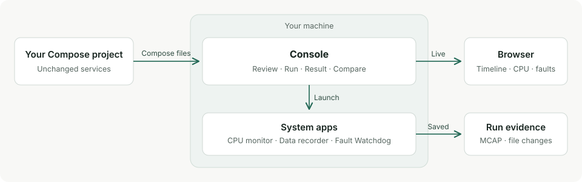

# doramcap
[](https://github.com/Cutuy/doramcap/actions/workflows/console-release.yml)
[](https://github.com/Cutuy/doramcap/actions/workflows/ci.yml)
[](https://github.com/Cutuy/doramcap/actions/workflows/node.yml)
[](rust-toolchain.toml)
[](https://github.com/Cutuy/doramcap/actions/workflows/dependabot/dependabot-updates)

**Run your robot software, see where the time went, and keep the evidence that proves a fix.**

Perception, control and recording often share one onboard computer. When a
deadline slips, the cause can be CPU contention, a late message or a storage
backlog, and the moment is usually gone before anyone can look. doramcap records
what actually happened on the machine, so you can find the cause and check that
your change fixed it.

[](https://github.com/Cutuy/doramcap/releases/download/console-demo-2026-11-12/console-demo.mp4)

[Watch the 30 second Console demo](https://github.com/Cutuy/doramcap/releases/download/console-demo-2026-11-12/console-demo.mp4), filmed from real runs.

## What Console gives you

[Console](console/) runs your existing Docker Compose project as it is. No code
changes, no SDK.

- **Review before you run.** See the services, images and system apps that will
  run, and what changed since your last run.
- **Watch the run live.** Follow every step on a timeline, with CPU use, the top
  CPU consumers and faults as they happen.
- **Keep the full evidence.** Save CPU, message and fault recordings as MCAP,
  plus a report of the files the run wrote.
- **Compare any two runs.** Line up setup, machine condition and results side by
  side to see what changed.
- **Stay on your hardware.** Console, its data and its recordings stay on the
  machine you test.



## Try it

Console needs Ubuntu 24.04 or newer on x86_64 or ARM64, with Docker Engine and
Compose v2 ([full requirements](console/scripts/release-readme.md)). Inspect
`install.sh` before you run it.

```sh
curl -fLO https://github.com/Cutuy/doramcap/releases/latest/download/install.sh
sh install.sh
cd /path/to/your/compose/project
doramcap-console start
```

## Status

doramcap is open source and in active development. Console and the libraries
behind it run on Linux workstations today. NVIDIA Jetson Orin and Thor are the
target platforms, and their qualification is next on the
[roadmap](docs/roadmap.md).

## Go deeper

- **Demos:** [dataflow tracing](apps/dataflow-tracing-demo/) ·
  [live CPU activity](apps/cpu-viewer/docs/running.md) ·
  [recording and storage](apps/storage-demo/) · [GPU storage](apps/gpudirect-demo/)
- **Build with doramcap:** [library guide](libs/README.md) ·
  [project explorer](apps/project-explorer/)
- **Project:** [architecture and roadmap](docs/roadmap.md) ·
  [repository conventions](docs/repository-layout.md) ·
  [CI and validation](scripts/ci/README.md)
