<a href="apps/project-explorer/">
  <picture>
    <source media="(prefers-color-scheme: dark)" srcset="docs/readme/hero-dark.svg">
    
  </picture>
</a>

<p align="center">
  <a href="apps/project-explorer/"><b>Explorer</b></a> ·
  <a href="#use-cases">Use cases</a> ·
  <a href="#quick-start">Quick start</a> ·
  <a href="libs/README.md">Libraries</a> ·
  <a href="docs/roadmap.md">Roadmap</a>
</p>

<p align="center">
  <a href="https://github.com/Cutuy/doramcap/actions/workflows/ci.yml"></a>
  <a href="rust-toolchain.toml"></a>
  <a href="LICENSE"></a>
</p>

**doramcap** helps robotics teams diagnose and fix performance failures on onboard
computers, starting with NVIDIA Jetson. When perception, control and recording share
a computer, a missed deadline can come from CPU contention, a delayed message or a
storage backlog. doramcap connects execution policy, traces and recordings so you can
see what happened and test a fix.

> **Configured policy, measured reality, actionable evidence.**

## Highlights

- **See where time went** — CPU activity, message lineage and processing latency on linked live timelines.
- **Keep evidence from every run** — telemetry and activity traces recorded to MCAP for later investigation.
- **Compare intent with execution** — typed resource policies, workload supervision and fault reporting under competing load.
- **Bring your workloads** — Docker Compose apps run unchanged beside doramcap; each run is recorded and repeatable.
- **Built in Rust on Dora** — reusable libraries and runnable Linux demos; Jetson qualification follows the [roadmap](docs/roadmap.md).

## Use cases

<table>
  <tr>
    <td width="50%" valign="top">
      <a href="console/"><picture>
        <source media="(prefers-color-scheme: dark)" srcset="docs/readme/use-case-repeat-dark.svg">
        
      </picture></a>
      <h3>Run and repeat an experiment</h3>
      Run Docker Compose workloads unchanged beside doramcap, inspect the recorded run and run it again.
      <br><sub><a href="console/">Console</a> · <a href="apps/orchestrator-demo/">Orchestrator demo</a> · <a href="apps/system-monitor/">System monitor</a></sub>
    </td>
    <td width="50%" valign="top">
      <a href="apps/dataflow-tracing/"><picture>
        <source media="(prefers-color-scheme: dark)" srcset="docs/readme/use-case-perception-dark.svg">
        
      </picture></a>
      <h3>Run a perception pipeline</h3>
      Move a payload through a dataflow, keep its buffer until processing completes, trace the work and capture evidence.
      <br><sub><a href="apps/dataflow-tracing/">Dataflow tracing</a> · <a href="apps/cuda-shm-demo/">CUDA shared memory</a> · <a href="apps/mcap-recorder/">MCAP recorder</a></sub>
    </td>
  </tr>
  <tr>
    <td width="50%" valign="top">
      <a href="apps/cpu-viewer/"><picture>
        <source media="(prefers-color-scheme: dark)" srcset="docs/readme/use-case-latency-dark.svg">
        
      </picture></a>
      <h3>Explain a missed deadline</h3>
      Inspect activity timing and output ancestry, relate a delay to resource accounting and keep the evidence.
      <br><sub><a href="apps/cpu-viewer/">CPU viewer</a> · <a href="apps/activity-demo/">Activity demo</a> · <a href="apps/system-monitor/">System monitor</a></sub>
    </td>
    <td width="50%" valign="top">
      <a href="apps/fault-demo/"><picture>
        <source media="(prefers-color-scheme: dark)" srcset="docs/readme/use-case-fault-dark.svg">
        
      </picture></a>
      <h3>Respond to a fault</h3>
      Observe liveness and fault reports, inspect the surrounding activity and feed health context to the response policy.
      <br><sub><a href="apps/fault-demo/">Fault demo</a> · <a href="apps/fault-watchdog/">Fault watchdog</a></sub>
    </td>
  </tr>
</table>

## Quick start

Browse the platform, apps, crates and dependencies in the [project explorer](apps/project-explorer/).
Requires Node.js 22+ and the repository's Rust toolchain:

```sh
npm --prefix apps/project-explorer/frontend ci
npm --prefix apps/project-explorer/frontend run dev
```

Then follow inputs through a four-node Dora pipeline with the
[dataflow tracing demo](apps/dataflow-tracing/) (requires Dora CLI 1.1.0):

```sh
cargo build --locked -p dataflow-tracing
npm --prefix apps/dataflow-tracing/frontend ci
npm --prefix apps/dataflow-tracing/frontend run build
python3 apps/dataflow-tracing/run.py --dora /path/to/dora
```

## Repository

| Path | Contents |
|---|---|
| [`libs/`](libs/README.md) | Reusable Rust crates: resources, memory, tracing, provenance, storage, faults, configuration |
| [`apps/`](apps/) | Runnable demos, each with its own setup and validation guide |
| [`console/`](console/) | Compose experiment runner with recordings and run history |
| [`docs/`](docs/) | [Roadmap](docs/roadmap.md), [vision](docs/vision.md) and [repository conventions](docs/repository-layout.md) |

doramcap is in active development. [CI and validation](scripts/ci/README.md) ·
[PolyForm Noncommercial 1.0.0](LICENSE) · [Notices](NOTICE)
