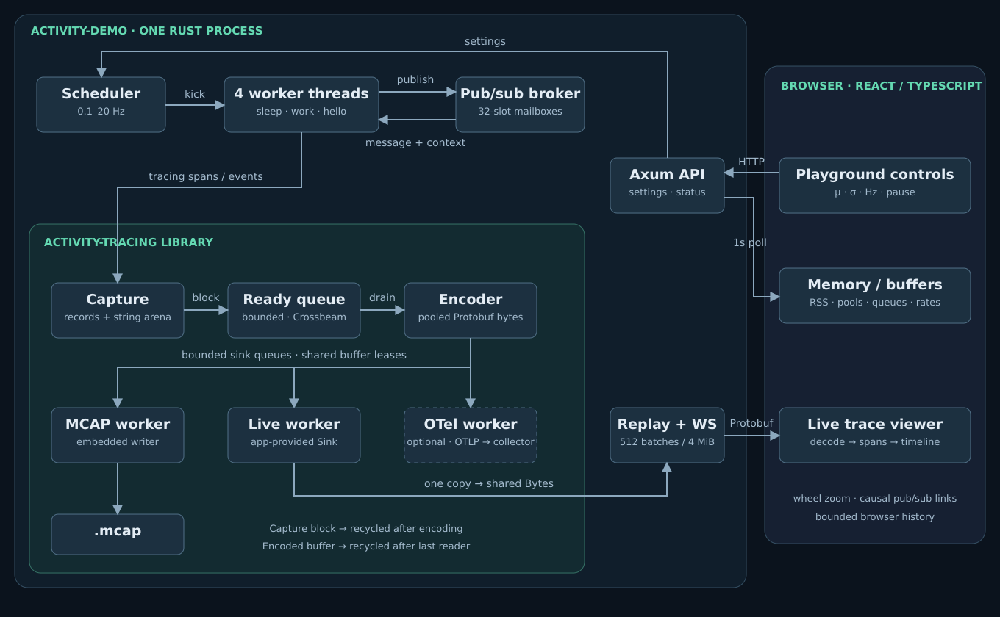

# Activity lab

Four real OS threads sleep, publish “hello” to three subscribers, and reply through
named inboxes. A React/TypeScript web app shows live spans, causal arrows, thread
IDs, message fields, and loss counters. The embedded recorder writes the same
Protobuf batches to MCAP.



## Run

From the repository root, with the project's Rust toolchain and Node 22:

```sh
npm ci --prefix apps/activity-demo/frontend
npm run build --prefix apps/activity-demo/frontend
cargo run --locked -p activity-demo
```

Open http://127.0.0.1:8088. Select a span or message to highlight its conversation;
scroll over the timeline to zoom. Ctrl-C stops workers and finalizes the MCAP
recording printed under `/tmp`. Options: `--port`, `--record`, `--assets`, `--duration`
and `--bind` (default loopback).

For frontend development, run the Rust server, then `npm run dev --prefix
apps/activity-demo/frontend`; Vite proxies the API and stream to port 8088.

## Validation

```sh
cargo test --locked -p activity-tracing -p activity-demo
npm test --prefix apps/activity-demo/frontend
```

[Worker interactions](docs/architecture.svg) ·
[Milestones](docs/101826-my-roadmpa.md) · [Docker deployment](deploy/README.md)
