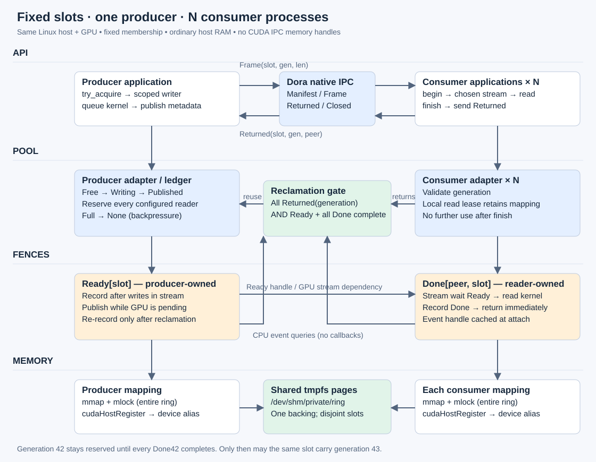

# Dora CUDA SPMC demo

One process produces GPU-written frames; N consumer processes verify them on
independent non-default CUDA streams. Two fixed host-memory slots are reused.
The runner defaults to 4 KiB slot alignment; `--slot-alignment 64` selects a compact layout.



## Interactive viewer

```sh
cargo build -p cuda-shm-demo
python3 -m venv apps/cuda-shm-demo/.venv
apps/cuda-shm-demo/.venv/bin/pip install -r apps/cuda-shm-demo/requirements.txt
npm --prefix apps/cuda-shm-demo/frontend ci
npm --prefix apps/cuda-shm-demo/frontend run build
apps/cuda-shm-demo/.venv/bin/python apps/cuda-shm-demo/viewer.py --dora /path/to/dora
```

Open **http://127.0.0.1:8768**. Run experiments, filter slot generations and processes,
compare event submissions with reclamation and stats, and optionally sample CPU
checksums. Each run saves activity MCAP/Protobuf and logs under
`/tmp/cuda-shm-observations/`. CPU checksum sampling waits Ready and changes timing.

[Viewer architecture and validation](docs/102126-live-observations.md).

## Command-line validation

```sh
cargo build -p cuda-shm-demo
python3 apps/cuda-shm-demo/run.py --dora /path/to/dora
python3 apps/cuda-shm-demo/run.py --dora /path/to/dora --failure stall
python3 apps/cuda-shm-demo/run.py --dora /path/to/dora --failure duplicate
python3 apps/cuda-shm-demo/run.py --dora /path/to/dora \
  --consumers 2 --frames 6 --sanitizer /usr/local/cuda/bin/compute-sanitizer
```

Requires Linux, CUDA runtime/NVRTC, mapped-host-memory + IPC-event support,
`/dev/shm` capacity, and Dora CLI 1.1.0. GPU tests fail visibly if unsupported.
The runner checks process summaries, GPU verification, asynchronous publication,
and slot reuse. Failure modes must fail for the expected reason.

[Adapter contracts and limitations](../../libs/memory/cuda-dora-shm/docs/102126-fixed-slot-ipc.md).

## Content regression tests

```sh
cargo test -p cuda-shm-demo
python3 apps/cuda-shm-demo/tests/content_e2e.py --dora /path/to/dora
python3 apps/cuda-shm-demo/run.py --dora /path/to/dora --seed 0xdeadbeef --checksum
```

GPU fill bytes depend on seed, frame sequence and byte offset. Every consumer's
GPU compares every byte and retains a failure flag, read after completion before
reporting success. Optional CPU validation checks every byte and its checksum.
The matrix covers boundary lengths, slot reuse and independent GPU/CPU corruption
rejection; CUDA absence fails visibly. Seeds reproduce failures.
