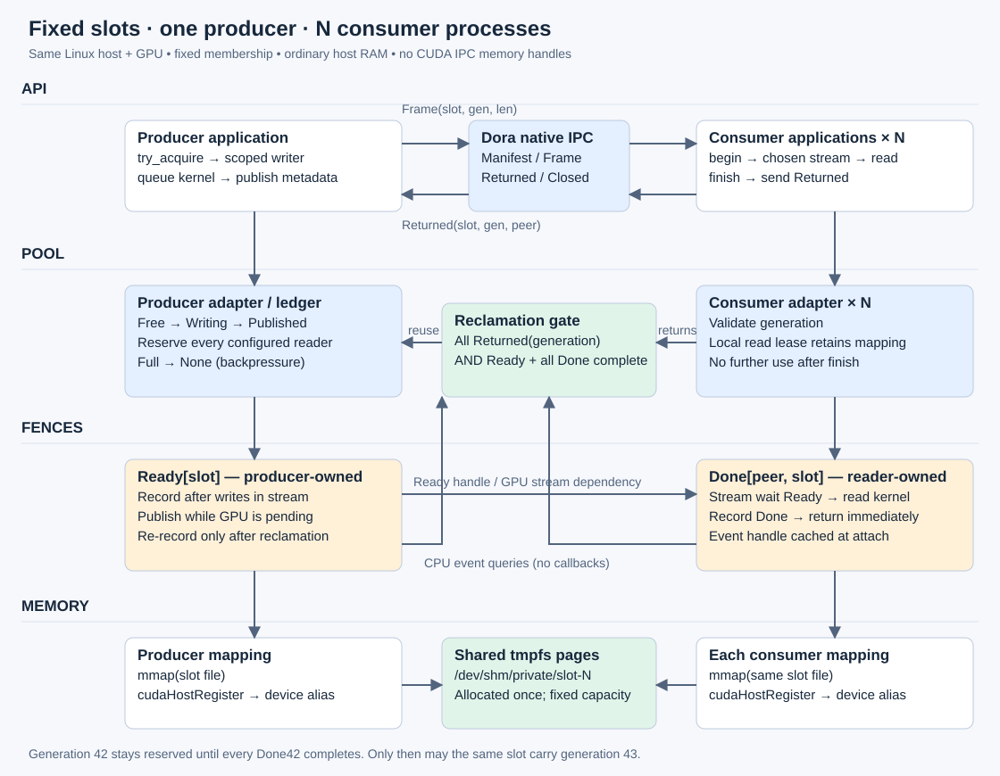

# Dora CUDA SPMC demo

One process produces GPU-written frames; N consumer processes verify them on
independent non-default CUDA streams. Two fixed host-memory slots are reused.



```sh
cargo build -p cuda-shm-demo
python3 apps/cuda-shm-demo/run.py --dora /path/to/dora
python3 apps/cuda-shm-demo/run.py --dora /path/to/dora --failure stall
python3 apps/cuda-shm-demo/run.py --dora /path/to/dora --failure duplicate
python3 apps/cuda-shm-demo/run.py --dora /path/to/dora \
  --consumers 2 --frames 6 --sanitizer /usr/local/cuda/bin/compute-sanitizer
```

Requires Linux, CUDA runtime/NVRTC, mapped-host-memory + IPC-event support,
`/dev/shm` capacity, and Dora CLI 1.1.0. GPU tests fail visibly if unsupported.
The runner checks process summaries, GPU verification, asynchronous publication,
and slot reuse. Failure modes must fail for the expected reason.

[Adapter contracts and limitations](../../libs/cuda-dora-shm/docs/102126-fixed-slot-ipc.md).
