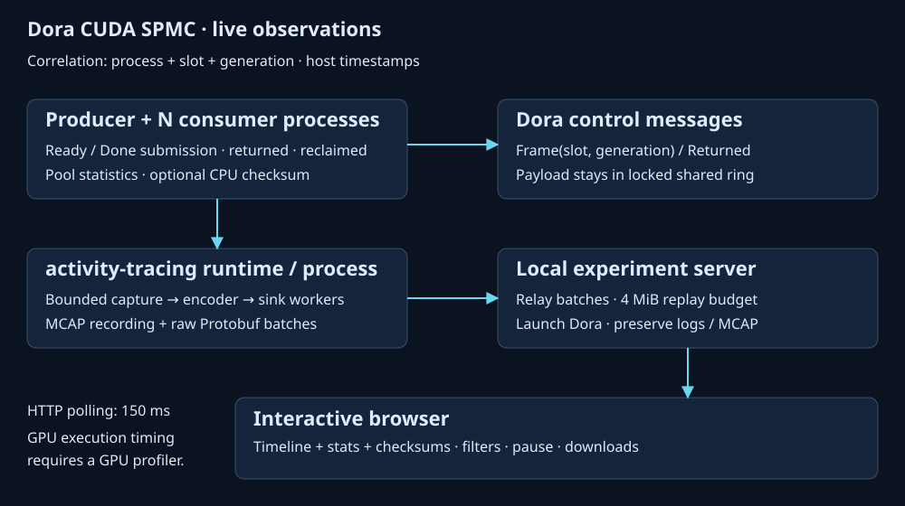

# Live observations

- [x] Instrument real adapter transitions using `tracing` target `activity`.
- [x] Record each process through `activity-tracing` to MCAP and live Protobuf.
- [x] Correlate process / slot / generation; show stats, checksums and timeline together.
- [x] Bound browser to 20,000 records and server to 4 MiB / 20,000 batches; expose truncation and capture losses.
- [x] Run normal, checksum, stall and duplicate-return experiments through HTTP.
- [ ] Visually inspect in browser: this session exposes no browser through UI tools.

## Semantics

- Ready/Done records and stream waits indicate successful API submission.
- `reclaimed` follows all Returned messages, successful Ready/Done queries and local lease retirement.
- Timestamps come from host activity capture, aligned by each runtime's Unix origin.
  They are not GPU kernel start/end timestamps; no CUPTI integration is provided.
- `cpu_checksum` is a byte sum over the live slot, checked against the fill pattern.
  It waits Ready on CPU and changes timing. GPU read verification runs in both modes.
- Pool statistics remain global while process/slot filters narrow activity records.
- Pause freezes rendering while capture and ingestion continue. Full Protobuf/MCAP remains on disk.
- Fixed membership, same-host CUDA-event support and trusted peers retain the adapter's contracts.

## Validation

- Local GPU / real Dora, 3 consumers, 24 frames, 2 slots, 4097-byte payloads:
  normal run `0919c98b1e4d47458e7b102c3b0a4e6e`, 397 records, 24 reclaimed.
- Checksum run `01cc89b6f2fe4e23bb8e8920ca5e34a6`, 469 records, all 72 samples match.
- Stall `e0fd9767b9b64a969cc7b871b95f1089`: no reclamation.
- Duplicate `cec58725b6b84275bdb69d5f9463ba73`: expected rejection.
- All four runs delivered activity during execution; four process MCAP files per run;
  zero capture losses. Artifacts: `/tmp/cuda-shm-observations/<run>/`.
- Three frontend model tests cover reordered arrivals, generation isolation, replay,
  run reset and bounded retention. Python tests cover request validation and cursors.
- Build and strict Clippy pass for both CUDA adapter and demo.

Run validation with `npm --prefix apps/cuda-shm-demo/frontend test`,
`apps/cuda-shm-demo/.venv/bin/python apps/cuda-shm-demo/tests/viewer.py`, and (against a running viewer)
`apps/cuda-shm-demo/.venv/bin/python apps/cuda-shm-demo/tests/live.py`.
- Longer checksum run `8f39b3895fed4bfea1fa08f5618c7bef`: 120 frames published
  pending and reclaimed; all 360 consumer checksum samples match.
- ARM64 Pueue job **111** passed the full worker suite (build, CPU and native
  workspace tests). CUDA execution was skipped on that worker; it has no CUDA.
  Local frontend empty-state/scroll/configuration changes were syntax-checked
  separately after the worker snapshot.

## Binary wire format

- Original activity batch bytes flow from the capture sink to MCAP and a live
  `.activity.pb` file: little-endian u32 length, then the encoded batch.
- The server relays batches unchanged in `proto/viewer.proto` snapshots. Browser
  decoding uses the same generated `protobufjs` approach as CPU/storage viewers.
- Run controls, replies and snapshots use `application/x-protobuf`. Unchanged
  polls return HTTP 204 with no body; completed logs are included on state change.
- `session` and large integer fields retain exact u64 values in the decoder.
- The schema generator is `npm --prefix apps/cuda-shm-demo/frontend run generate:proto`.
  Python bindings use protoc 36.2 and the runtime in `requirements.txt`.
- JSON appears only as local display formatting and the existing CLI summaries;
  the live API and trace files carry Protobuf.

### Protobuf validation

- Seven JavaScript tests and five Python tests pass: native schema decoding, u64
  precision, malformed data, controls, partial writes, cursor replay and idle polls.
- Real CUDA runs after batching: normal `01ca58d24e024e26aa3005e48f62613b`, checksum
  `a957c49cba534046b58303dcb072f37e`, stall `69c50cd3657349dfb174c495a2927471`,
  duplicate `07cbebf6899045c49dcdb3c96f04762a`; all expected outcomes pass.
- The checksum run carries 469 records in 36 native batches; all 72 checksums match
  when decoded by the generated JavaScript codec from Python-produced snapshots.
- Snapshot size: 68,939 bytes Protobuf versus 147,646 bytes for equivalent decoded
  JSON (uncompressed, 53.3% reduction). This excludes HTTP headers and frontend assets.
- Partial trace batches flush every 50 ms in active demo loops; full batches and
  registration drop also flush. Slow CUDA/CPU operations can delay partial flushes.
- Frontend production build and strict Rust Clippy pass.
- ARM job 112 passed for the initial Protobuf relay. Job 113 (50 ms batching)
  was stopped at the user's request; it is not a passing validation result.
  Further ARM submissions are paused for this work. Local CUDA, HTTP, codec,
  frontend build and Clippy checks above cover the final implementation.

## Strong content verification

- [x] GPU fill uses reproducible seed / frame sequence / offset-dependent bytes.
- [x] Each consumer GPU compares every byte and atomically latches a process-local
  failure flag. Completion and flag readback precede its success summary.
- [x] Optional CPU sampling compares every byte before submitting GPU verification,
  then reports the checksum. This permits independent CPU corruption rejection.
- [x] Two unit tests cover reference bytes, page-tail corruption, wrong sequence /
  seed, and a byte swap whose checksum is unchanged.
- [x] Seven local GPU/Dora scenarios pass: 1, 257, 4097 and 65537-byte payloads;
  one/two slots; several seeds; asynchronous GPU-only verification; independent
  GPU and CPU corruption rejection. Each run uses three consumer processes.
- [x] Build and strict Clippy pass. Logs: `/tmp/cuda-content-e2e-final/`.

The corruption regression exposed that the previous GPU `trap` could leave IPC
teardown waiting. Explicit failure flags now report `GPU_CONTENT_MISMATCH` after
normal GPU completion. CPU failures report `CPU_CONTENT_MISMATCH`. Error modes
require those specific markers; a timeout alone cannot pass the regression.
ARM submissions remain paused at the user's request.
