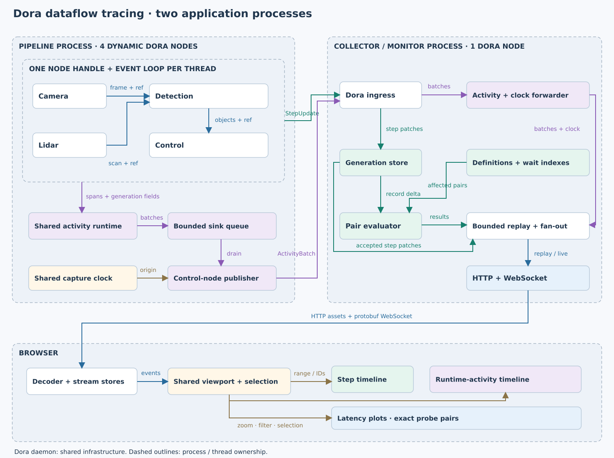

# Dataflow Tracing

Four Dora nodes share one pipeline process. A dedicated monitor tracks which inputs
produce each output, computes four fixed latency measurements, and streams runtime activities
and steps to linked timelines.



## Run

Requires Rust, Node.js 22+, and Dora CLI 1.1.0. From the repository root:

```sh
cargo build --locked -p dataflow-tracing
npm --prefix apps/dataflow-tracing/frontend ci
npm --prefix apps/dataflow-tracing/frontend run build
python3 apps/dataflow-tracing/run.py --dora /path/to/dora
```

Open <http://127.0.0.1:8090>. Scroll to zoom, drag to pan, and select a generation,
activity span, or latency point. Both timelines and the latency plot share one range. Pausing (including zoom/pan)
preserves a bounded snapshot across all three panels while live collection continues;
resume switches back to the current live history.
Ctrl-C stops this demo's flow; shared Dora infrastructure stays running.

- `--duration 15 --check`: verify real Dora traffic, process boundaries, exact probe arithmetic, activity delivery, and retention.
- `--duration 15 --drop-every 7 --report-delay-ms 40 --check`: missing reports and end-before-start delivery.
- `--port 8091`: choose another HTTP port.
- `--output /tmp/demo.json`: save final diagnostic evidence.

The `dataflow-tracing pipeline` executable also accepts `--duration until-stopped`
for a long-running host that sends the shutdown signal.

Dora 1.1.0 may print “failed to receive finished signal” while starting dynamic
nodes before the launcher attaches them. The launcher checks actual registrations
and traffic; startup and runtime failures still fail the check.

## Validate

```sh
cargo test --locked -p dataflow-tracing -p activity-tracing -p step-provenance
npm --prefix apps/dataflow-tracing/frontend test
# While a demo is running:
npm --prefix apps/dataflow-tracing/frontend run test:live
```

[Implementation plan and evidence](docs/102026-dataflow-tracing.md) ·
[Node internals](docs/102026-provenance-node.svg) ·
[Fixed measurement definitions](configs/measurements.pbtxt)

Steps use the activity runtime's capture clock through an additive `Handle::clock()`
API. Generation fields link spans to steps; the provenance library stays independent.
The evaluator retains 64 generations per stream. WebSocket replay retains at most
4,096 messages / 8 MiB, signals gaps, and disconnects stalled clients. Browser history
is bounded independently; old ancestry can be unavailable after replay or eviction.
Multi-host clock synchronization and temporary measurements remain future work.

[Docker deployment and gallery registration](deploy/README.md).
