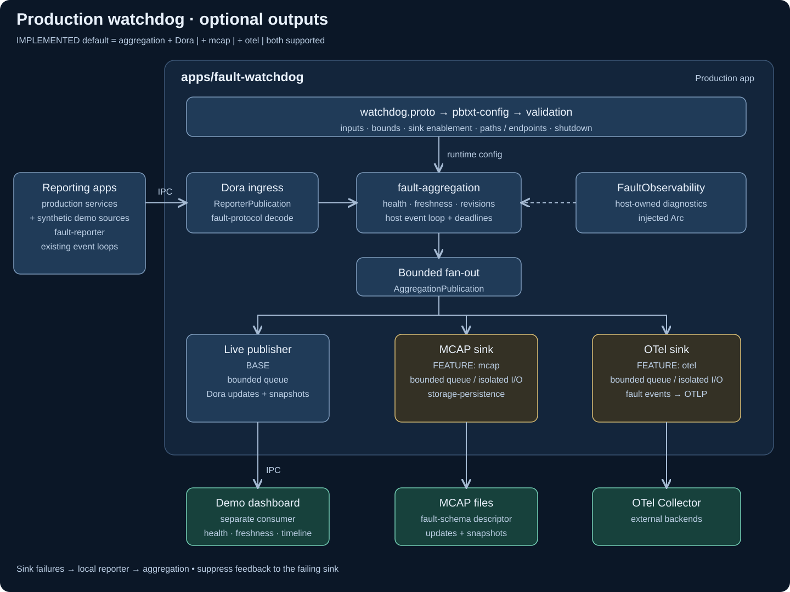

# Fault demo



Two synthetic reporters feed the production watchdog. The dashboard shows health,
freshness and recent events, with fail/recover/flap/pause/flood/event controls.

From the repository root:

```sh
cargo build -p fault-demo -p fault-watchdog
dora run apps/fault-demo/dataflows/live.yml
```

Open `http://127.0.0.1:8088`. The dashboard binds to loopback by default;
`FAULT_DEMO_LISTEN` overrides the address. It is a local demonstration with no authentication.

[Production config and optional sinks](../fault-watchdog/README.md) ·
[Roadmap](docs/102026-fault-reporting-roadmap.md)

```sh
python3 apps/fault-demo/tests/validate_dora.py --dora /path/to/dora --bin-dir target/debug
# Add --sinks with an all-feature watchdog build and the fault_readback example.
```

The timeline aligns report evidence, health, freshness and one-off events. Choose
**Recovery** for a guided hysteresis example; it freezes the view for inspection.
[Timeline design and semantics](docs/102026-timelines.md).
