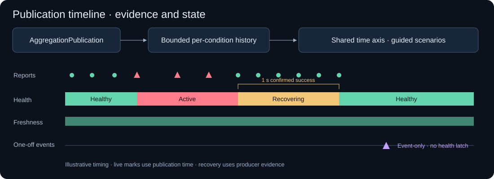

# Event and state timelines

Created 2026-10-20. Replace the status table with aligned evidence, health,
freshness and event-only lanes for each demo source.

## Milestones

- [x] Retain bounded per-condition reports and state transitions independently of the publication log.
- [x] Expose recovery policy and confirmed success span; silence never advances the progress indicator.
- [x] Mark cumulative-count deltas and reconciled evidence; preserve snapshots without duplicating report marks.
- [x] Add recovery, flapping, silence, burst and event-only guided scenarios, with manual controls.
- [x] Add shared 15/30/60-second windows, hover counts and a frozen review view.
- [x] Validate and refresh the running dashboard.

## Contract

- Axis: aggregator publication time; source observation clocks stay independent.
- Recovery indicator: latest producer evidence, not elapsed browser time.
- History: up to 16 demo conditions, 512 state points and 1,200 report buckets per condition; retain 60 seconds and one state spanning the left edge.
- Report marks summarize count deltas in 100 ms buckets. Diamonds identify reconciled evidence. Missing intermediate history is not reconstructed.
- Command markers mean accepted requests. Guided scenarios freeze the view after completion; the producers keep running.
- New aggregator epochs clear history. Snapshots repair current state; existing event history remains bounded.

## Validation

- [x] Projection tests: hysteresis transitions, stationary recovery on silence, count deltas and duplicate snapshots.
- [x] Focused Clippy, JavaScript syntax, ARM64 dashboard build and live API checks.

Evidence: local strict Clippy and two projection tests passed; JavaScript syntax and SVG XML parsed successfully. ARM64 Pueue job 102 passed the same tests and dashboard build with two build jobs. Live Dora/API checks verified Active → Recovering → Healthy (1,000 ms policy), stale freshness preserving healthy state, event evidence and command markers. The preview was restarted on port 8088. Browser automation was unavailable; visual inspection remains manual.
