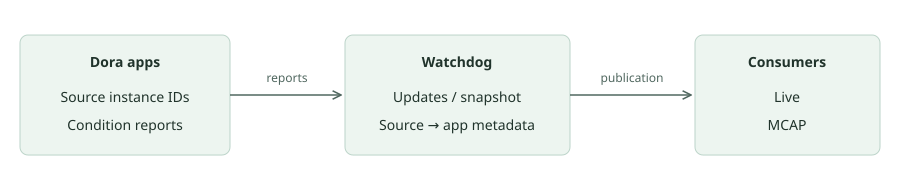

# Source app names

Created: 2026-11-15. [Implementation](111526-source-app-names-impl.md).

The watchdog adds `source_apps` metadata to each aggregation publication. Each
entry maps a source instance ID to its upstream Dora node name. Consumers join
that name to the existing condition updates or snapshot sources.

The existing records carry health, freshness, connectivity, revisions and loss
information. Names come from Dora routing, independently of reporter components.
Several source instances may map to the same app.

Mappings accompany the sources referenced by a payload. A restart preserves names
for retained old-source updates and maps the new instance. Repair snapshots name
their current sources. Attribution retention is bounded by current inputs and the
existing update queue.

Before an app reports, its identity comes from run configuration. Older hosts and
sources without known upstream attribution omit mappings; consumers retain unknown
attribution explicitly. App names use the existing 192-byte text bound.
