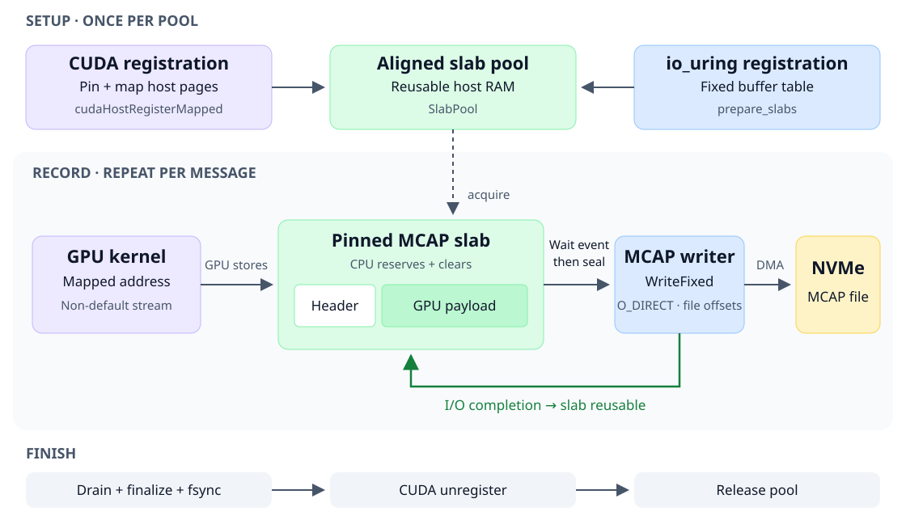

# GPU storage demo



One host-RAM slab serves GPU production and direct file I/O.

Created 2026-11-09. [Results and test](implementation.md).

Requires NVIDIA CUDA driver/runtime/NVRTC and Linux direct I/O/io_uring.
Run from the repository root with a new output path:

```sh
cargo run --release --locked -p gpudirect-demo -- /absolute/path/output.mcap mapped 8388608 128 4
```

Arguments: path, mode (`mapped`, `staged`, `io-only`), payload bytes, messages, slabs.

[Start from the SPA](deploy/README.md).
