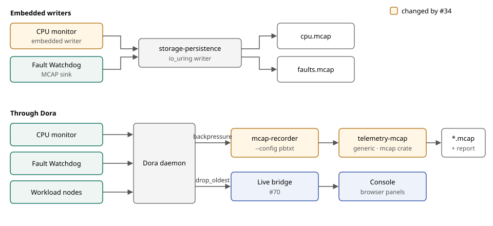

# MCAP recorder

A Dora subscriber that records configured byte inputs using
[`telemetry-mcap`](../../libs/telemetry/mcap/). Each channel declares its topic,
encoding and optional schema. CPU snapshot/dictionary modes validate telemetry
before writing and preserve its original payloads and capture timestamps.



- **This recorder** records declared Dora outputs through `telemetry-mcap`'s generic
  `RecordingSink`, which uses the `mcap` crate without io_uring.
- **Embedded writers** stay in their apps. The CPU monitor's writer lives in
  `system-monitor` and uses `storage-persistence`.
- **Live view** uses Console's [live bridge](../../console/bridge/README.md) on the same outputs.

```sh
cargo build --release --locked -p mcap-recorder
mcap-recorder --config apps/mcap-recorder/deploy/reusable/bytes.pbtxt
```

The process requires a Dora attachment and writable configured output directory.
It creates recordings exclusively, drains normal input closure and writes a
separate report distinguishing finalization from drain and known loss evidence.
Use `deploy/reusable/cpu.pbtxt` for CPU accounting channels.

[Configuration, artifacts and reusable deployment](deploy/reusable/README.md) ·
[Gallery deployment](deploy/README.md) ·
[CPU viewer guide](../cpu-viewer/docs/running.md)
