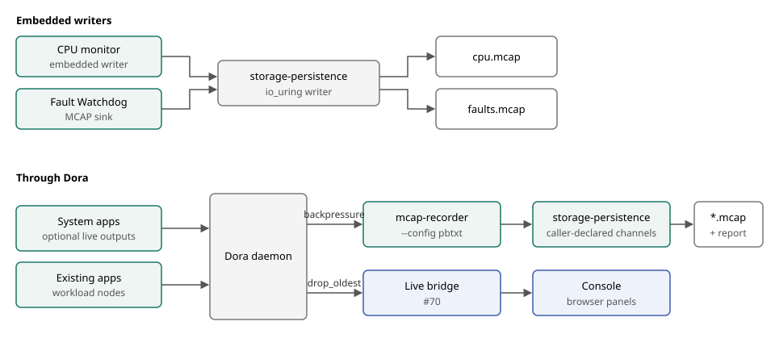

# MCAP recorder

A standalone Dora subscriber that records any app's messages to MCAP. It links no
message types: each channel declares its topic, encoding, schema file and source
metadata keys. Protobuf channels [need a schema](deploy/README.md#schemas) for
readers to decode them. Payloads stay unchanged. ROS 2 input is planned.



- **This recorder** captures declared Dora outputs through the `mcap` crate.
- **Embedded writers** stay in their apps and use `storage-persistence`.
- **Live view** uses Console's [live bridge](../../console/bridge/README.md) on the same outputs.

```sh
cargo build --release --locked -p mcap-recorder
mcap-recorder --config apps/mcap-recorder/deploy/bytes.pbtxt
```

The process requires a Dora attachment and writable configured output directory.
It creates recordings exclusively, drains normal input closure and writes a
separate report distinguishing finalization from drain and known loss evidence.

[Configuration, artifacts and deployment](deploy/README.md)
