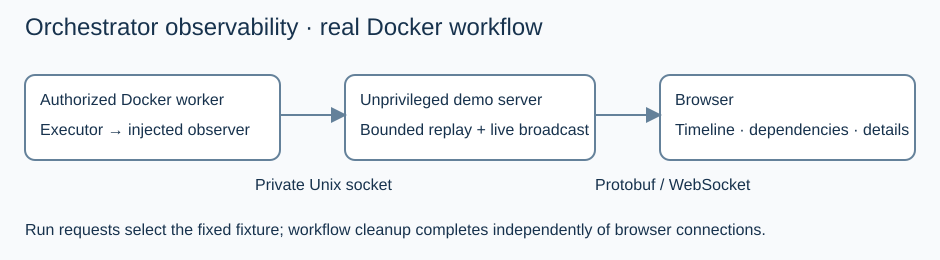

# Orchestrator lab

A live view of real Docker CPU-monitor experiments: step timing, dependencies,
inputs/outputs, errors and verified cleanup. The library emits shared Protobuf
telemetry; the demo owns transport and presentation.

The former native launcher has been removed; a supported local launch path is
not currently provided. The hosting profile is pending qualification.

**Run experiment** executes the Compose workflow and filesystem fixture;
**Test failure & cleanup** uses an unhealthy service to exercise cleanup.
Select a timeline row to inspect its evidence. Closing a browser leaves cleanup
running; reconnect recovers bounded history.

Requires the [native Docker fixture prerequisites](../../libs/orchestrator/docs/102626-docker-monitor-e2e.md#run-and-inspect).
The web server runs unprivileged; only the fixed Docker worker is
optionally elevated. Node is needed for building static assets.
Set `ORCHESTRATOR_ASSETS` to an absolute frontend build directory when relocating
the server binary. Set `ORCHESTRATOR_BIND` to an IP address for container hosting;
the default remains `127.0.0.1`. `/health/ready` succeeds while a worker is attached.
The worker accepts `ORCHESTRATOR_DOCKER_SOCKET` for trusted deployment configuration.
`ORCHESTRATOR_RUN_PREFIX` can scope nested runs to a gallery generation.
The worker requires `SOCKET IMAGE ARTIFACT_DIRECTORY REPOSITORY_ROOT`; the canonical
repository root defines admission and strict pre-run cleanup.
`ORCHESTRATOR_PRIVATE_TELEMETRY=1` sends lifecycle summaries without detailed
payloads or filesystem paths; full reports remain in the run directory.

[Milestones and validation](docs/102626-live-workflow.md) ·
[Filesystem tracking](docs/102626-filesystem-tracking.md) ·
[Compose workflow](../../libs/workload-docker/src/workflows/recorded_compose/mod.rs) ·
[Telemetry observer](../../libs/orchestrator/src/telemetry.rs)

The filesystem panel separates host binds, container layers and named volumes,
with change filters, metadata and coverage warnings. Writable host directories use per-run OverlayFS views; after writers stop, views are unmounted and selected upper files are written
back directly to the host by default. The panel reports metadata coverage limitations.

[Docker deployment and gallery registration](deploy/README.md).
