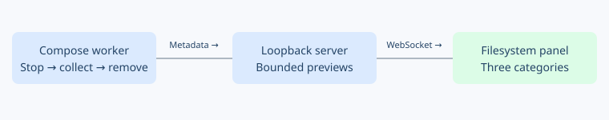

# Filesystem tracking demo

- [x] Run the production Compose workflow with a fresh CPU monitor and file-writing fixture.
- [x] Display host binds, container layers and named volumes separately; preserve change kinds.
- [x] Show metadata, coverage warnings, manifest paths and bounded previews.
- [x] Validate normal and unhealthy-start runs, disconnect cleanup and reconnect replay.
- [x] ARM64 CI for the updated demo (Pueue job 145 succeeded).

The demo observes OverlayFS-managed host binds and their write-back. Each run gets fresh host paths. Fixture volumes are removed after collection; container contents are not exported.

Previews contain at most 100 rows / 32 KiB of JSON per category. The server retains eight reports. Full protobuf manifests remain in run artifacts. Browser requests select only normal/failure mode; they cannot supply paths or commands.

Validation: frontend build and model tests; server unit test and strict Clippy passed. Real Docker normal/failure runs passed `tests/live.mts` at port 8093; evidence is [recorded here](102626-filesystem-validation.json). Both runs finalized MCAP, verified cleanup and reported all three storage categories. Browser visual inspection was unavailable because the browser provider is not connected.

ARM64 snapshot `a73f81e30aeb4af781b42911a51d0615`, job 145, completed successfully on October 26 at 19:51 PDT. Full local log: `/tmp/orchestrator-filesystem-arm64-145.log`.
