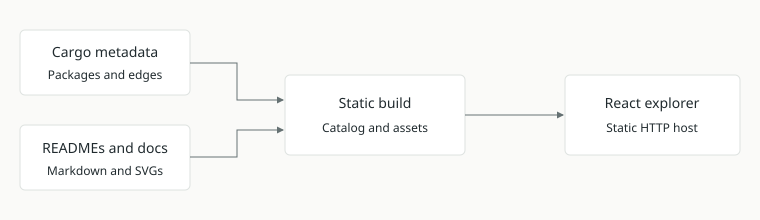

# Runtime gallery refresh

- [x] Categorize Orchestrator Lab and orchestration/lifecycle crates as Runtime.
- [x] Map workflow execution and the recorded Compose use case to implementation docs.
- [x] Generate catalog, validate mappings and build production assets.
- [x] Refresh the local preview and verify HTTP delivery.

Manifest and README discovery provides app/crate pages and dependency edges. The
lifecycle README identifies its design-only scope. The overview retains the existing
layout and separates implemented Compose execution from planned OverlayFS mounting.

Validation: production build and overview schema/reference checks passed; all four
Runtime entries present, link report empty. Preview serves at port 4175. Browser
visual inspection is unavailable in this session; layout components are preserved.

The refreshed catalog includes workflow-protocol from the rebased telemetry split.
The preview serves an independent artifact copy in `/tmp/doramcap-gallery-102727`.

The first/default use case is “Run and repeat an experiment”; explicit use-case URLs
retain their selections. Existing Docker Compose appears alongside existing middleware,
with vertical desktop labels and horizontal mobile labels.

Integration validation: rebased Rust unit tests and strict Clippy passed; ARM64
job 147 succeeded (snapshot `f90af79ae2b0419f997f6092cfe6b5a4`). Subsequent gallery
copy/order changes passed a fresh production build and schema validation.
