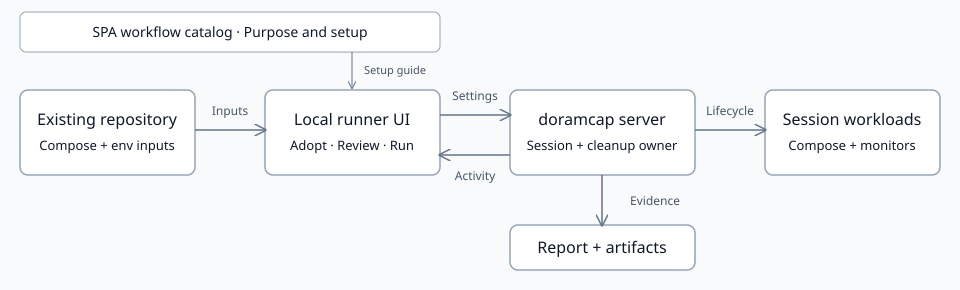
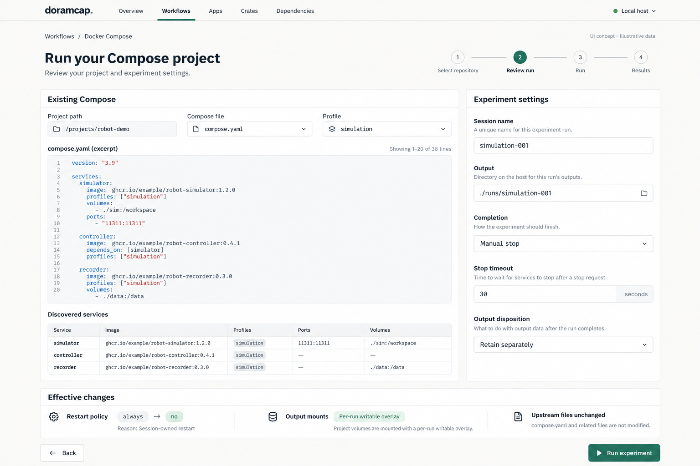
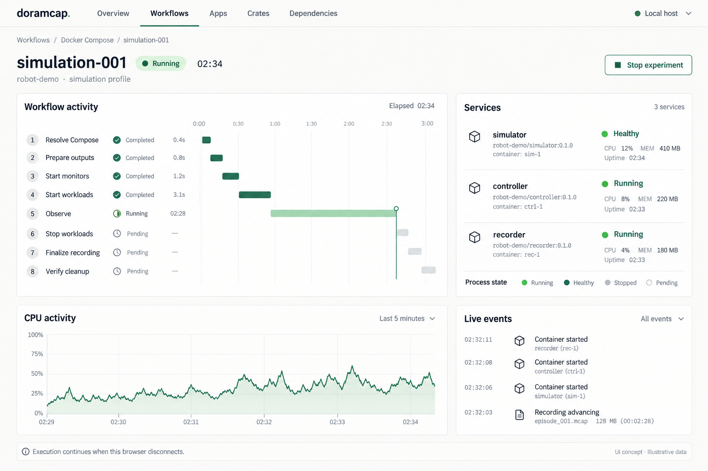
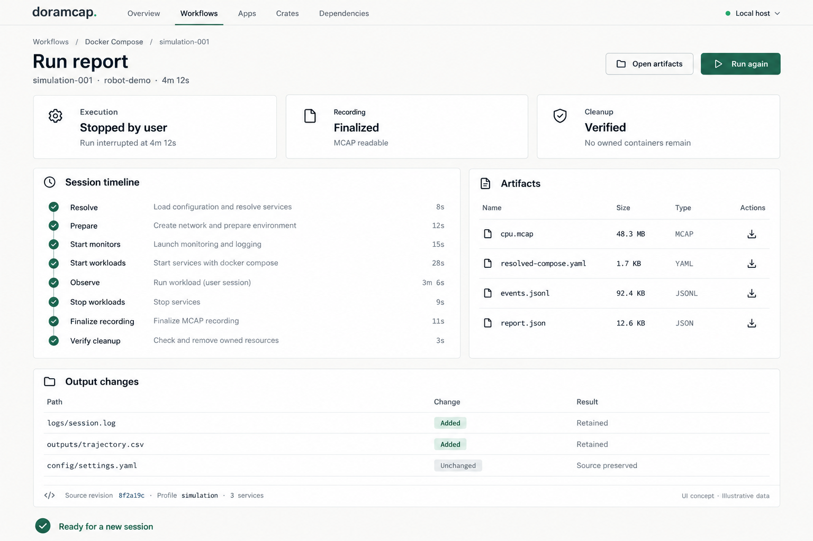
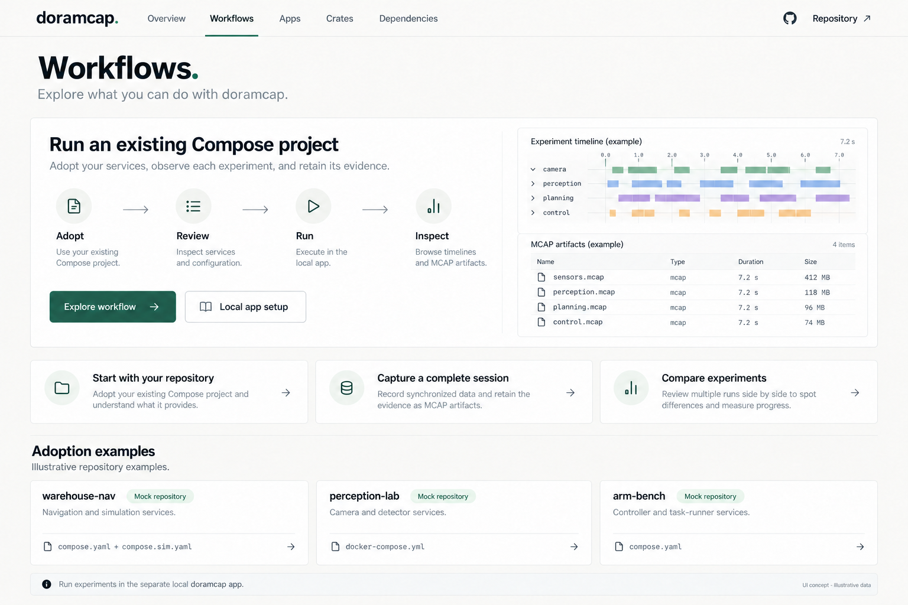
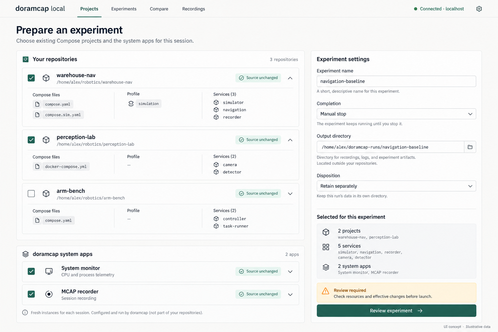
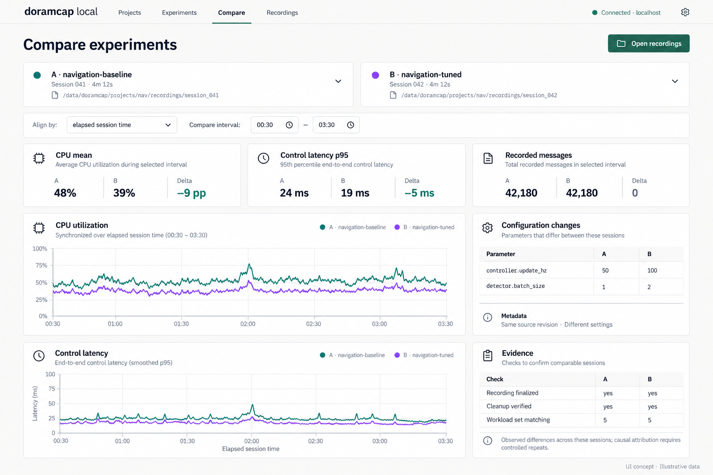
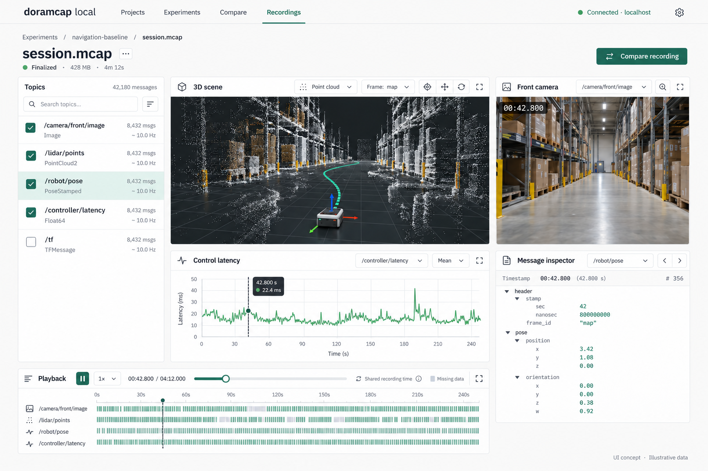
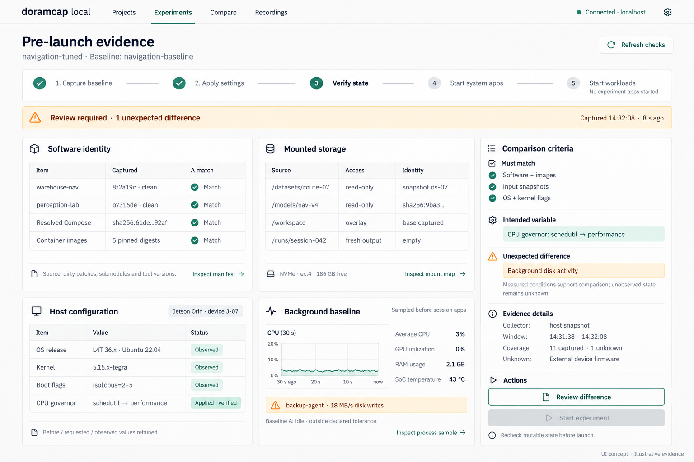
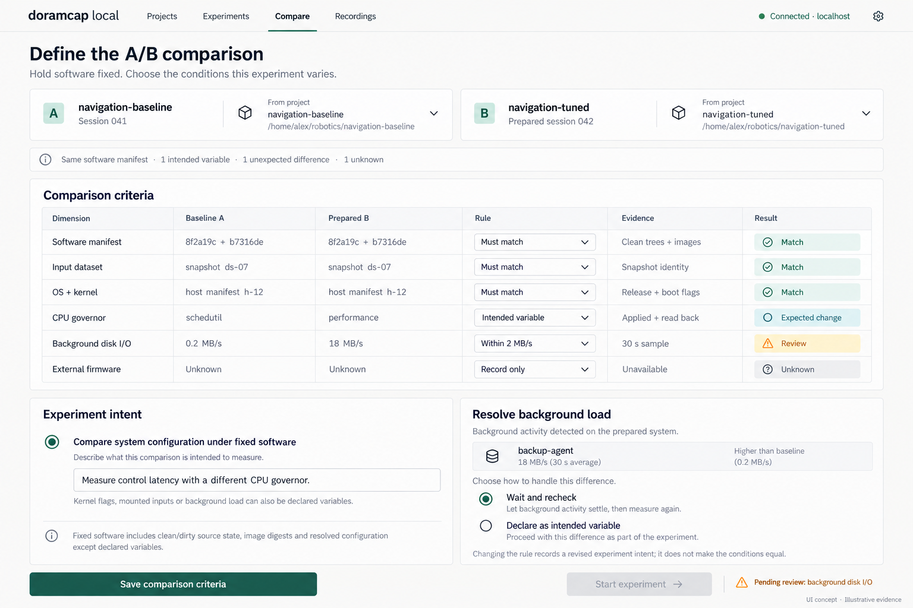

# Adopt and run an existing Compose project

Created: 2026-10-29. Status: agreed product direction; implementation pending.

Ship a doramcap executable that hosts a local UI. Users start from their existing
repository, review its Compose configuration and experiment settings, run a session,
watch live activity, and inspect the resulting report and artifacts.

The local server owns execution and cleanup. Browser refresh, disconnect, and
reconnect preserve the active session. Only the lifecycle manager persists across
sessions; experiment monitors, writers and workloads get fresh instances.

## Product structure

Add **Workflows** beside Apps and Crates, with navigation ordered Overview,
Workflows, Apps, Crates, Dependencies. Its first entry is **Run your existing
Docker Compose project**. Apps and Crates remain the component galleries.

The SPA Workflows section is a catalog: explain available workflows, their purpose,
prerequisites and evidence, with guided walkthroughs and local setup instructions.

A separate webapp, hosted on the user's machine by the doramcap executable, owns
project preparation, experiment execution, live activity, comparisons and recording
inspection. Its navigation is Projects, Experiments, Compare and Recordings.
The catalog links to setup instructions; it does not own an active experiment.

Show user repositories and their discovered Compose projects separately from
doramcap's built-in system apps. Multiple files within a project and multiple
independent projects retain their identities. Selected system apps, including
monitoring and recording, receive fresh instances for each session.

2026-10-29 refinement: user confirmed the catalog/local-app separation and requested
multi-repository preparation, A/B experiment comparison and MCAP-centered inspection.

## M1 — Launch locally and adopt a repository

**Work items**

- [ ] Package the separate local webapp and server behind the doramcap executable; document launch.
- [ ] Present workflow purposes, examples and setup instructions in the SPA catalog.
- [ ] Distinguish user repositories/Compose projects from built-in system apps in preparation.
- [ ] Default repository selection to the working directory and allow another path.
- [ ] Discover Compose files; confirm ordered files, env inputs, profiles and services.
- [ ] Resolve prerequisites, required images/builds, devices and compatibility gaps.
- [ ] Save reusable typed preparation settings; prefer protobuf and pbtxt.

**Validation**

- [ ] A user can start from an existing checkout and reach a resolved service preview.
- [ ] The catalog explains workflows; execution and live state belong to the separate local app.
- [ ] Selected user projects and system apps appear separately in the effective run review.
- [ ] Multiple override files and independent Compose projects remain distinguishable.
- [ ] Missing prerequisites produce actionable diagnostics; secrets stay redacted.
- [ ] Upstream application code and Compose files remain unchanged.

## M2 — Review the effective run

**Work items**

- [ ] Present source Compose configuration, discovered services and effective settings.
- [ ] Explain runtime overrides, including restart ownership and filesystem mappings.
- [ ] Configure outputs, timeouts, filesystem disposition and supported lifecycle hooks.
- [ ] Choose completion explicitly: manual Stop, elapsed duration or declared task completion.
- [ ] Keep service membership derived from Compose; settings parameterize the built-in workflow.

**Validation**

- [ ] Every override has a reason and persists in the run evidence.
- [ ] Users need no workflow code, step graph or duplicate service catalog.
- [ ] A healthy long-running stack does not accidentally count as a completed experiment.
- [ ] Saved preparation is re-resolved when a new run starts; changed inputs are visible.

## M3 — Run and observe live activity

**Work items**

- [ ] Submit the reviewed request to the server-owned runner.
- [ ] Stream actual step activity, logs, container health and telemetry using the activity-monitor interaction model.
- [ ] Provide Stop with awaited, orderly finalization and visible cleanup progress.
- [ ] Preserve run identity and current state across browser reconnects.
- [ ] Keep gallery idle expiry from terminating a manager that owns a run.

**Validation**

- [ ] Activity reflects real execution, including partial startup and failure paths.
- [ ] Browser disconnect and refresh leave the run owned by the server.
- [ ] Manual Stop finalizes artifacts and verifies owned workload termination.
- [ ] Unresolved cleanup blocks the next conflicting run and exposes recovery evidence.

## M4 — Report results and repeat

**Work items**

- [ ] Report execution outcome, evidence completeness and cleanup status separately.
- [ ] Link recordings, configuration snapshots, logs, output changes and final inspections.
- [ ] Show original/effective paths and the selected output disposition.
- [ ] Reuse preparation settings for a new session with fresh participants and artifacts.

**Validation**

- [ ] Two sequential runs have distinct identities and fresh monitors, writers and workloads.
- [ ] Completed recordings are readable; incomplete evidence remains clearly identified.
- [ ] Reports remain inspectable after the run finishes.
- [ ] Failure and cleanup results remain distinct even when forced cleanup succeeds.

## M5 — Showcase adoption and qualify the claim

**Work items**

- [ ] Publish one recorded fixture walkthrough with configuration, activity and artifacts.
- [ ] Add vEDGAR and AnywhereVLA candidate cards with pinned sources and prerequisites.
- [ ] Turn each qualified upstream run into a case study with inspectable evidence.
- [ ] Label evidence separately from coverage: source reviewed / fixture tested / upstream executed;
  launch lifecycle / experiment boundary / application semantics.
- [ ] Demonstrate adding a Compose service and rerunning with identical workflow code.

**Validation**

- [ ] Two upstream Compose projects run with zero tracked-file changes and published preparation settings.
- [ ] Each project passes two sequential runs, interrupted startup and manual-stop cleanup.
- [ ] Added services automatically enter discovery, observation and cleanup.
- [ ] Simulator, fixture and physical-hardware evidence remain distinguishable.
- [ ] Readiness, recorder flush and reset guarantees link to observed application contracts.

## M6 — Compare experiments

**Work items**

- [ ] Select experiments A and B with source, configuration and workload identities.
- [ ] Show effective configuration changes alongside aligned resource and application measurements.
- [ ] Offer elapsed-time alignment and explicit comparison intervals; expose missing samples.
- [ ] Display recording completeness and cleanup evidence for each experiment.
- [ ] Link each measurement back to its recording, topic, units and aggregation interval.

**Validation**

- [ ] Deltas use matching units and declared intervals; percentages distinguish relative change from percentage points.
- [ ] Different workloads, clock origins and incomplete recordings remain visible.
- [ ] Aligned plots retain source timestamps and disclose the chosen alignment.
- [ ] Two-session differences are presented as observations; causal or statistical claims require further evidence.

## M7 — Inspect MCAP recordings

**Work items**

- [ ] Open MCAP artifacts from experiment results and the Recordings view.
- [ ] Provide topic/schema inventory, message inspection and shared playback controls.
- [ ] Synchronize supported camera, 3D scene, trajectory and time-series panels to a shared playhead.
- [ ] Show recording bounds, gaps, clock basis and decoding limitations.
- [ ] Evaluate reputable viewer/MCAP libraries with the user before adopting dependencies or implementing custom decoding/rendering.

**Validation**

- [ ] Supported fixture topics render at the selected playback time with clear units and frames.
- [ ] Seeking, pause, speed changes and end-of-recording keep panels synchronized.
- [ ] Unsupported schemas, missing transforms and absent topics produce specific empty states.
- [ ] Large recordings use bounded loading; incomplete files and missing intervals stay visible.
- [ ] MCAP container readability remains distinct from topic decoding and availability of robotics content.

## M8 — Capture pre-launch provenance and comparison criteria

2026-10-29 refinement: capture software, mounted storage, host configuration and
background conditions before starting session system apps or user workloads.
Users may intentionally vary these conditions while holding application software
fixed. The UI evaluates evidence against that declared experiment intent.

**Work items**

- [ ] Capture the status quo, apply declared supported settings, and record verified
  effective state before starting any session app. Preflight capture belongs to
  the lifecycle manager; record its measurement window and overhead.
- [ ] Capture source revisions for every selected repo, dirty/untracked content
  according to explicit scope, submodules, resolved Compose/env identity, image
  digests, tool versions and planned system-app identities. Redact secret values.
- [ ] Inventory mounts: source/target, access mode, ownership, backing storage,
  input identity, overlays, retained volumes and fresh output locations.
- [ ] Distinguish captured metadata, content digests and immutable snapshots.
  Use declared capture policies; avoid unconditional recursive hashing or copying.
- [ ] Capture hardware identity, Jetson OS/BSP and kernel release, boot flags,
  driver/runtime versions, power modes, clocks, governors and relevant system settings.
- [ ] Retain before, requested, applied and observed settings, collector/version,
  timestamps, errors and verification evidence. Readback failure remains explicit.
- [ ] Sample background processes, CPU/GPU, memory, disk/network activity and
  thermal conditions over a declared pre-launch interval. Record relevant drift
  during execution separately from the pre-launch sample.
- [ ] Define per-dimension rules: must match, within tolerance, intended variable
  or record only. Save the intent, baseline identity and rule revision with the run.
- [ ] Surface unexpected differences and unknown evidence separately. Recheck
  mutable conditions before launch; never present two unknown values as a match.
- [ ] Allow users to revise intended variables explicitly, including system state,
  storage or background load under fixed software. Preserve the original observation
  and the rule change; distinguish such changes from controlled measurement.
- [ ] Link report and MCAP artifacts to the same session provenance manifest.
  Record post-run state, owned-setting restoration and verification independently.

**Validation**

- [ ] Capture baseline and verified post-configuration state before any session
  monitor, recorder or user workload starts; retain both snapshots.
- [ ] A matching Git commit with changed dirty files, images or mounted inputs
  produces distinct software/input identities and visible differences.
- [ ] Paths alone do not establish content identity. Uncaptured mutable inputs
  remain unverified; record changes detected between review and launch.
- [ ] Same-software OS/kernel/governor comparisons show declared differences as
  expected while checking the remaining selected invariants.
- [ ] Unknown, stale, denied and failed measurements retain their status and
  block launch only when the saved criteria require their verification.
- [ ] A required tolerance violation remains unresolved until it clears or the
  user explicitly revises the experiment criteria; retain that revision.
- [ ] Background windows use declared units, aggregation and tolerance; quiet
  pre-launch samples do not imply absence of interference during the run.
- [ ] Reboot-required settings are reported as prerequisites rather than claimed
  applied. Unsupported setters remain capability gaps.
- [ ] Comparison summaries describe evidence and coverage; they do not claim
  causal isolation or complete equivalence from a matching subset of fields.

## M9 — Explain a run and export its evidence

2026-10-29 refinement: make external observation and execution provenance the
primary first-stage experience. System-telemetry MCAP is the default recording
example; application-message recording remains an optional qualified integration.

**Work items**

- [ ] Explain the added lifecycle, observation, provenance and artifact capabilities
  beside planned application/Compose edits and inspectable runtime overrides.
- [ ] Correlate workflow activity, actual workload lifetimes, external CPU observations
  and evidence markers on a shared timeline with explicit clock mapping.
- [ ] Link selected intervals to source samples, workload identities and coverage.
- [ ] Link source/configuration to runtime instances, recordings and the evidence bundle.
- [ ] Offer a saved-bundle report and local reopening/export with manifest, telemetry,
  launch diagnostics, runtime events, output changes and cleanup evidence.
- [ ] Open system telemetry MCAP with CPU/accounting and identity views; expose
  optional application data only when a configured adapter supplies it.

**Validation**

- [ ] A selected interval exposes measured co-occurrence without asserting causality.
- [ ] Workflow steps and container lifetimes remain distinct from internal application spans.
- [ ] Provenance links identify their capture source and scope; unavailable lineage stays unknown.
- [ ] Execution, evidence coverage and cleanup have independent result fields.
- [ ] Export/reopen preserves source identities, clocks, evidence gaps and artifact checksums.
- [ ] No ROS topic payloads or application-completion guarantees appear without qualified evidence.

## Claim boundary

Target claim: adopt supported existing Compose projects without editing application
code or upstream Compose files. Users supply project selection and experiment
settings; doramcap discovers services and manages their lifecycle.

Preparation settings and disclosed runtime overrides are compatible with this claim.
Required custom integration code must be reported per project. Container health and
exit alone cannot establish recorder completeness, robot readiness or reset.

The core workflow documents real Docker fixture evidence. Upstream robotics runs
remain qualification work. Event-Orin and OpenTeach need additional staged-launch
or process-adapter qualification before inclusion as supported Compose examples.

## Implementation references

- [Server preparation milestones](../server/docs/102726-experiment-preparation.md): input resolution, mount review and runner integration.
- [Compose execution](../../../libs/workload-docker/docs/102626-compose-workflow.md): implemented backend and current limits.
- [Adoption candidates](../../../libs/workload-lifecycle/docs/102626-adoption-candidates.md): pinned source analysis and qualification tiers.

Record implementation evidence beside each milestone before checking its items.

## UI concepts

Illustrative layouts generated with image_gen; sample data and timing are conceptual.
Artifact storage in implementation must remain outside source trees.
The first three concepts below preserve the initial exploration; their shared SPA
header is superseded by the separate local-app navigation in the updated concepts.

[Generation prompts](102926-compose-concept-prompts.md).

### Updated catalog and local-app concepts

[Updated generation prompts](102926-compose-concept-prompts-v2.md).

### Shared local-app visual system

The preparation screen defines the reference style for all three local-app concepts.
Comparison and MCAP images above use the revised versions; originals are retained.
Generated mockups approximate these targets; implementation should use shared components.

| Element | Shared target |
|---|---|
| Branding | Text-only **doramcap** local; charcoal, no leading symbol |
| Header | 54 px; Projects, Experiments, Compare, Recordings; active green underline |
| Host controls | Green connection dot, Connected · localhost, settings gear |
| Typography | 32 px page title; 18 px panel heading; 14 px body; 12 px metadata |
| Layout | 48 px outer margins; 16 px gutters; 20 px panel padding |
| Controls | 38 px height; 5 px radius; compact viewer tools 32 px square |
| Panels | White background; 6 px radius; thin gray border |
| Palette | Warm off-white canvas, charcoal text, forest-green actions |

[Consistency edit prompts](102926-compose-concept-prompts-v3.md).

### Pre-launch evidence and comparison criteria

Proposed local-app views; hardware values and evidence are illustrative. Settings
application, platform collectors and comparison admission require qualification.

[Provenance concept prompts](102926-compose-concept-prompts-provenance.md).

### Source-grounded vEDGAR concepts

[Four vEDGAR screens and source references](102926-vedgar-ui-concepts.md) ground
preparation, provenance, A/B criteria and recording inspection in the pinned
singlepc configuration. Runtime qualification and ROS 2 recording remain pending.

[Latest selected mockup gallery](102926-workflow-mockups-latest.md).

## Implementation priority

The [lean Compose MVP](../../../console/docs/102926-console-mvp.md) defines the first end-to-end delivery
scope. Broader milestones and mockups remain follow-up work.
