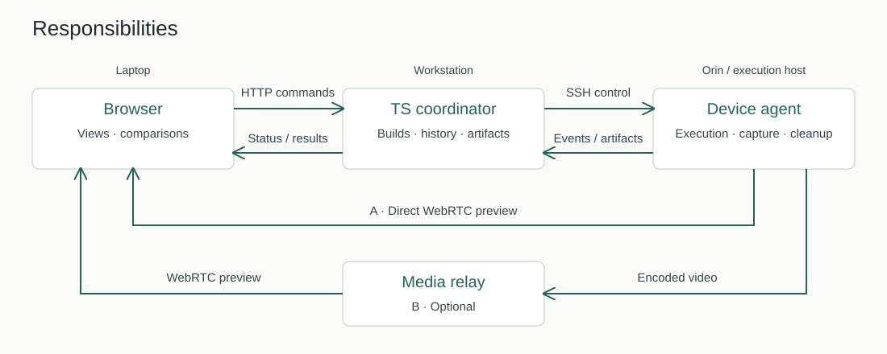
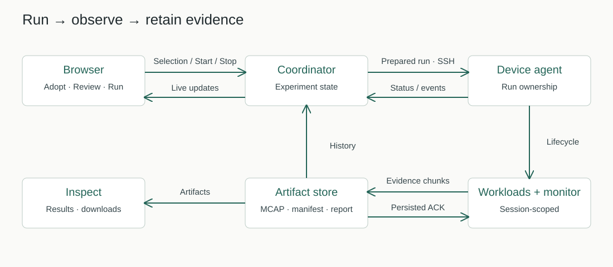
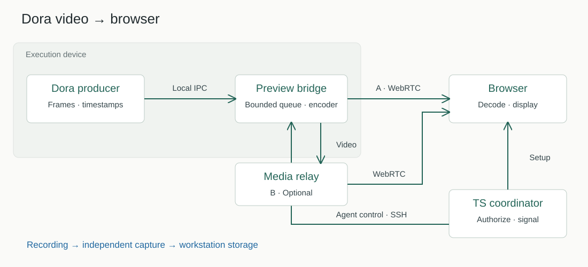

# Distributed architecture

Created: 2026-10-29. Deferred exploration. The [on-prem MVP](../../../console/docs/102926-console-mvp.md)
uses a browser and one server; separate agents are outside MVP scope.

- **Browser:** presentation and interaction.
- **Coordinator:** experiments, builds, history and durable storage.
- **Agent:** device-local execution, monitoring and cleanup.
- **Media:** direct WebRTC when reachable; dedicated relay otherwise.
- **Capture:** bounded device buffers; explicit outage and loss policy.

## Run and evidence

## Live video

SSH-only networks need a qualified media fallback. Video requires a schema/codec
bridge; preview and recording have separate budgets.

[Local MVP](../../../console/docs/102926-console-mvp.md) · [Mockups](102926-workflow-mockups-latest.md)
