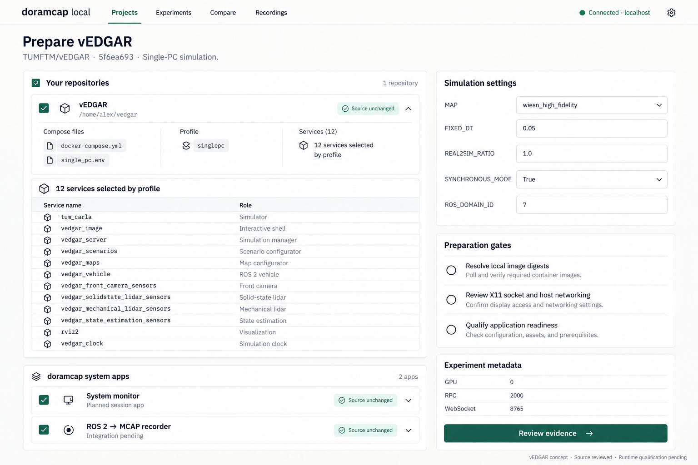
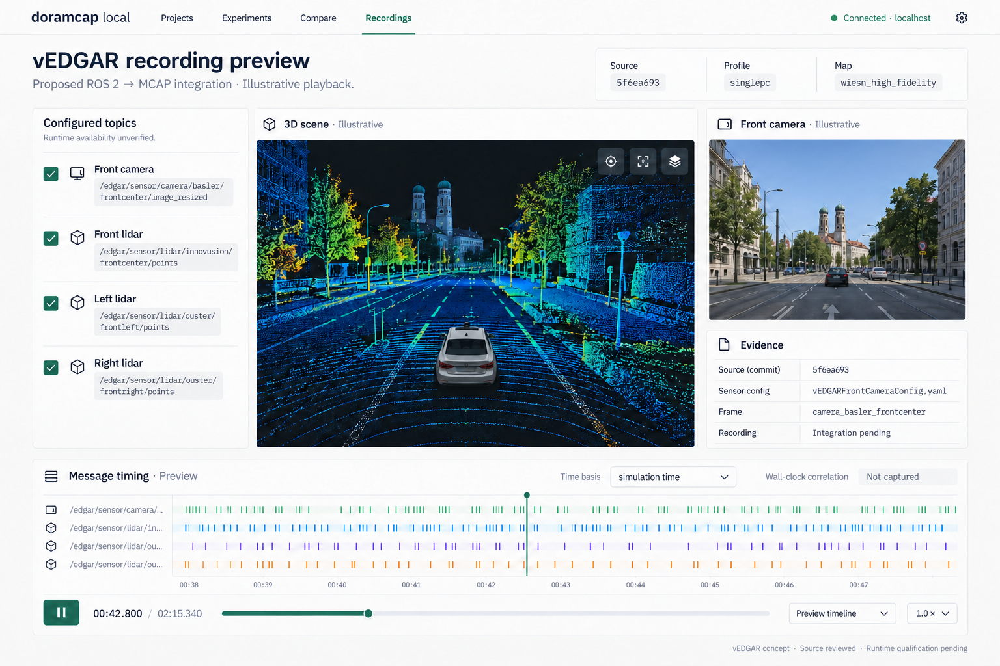

# vEDGAR UI concepts

Created: 2026-10-29. Source-grounded concepts; no upstream execution performed.
All host measurements, playback imagery and plotted traces are illustrative.
The shared local-app design follows the preparation-screen reference.

## Source anchors

| Source | Content used |
|---|---|
| [Compose](https://github.com/TUMFTM/vEDGAR/blob/5f6ea693c73ffd43d4b52ffde216fb6a56ee3bbc/docker-compose.yml) | Twelve singlepc services, host networking, GPU 0, privileged CARLA, source and X11 mounts |
| [Environment](https://github.com/TUMFTM/vEDGAR/blob/5f6ea693c73ffd43d4b52ffde216fb6a56ee3bbc/single_pc.env) | Map, simulation timing, ports, image tag and ROS settings |
| [README](https://github.com/TUMFTM/vEDGAR/blob/5f6ea693c73ffd43d4b52ffde216fb6a56ee3bbc/README.md) | Ubuntu 22.04, single-PC setup, documented startup order |
| [Front camera](https://github.com/TUMFTM/vEDGAR/blob/5f6ea693c73ffd43d4b52ffde216fb6a56ee3bbc/vedgar_services/vedgar_sensors/sensor_configs/vEDGARFrontCameraConfig.yaml) | Active front-center resized camera topic and frame |
| [RViz](https://github.com/TUMFTM/vEDGAR/blob/5f6ea693c73ffd43d4b52ffde216fb6a56ee3bbc/vedgar_services/vedgar_rviz2/vedgar_rviz_config.rviz) | Configured camera and lidar topic names |

## Interpretation

- docker-compose.yml is the Compose input; single_pc.env is its interpolation environment file.
- Twelve services carry singlepc in the pinned source. Runtime resolution remains unexecuted.
- Local images carla_dist:hflidar_maps and vedgar_base:latest require resolved digests.
- The ./vedgar_services bind means committed revision alone cannot establish executed code.
- Upstream CARLA recording storage is distinct from the proposed ROS 2 to MCAP integration.
- The output-directory override is proposed doramcap preparation data, not an upstream default.
- A/B varies REAL2SIM_RATIO from 1.0 to 2.0, both documented options. Hold code, map,
  fixed step, sensor configuration and scenario state constant; qualify clocks and reset.
- GPU plots are synthetic previews; measurements remain blank until execution.
- Configured topics do not establish publication, successful recording or decoder support.
- The urban scene illustrates a viewer; it is not a screenshot of the pinned map.
- UI badges describing source declarations do not establish runtime verification.
- Qualify interactive shell lifecycle, application readiness, X11 access, privileges and cleanup.

## First-stage experience

These concepts center zero application-code changes, external observations and
execution provenance. Example timelines, outcomes, identities and bundle checks
are synthetic; they do not qualify vEDGAR execution.

- Preparation separates source edits from reviewed runtime overrides.
- Run investigation links external resource observations and container lifetimes.
  Co-occurrence is evidence to investigate; causal attribution stays explicit.
- Provenance links source/configuration, instances and artifacts. It does not
  assert message ancestry or internal algorithm tracing.
- Reports separate execution outcome, evidence coverage and cleanup.
- System-telemetry MCAP is the primary recording example. Robotics payloads
  require a configured, qualified adapter.
- Bundle filenames and export/reopen behavior are proposed UI contracts.
- Rendered timestamps, chart geometry and statuses are illustrative layout data;
  implementation must derive them from consistent recorded timestamps. Existing
  application instrumentation can enrich coverage through qualified adapters.

[First-stage generation prompts](102926-vedgar-concept-prompts-stage1.md).

## Earlier concepts and optional application recording

The earlier preparation image is superseded above. The camera/point-cloud preview
illustrates a future adapter-dependent extension.

[Image-generation prompts](102926-vedgar-concept-prompts.md).

[Latest selected mockup gallery](102926-workflow-mockups-latest.md).
