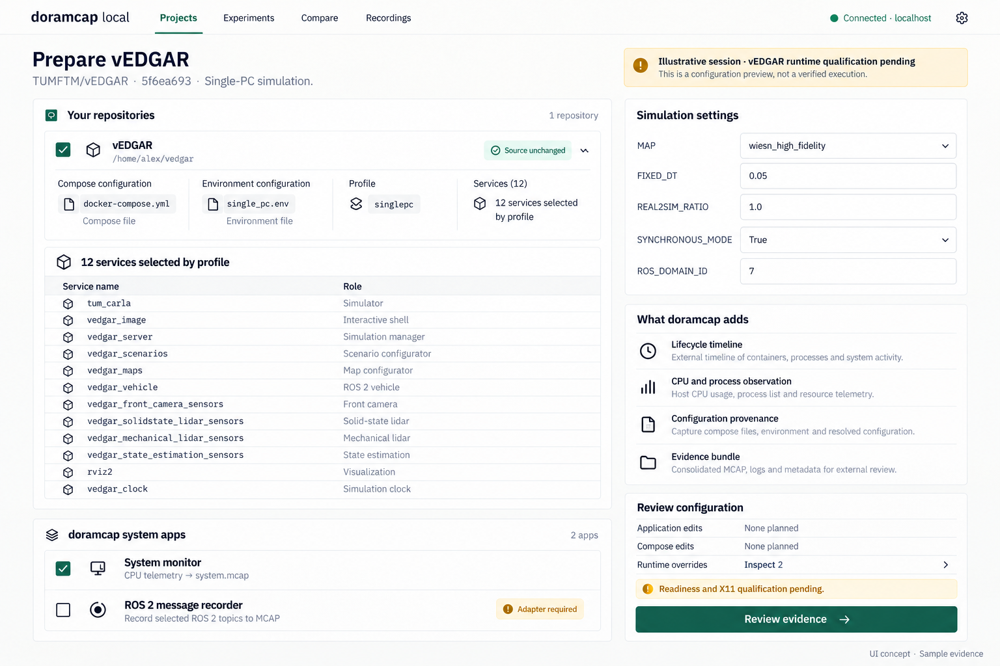
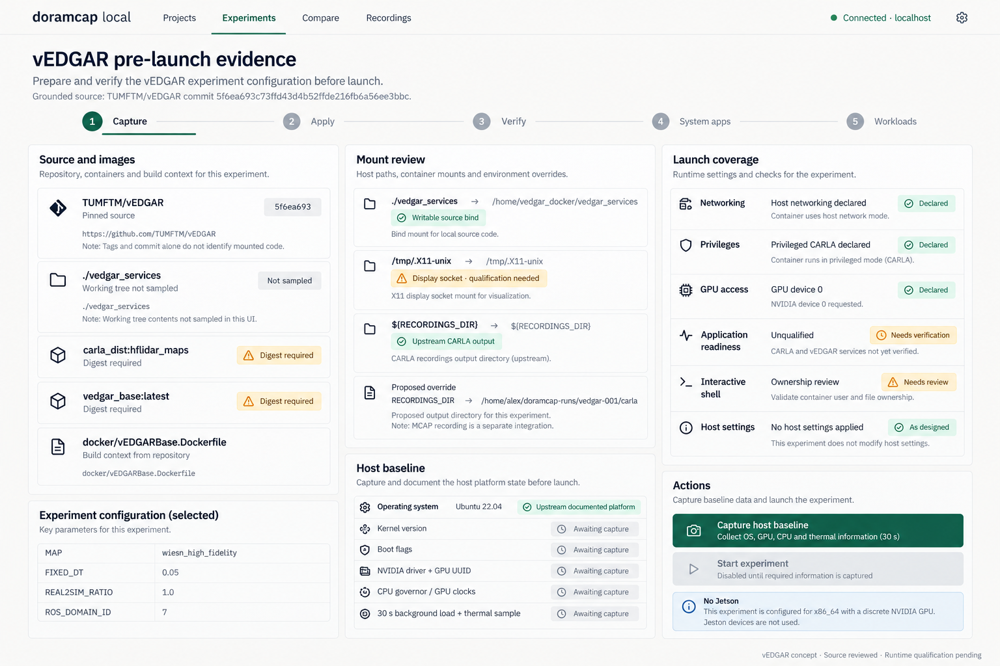
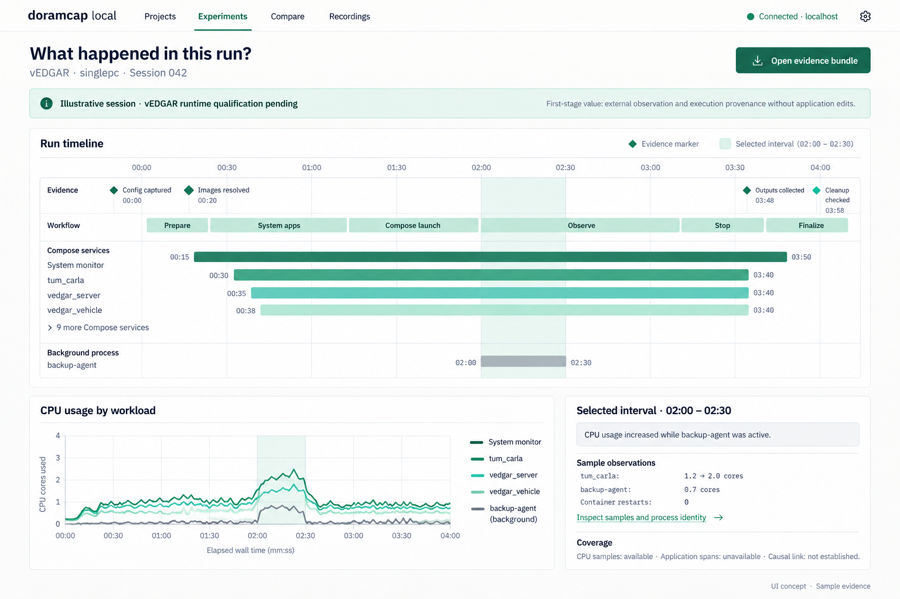
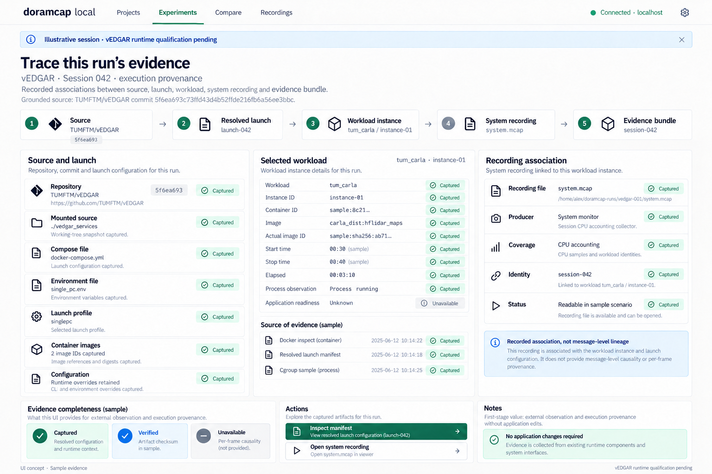
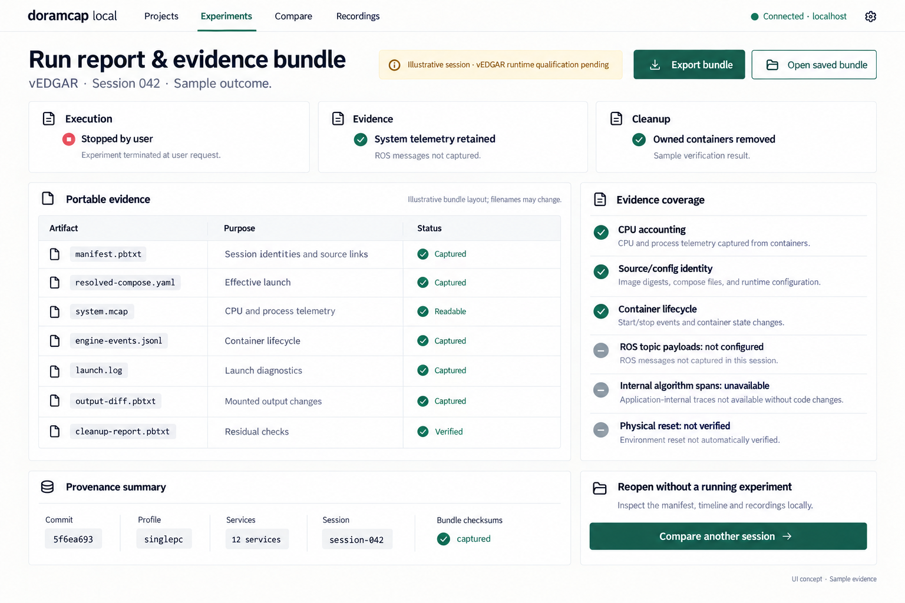
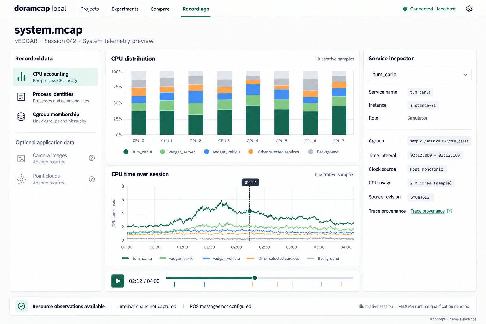
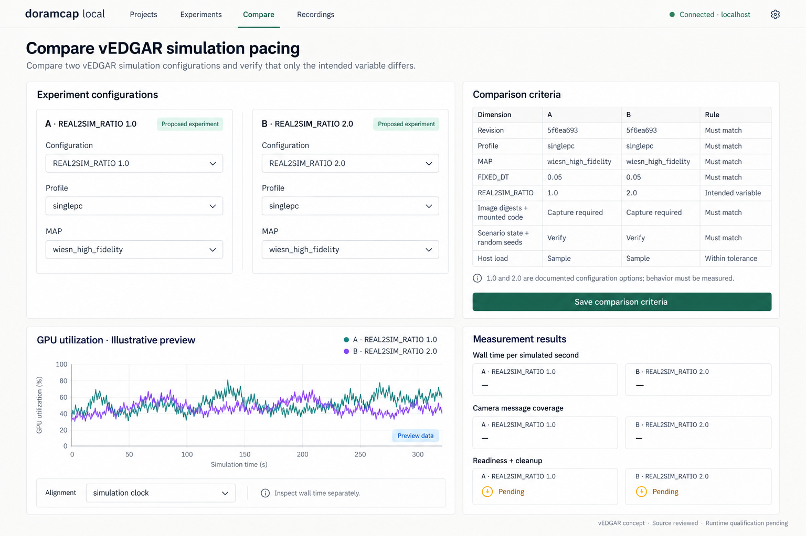

# Latest workflow mockups

Updated: 2026-10-29. Start here for the current selected renderings.
All images are saved beside this file. Runtime examples are illustrative.

## First-stage vEDGAR experience

Zero application-code changes, external observation, execution provenance and
portable evidence. System telemetry is the default recording experience.

### Prepare vEDGAR

### Pre-launch evidence

### Investigate a run

### Trace execution provenance

### Report and export evidence

### Inspect system MCAP

### Compare experiments

## Additional current concepts

| View | Latest rendering |
|---|---|
| SPA workflow catalog | [Catalog](102926-compose-concept-workflow-catalog.png) |
| Multiple user repositories | [Local preparation](102926-compose-concept-local-projects.png) |
| Detailed host provenance | [Pre-launch review](102926-compose-concept-prelaunch-evidence.png) |
| Declared experiment variables | [Comparison criteria](102926-compose-concept-comparison-criteria.png) |
| Generic A/B analysis | [Consistent UI revision](102926-compose-concept-experiment-compare-v2.png) |
| Optional robotics viewer | [vEDGAR topic preview](102926-vedgar-concept-recording.png) |
| Generic robotics viewer | [Consistent UI revision](102926-compose-concept-mcap-viewer-v2.png) |

Robotics-message viewers require a qualified adapter. Earlier renderings remain
saved for reference; this index selects the current versions.

## Plans, sources and prompts

- [Product plan and architecture](102926-compose-adoption-experience.md)
- [vEDGAR source references and scope](102926-vedgar-ui-concepts.md)
- [First-stage prompts](102926-vedgar-concept-prompts-stage1.md)
- [Original vEDGAR prompts](102926-vedgar-concept-prompts.md)
- [Host provenance prompts](102926-compose-concept-prompts-provenance.md)
- [Consistent UI edit prompts](102926-compose-concept-prompts-v3.md)

## Distributed architecture exploration

[Responsibilities and two data flows](102926-distributed-architecture.md): SVGs for
coordinator/device separation, experiment evidence and Dora video delivery.
