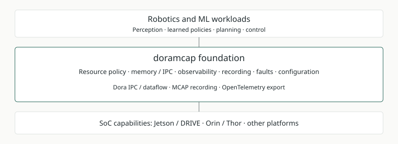

# Foundation overview page

Status: original design proposal, October 21, 2026. The overview is now implemented;
see the [canonical mapping contract](../overview-mappings.md). [Interactive visual template](102126-foundation-vision.html).

## Milestones

- [x] Save the visual concept and interaction proposal. Evidence: the accompanying
  standalone HTML preserves capability, scenario and third-party selections.
- [x] Canonical versioned JSON and schema implemented; see the mapping contract.
- [x] Overview narrative and maturity labels recorded in the canonical manifest.
- [x] Overview deep links implemented with selection and history.
- [x] Mapping integrity and responsive navigation checked; see [validation](../validation.md).

## Intent

Present doramcap as the systems foundation between SoC capabilities and robotics/ML
workloads. Give the foundation the strongest visual emphasis; connect its promises
to concrete crates, runnable demos, documentation and validation evidence.

The platform row expresses the vision for Jetson/DRIVE Orin/Thor and other SoCs.
Each platform needs its own capability and qualification profile. Clearly label
existing building blocks and future work.

## Interaction

- Select a foundation capability to reveal its purpose and related components.
- Select a scenario to highlight the capabilities and upstream integrations it uses.
- Select Dora IPC/dataflow, MCAP or OpenTelemetry to explain its upstream role and
  the doramcap integration around it.
- Link each selection to apps, crates, diagrams and evidence; preserve selections
  in URLs when implemented.

| Illustrative scenario | Capabilities | Example components |
|---|---|---|
| Run a perception pipeline | Shared data, tracing, recording | cuda-dora-shm, activity-tracing, dataflow-tracing, mcap-recorder |
| Explain a missed deadline | Resource accounting, ancestry, recording | cgroup-bpf, step-provenance, system-monitor, storage-persistence |
| Respond to a fault | Fault reports, liveness, evidence | fault-reporter, fault-aggregation, fault-watchdog, fault-demo |

These are illustrative relationships. They do not establish a fully integrated
runtime or a qualified platform guarantee.

## Content ownership

Cargo metadata supplies package dependencies. Scenario intent and capability
membership require editorial mapping; generating them from dependency edges alone
would misrepresent the architecture.

The implemented mapping lives in `apps/project-explorer/overview.json`.
The following alternatives record the original design discussion. Possible approaches are a small declarative manifest
beside the vision document or component-owned tags aggregated during the build.
Prefer links and component identifiers over duplicated descriptions. Continue
using repository READMEs and SVGs for detailed content.

The saved HTML contains representative mappings for design review. Its navigation
labels and component chips are visual placeholders. It uses the exported preview
runtime and CDN-hosted glyphs; a production implementation should reuse the SPA’s
local frontend dependencies.

## Validation

- [x] Export the interactive concept to standalone HTML; exporter completed.
- [x] Check repository patch whitespace with `git diff --check`.
- [x] Browser tests exercise overview deep links and history; selections use native links.
- [x] Schema tests verify component/docs references; end-to-end scenarios remain illustrative.
