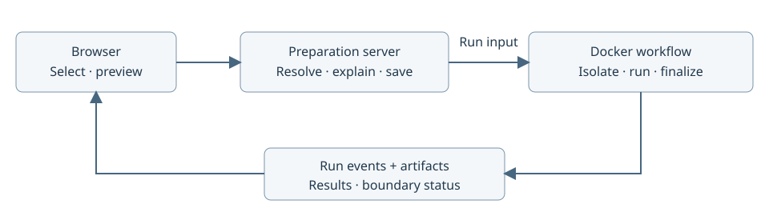

# Prepare and run an existing Compose experiment

Created: 2026-10-27. Planned frontend/server work.

Users select existing Compose projects, resolve setup questions once, then run and
repeat a complete robot task with lifecycle and recording evidence. Upstream files
and application code stay unchanged. Preparation produces the typed `ComposeRun`
input for the procedural Rust workflow in `workload-docker`.

The gallery server owns interactive preparation and progress delivery. The core
orchestrator owns step execution and telemetry. Docker resolution, mount planning,
launch and cleanup remain in `workload-docker`. The browser never owns cleanup.

## M1 — Select and resolve inputs

### Work items

- [ ] Add “Run an experiment” with one or more existing Compose projects.
- [ ] Select ordered files, working directories, env inputs, profiles and services.
- [ ] Resolve through Docker Compose; retain source identities and resolved settings.
- [ ] Surface missing images, devices, permissions and ambiguous completion/readiness.
- [ ] Save reusable preparation inputs; resolve again when their sources change.

### Validation

- [ ] Adding a service to upstream Compose requires zero pipeline or application edits.
- [ ] Multiple files in one project remain distinct from multiple independently named projects.
- [ ] Profile/env changes are reflected in the resolved preview; secrets are redacted.
- [ ] Errors identify the project, source and actionable prerequisite.

## M2 — Explain the effective launch

### Work items

- [ ] Show original → effective settings and the reason for each override, including
  restart policies, image IDs, project names, labels and host bind sources.
- [ ] Show writable directory overlays, shared aliases, read-only inputs and fresh outputs.
- [ ] Choose fresh artifact storage outside every source tree; flag missing source
  directories before submission and explain the current existing-directory requirement.
- [ ] Offer write-back by default or independent retained results; explain when host
  changes become visible and what the next run inherits.
- [ ] Show named-volume carryover, container-layer disposal and unsupported mounts.
- [ ] Check capabilities, local daemon mount visibility and backing filesystem support.
  Actual mount preparation remains a workflow step and fails closed on error.

### Validation

- [ ] Source Compose/env files remain byte-for-byte unchanged across preparation and runs.
- [ ] Every runtime override is linked to persisted resolution or mount-mapping evidence.
- [ ] Unqualified sockets, devices, writable single-file binds and nested mounts produce
  clear errors; isolation never silently becomes passthrough.
- [ ] No default hashing, model copying, artificial file-count cutoff or repeated prompt.

## M3 — Launch, observe and repeat

### Work items

- [ ] Submit prepared input to a server-owned serial runner; expose lifecycle telemetry.
- [ ] Show preparation, first-party startup, foreign startup, observation, shutdown,
  categorized diffs, filesystem finalization and cleanup.
- [ ] Support explicit stop and browser reconnect; retain server-owned run identity.
- [ ] Show results, recording status, original/effective paths and incomplete cleanup.
- [ ] Block the next run after an unresolved boundary failure; provide recovery evidence.
- [ ] Reuse the hosting components in [on-demand apps](102727-on-demand-apps.md).
  Define experiment disconnect behavior explicitly: gallery idle-app expiry must
  never kill the lifecycle manager while it still owns an active run.

### Validation

- [ ] Two serial runs get fresh monitors, recordings and overlay upper/work directories.
- [ ] Disconnect/reconnect preserves the run and exposes current state and results.
- [ ] A failed start still drains owned workloads and records cleanup outcomes.
- [ ] Busy mounts and incomplete evidence keep the next-run action unavailable.
- [ ] File lists load incrementally; preview size never limits collection completeness.
- [ ] Verify production build, schema validation and desktop/mobile browser behavior.

## M4 — Qualify robotics adoption

### Work items

- [ ] Pin vEDGAR and AnywhereVLA revisions; inventory their actual Compose launch paths.
- [ ] Qualify vEDGAR profiles, GPU/port ownership, simulator readiness and reset.
- [ ] Qualify AnywhereVLA multiple files, interactive execution and nested ROS launches.
- [ ] Record zero-edit success, prerequisites and unsupported cases per project.
- [ ] Use Event-Orin and OpenTeach to scope later staged-launch/process adapters.

### Validation

- [ ] Run each qualified Compose fixture twice; prove lower directories stay unchanged
  during execution, then verify the selected result disposition after shutdown.
- [ ] Exercise interrupted startup, manual stop and an added upstream service.
- [ ] Compare declared resources with observed containers/processes and recordings.
- [ ] Separate fixture-only, simulator and physical-hardware evidence; never imply
  hardware qualification from a synthetic fixture.

## Integration boundary

Preparation may use an optional agent to explain or propose inputs. Persist its
choices as ordinary reviewed preparation data. Keep filesystem privileges, Docker
execution and cleanup in the trusted server. No generated workflow code or pipeline
YAML is needed. Multi-host execution remains future work.

Related: [Compose workflow](../../../../libs/workload-docker/docs/102626-compose-workflow.md),
[filesystem isolation](../../../../libs/workload-docker/docs/102626-docker-experiment-isolation.md),
[adoption candidates](../../../../libs/workload-lifecycle/docs/102626-adoption-candidates.md).
