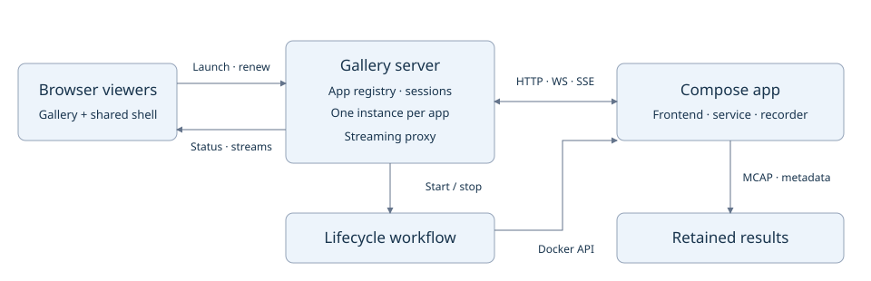

# On-demand app hosting

Created: 2026-10-27. Status: design proposal; implementation deferred.

## High-level plan

1. Establish the server-owned app registry and singleton lifecycle.
2. Package Activity Lab as the first Compose app.
3. Connect gallery launch, shared viewing and streaming.
4. Close the idle-shutdown, recording and cleanup loop.
5. Qualify additional apps through reusable wrappers.

## M1 — Gallery server and instance ownership

### Work items

- [ ] Add server-owned registrations for Compose definitions, readiness, endpoints and result paths.
- [ ] Implement per-app generation/state transitions and join concurrent launch requests.
- [ ] Return startup status promptly; expose failures and block replacement after unverified cleanup.
- [ ] Detect existing manager-owned resources at startup and require cleanup before replacement.

### Validation

- [ ] Concurrent launches for one app share one startup operation and generation.
- [ ] Different apps can start independently; unknown app IDs and client-supplied launch settings are rejected.
- [ ] Existing owned resources prevent duplicate launch after manager restart.
- [ ] State-transition tests cover startup failure and cleanup-blocked replacement.

## M2 — Activity Lab Compose wrapper

### Work items

- [ ] Package prebuilt assets/binaries and a trusted Compose definition for Activity Lab.
- [ ] Configure readiness, SIGINT shutdown, owned network and fresh per-generation writable paths.
- [ ] Qualify bind/base-path support and make only required app adaptations; keep sessions in shared hosting code.
- [ ] Retain recording output outside disposable storage with an explicit volume policy.

### Validation

- [ ] The packaged app becomes ready and serves its frontend and live stream.
- [ ] Graceful container stop produces a readable MCAP recording.
- [ ] Two sequential launches use distinct writable paths and preserve the earlier recording.
- [ ] Wrapper launch works without adding app-specific branches to core orchestration.

## M3 — Launch, shared viewers and proxy

### Work items

- [ ] Add Launch/Open and a shared viewer shell with startup/error status and session heartbeats.
- [ ] Proxy generation-scoped HTTP, downloads, WebSocket and SSE traffic incrementally.
- [ ] Support base-relative assets/API URLs and required redirect/cookie path handling.
- [ ] Keep static gallery browsing available and expose launch only with a hosting backend.

### Validation

- [ ] Two browsers receive live results from the same instance and have independent sessions.
- [ ] Launch opens the shell from the user click; refresh, deep links and prefix hosting work.
- [ ] Assets, downloads, WebSockets and SSE work through the proxy; upstream errors remain visible.
- [ ] Large responses continue across buffer boundaries without total-result truncation.
- [ ] Gallery production build/schema checks and manual desktop/mobile browser checks pass.

## M4 — Idle shutdown and verified cleanup

### Work items

- [ ] Apply the documented heartbeat/expiry policy using monotonic time and generation IDs.
- [ ] Serialize expiry, launch and stop transitions; wait for cleanup before replacement.
- [ ] Stop writers, finalize recordings, collect categorized metadata and remove owned resources.
- [ ] Handle browser closure during startup, unexpected app exit and manager shutdown.
- [ ] Preserve artifacts and report failure when finalization or cleanup cannot be verified.

### Validation

- [ ] Disconnecting one viewer preserves another viewer's instance; last-session expiry stops it.
- [ ] Reconnect within the grace period preserves the generation; late heartbeats cannot revive it.
- [ ] Launch during stopping waits for verified cleanup before creating a new generation.
- [ ] Background tabs, refresh, suspension and network loss follow the documented timeout policy.
- [ ] Startup failure, browser closure during startup and app exit release owned resources.
- [ ] Failed finalization is visible and preserves evidence; successful cleanup leaves no owned containers/networks.
- [ ] End-to-end serial runs retain readable recordings and separate storage-change categories.

## M5 — Additional apps and release qualification

### Work items

- [ ] Inventory remaining apps and record hosting gaps, readiness and shutdown behavior for each.
- [ ] Add Compose wrappers individually, reusing launch/session/proxy machinery.
- [ ] Document BPF/GPU/device needs, host-resource conflicts and allowed concurrent app combinations.
- [ ] Document launch, result access, idle expiry and recovery from failed cleanup.

### Validation

- [ ] Each enabled app passes launch, two-viewer streaming, expiry and sequential-relaunch checks.
- [ ] Each wrapper preserves required results and removes its disposable resources.
- [ ] Compatible apps run together; declared host-resource conflicts surface before launch.
- [ ] Required Rust/native tests and ARM64 CI pass; capability-specific tests run on suitable hardware.
- [ ] Final gallery build/schema validation and manual launch/status/result-access checks pass.

Record evidence under the relevant milestone before checking its items. Use
Arrange/Act/Assert in Rust tests; keep frontend verification to builds, schema
validation and manual checks per SPA instructions.

## Contract and ownership

One gallery manager owns at most one active instance per registered app on its server.
Multiple clients share that instance and its application state. Different apps may run
concurrently. Exclusive client ownership and conflicting-control detection are deferred.

| Owner | Responsibilities |
| --- | --- |
| Gallery frontend | Launch/Open, startup/error status, app viewer shell |
| Gallery server | App registry, instance state, viewer sessions, routing and streaming proxy |
| Procedural Rust workflow | Resolve, start, await readiness, stop, collect evidence, remove |
| `workload-docker` | Compose semantics, Engine inspection, verified resource cleanup |
| `orchestrator` | Typed step execution, injected services and execution telemetry |
| App + Compose wrapper | App process, readiness endpoint, mounts, signal and device settings |

Session policy stays in the gallery server. Backend-neutral lifecycle contracts remain
in `workload-lifecycle` when demonstrated common semantics warrant extraction.
Reuse Docker steps; select recording/monitoring by app needs rather than automatically
running the complete recorded-experiment workflow around every viewer.

## Launch and stop

`Stopped → Starting → Ready → Stopping → Stopped`. Startup/runtime/cleanup errors
remain visible; unverified cleanup blocks replacement of that app's instance.

1. Launch by app ID. The server allocates a generation and viewer session, or joins
   the existing startup/ready generation. A serialized per-app transition prevents
   duplicate creation; unrelated apps can launch independently.
2. Resolve the server-owned Compose definition, create fresh writable paths, start
   services, and wait for registered readiness. Return a shell URL and status promptly.
3. The shell renews its viewer session while showing startup progress, then embeds
   the app frontend. Launch opens this shell directly from the user's click to avoid
   popup blockers; same-tab navigation is also supported.
4. After the last session expires, stop writers, finalize recordings, collect available
   filesystem changes and remove owned containers/networks. Retain results separately.
5. A new launch during stopping waits for verified cleanup, then creates a new generation.
   A reconnect after expiry creates a new session only if that generation is still ready.

On manager shutdown, drain owned instances. Full crash recovery is deferred. On startup,
existing manager-labeled resources must be surfaced and block duplicate launch until
explicit cleanup; process-local state alone cannot establish the singleton guarantee.

## Viewer lifetime

The shared shell owns heartbeats; apps need no session SDK. Browsers heartbeat to the
server hosting the shell, independent of an app's data-stream connections. Opening an
app through the gallery always uses the shell so each viewer is counted.

Proposed policy: renew every 15 seconds, expire a session after 120 seconds without a
renewal. These are explicit, configurable idle-lifecycle settings, including startup;
there is no maximum active-session duration. Use server monotonic time and generation
IDs. Best-effort unload notification may shorten cleanup but is never required.

All live sessions keep the instance alive. Browser suspension beyond the grace period
can stop the instance; returning viewers see an expired-session state and can relaunch.
A still-open gallery tab alone does not keep an app alive. Heartbeat expiry and launch
transitions are serialized so cleanup cannot race a newly accepted session.

## Minimal app adaptations

Keep launch mechanics in `server/compose/<app>/` and trusted app registrations.
Build images ahead of launch; avoid compiling Rust/Node on each browser request.
Each registration identifies Compose files, service/port, readiness, stop policy,
result paths and required capabilities. Browser input selects an app ID only.

Prefer existing CLI/environment options. Adapt app code only where packaging exposes
an actual hosting gap: bind address, URL prefix, assets/results paths or graceful stop.
A common frontend URL helper and relative asset build settings can cover prefix routing;
shared proxy/session code belongs in the gallery server and viewer shell.

Activity Lab is the first candidate. It already accepts `--assets`, `--record` and
`--port`, serves `/api/status` and `/stream`, and finalizes MCAP on Ctrl-C. Its current
loopback bind and root-relative frontend API paths need qualification: add bind/base
support if necessary, or use a small proxy sidecar sharing its network namespace.
Its wrapper can set Docker's stop signal to SIGINT to reuse existing shutdown behavior.

## Routing and streaming

Use `/running/{app}/{generation}/` for the viewer shell and
`/app/{app}/{generation}/...` for proxied application traffic. Remove the upstream
prefix and handle redirect/cookie paths as needed. Apps must construct their API,
WebSocket and asset URLs relative to their assigned base; avoid brittle HTML rewriting.

The proxy streams HTTP bodies, downloads, SSE and WebSockets with backpressure.
Buffer/chunk sizes govern incremental work; they do not impose total-result or
session-length caps. Surface upstream closure and errors. App logs may preview a
small number of entries while full artifacts remain accessible.

A static/GitHub Pages gallery continues to browse documentation. On-demand Launch is
available when served with this backend. First deployment targets a trusted server;
external access requires an explicit authentication/access policy. Validate launch
origins and keep Docker control and upstream ports inaccessible to browser requests.

## Isolation and retention

- Give each app generation an owned Compose project/network and fresh writable directory.
- Use read-only image/config mounts where supported; place temporary data in container/tmpfs storage.
- Keep finalized recordings and metadata outside disposable storage; expose them through result routes.
- Preserve host-bind, container-layer and volume change categories. Metadata collection alone does
  not reset storage; host OverlayFS mounting/write-back remains separate planned work.
- Choose volume retention explicitly per wrapper. Never silently reuse writable scratch volumes.
- Qualify BPF, GPU, devices and shared host resources per app. Record incompatibilities before enabling
  simultaneous launch; container isolation alone cannot make conflicting hardware use safe.
- Keep the manager and its self-observation persistent. App services and their monitors stop together.

## Implementation choices to evaluate

Reuse existing Tokio, Axum, tower-http and Bollard dependencies. Evaluate Hyper/
Hyper-util for streaming HTTP and Tokio-tungstenite for WebSocket forwarding against
an established reverse proxy such as Caddy. Present dependency choices before adoption;
this proposal adds no dependencies. Keep routing/proxy mechanics out of core orchestration.

## Evidence and scope

Inspected Activity Lab's README, server routes/bind/shutdown and frontend URL handling;
reviewed the gallery hosting contract and `workload-docker` step interfaces. These
support the proposed first integration but do not establish container/proxy compatibility.
Implementation checkboxes remain open. No app packaging or launch code changes in this milestone.
