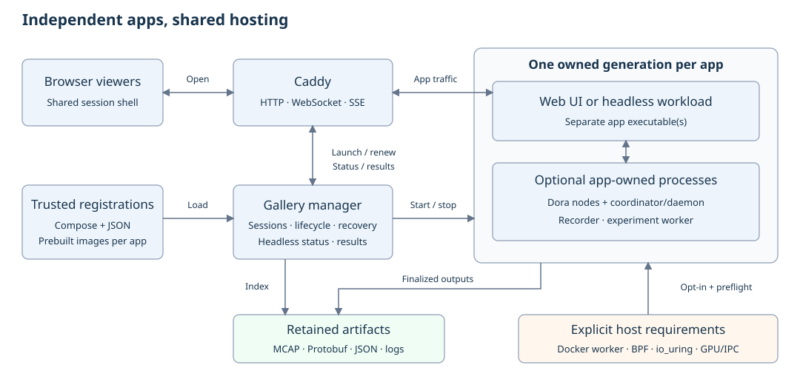

# Remaining on-demand apps

Created: 2026-10-27. Status: implementation in progress; qualification pending.

Extends the [hosting implementation](102727-on-demand-apps.md) with independent
app wrappers and native profiles.

## Order and scope

Ordered by expected implementation and qualification effort.

| Order | App / mode | Difficulty | Main work | Prerequisite |
| --- | --- | --- | --- | --- |
| M1 | CPU Viewer, synthetic | Easier | Bind/prefix, owned Dora flow, recorder | M0 Dora ownership |
| M2 | MCAP Recorder | Easier after M1 | Headless presentation, input drain, recording checks | M1; M0 headless view |
| M3 | System Monitor, synthetic | Moderate | Headless status, Protobuf retention, optional embedded recording | M0 artifacts/headless view |
| M4 | Fault Demo | Moderate | Package four-node flow, controls, final state export | M0 Dora/artifacts |
| M5 | Fault Watchdog | Moderate after M4 | Independent instance, sink configuration and drain | M4; M0 headless view |
| M6 | Provenance Lab | Moderate–hard | Dynamic nodes, launcher lifetime, retained summary/logs | M0 Dora/artifacts |
| M7 | Orchestrator Lab | Hard | Docker worker boundary, nested resources and crash recovery | M0 artifacts; native checks in M8 |
| M8 | Native CPU / monitor / storage modes | Hard | BPF, host namespaces, io_uring and resource conflicts | Respective synthetic wrappers |
| M9 | CUDA shared-memory demo | Hardest | GPU/IPC, process-tree shutdown, per-experiment artifacts | M0 Dora/artifacts; qualified GPU host |

Keep hardware-dependent modes opt-in.

## Architectural constraints

Use the [Docker-hostable app guide](docker-hostable-apps.md) for new apps and wrapper conventions.

- Each app keeps its own build target, binary and image. Compose may run several
  independently built binaries together, including an existing viewer or recorder.
- Keep registrations in `apps/<app>/deploy/registration.pbtxt`; app IDs,
  settings, paths and privileges come from trusted files. Adding an app using the
  supported schema requires a manager restart; schema extensions require a rebuild.
- Keep app-specific code in its app or wrapper. Shared sessions, proxying,
  artifact delivery and lifecycle handling stay in the hosting server.
- Reuse the existing Caddy, Compose, Dora and Rust libraries. Evaluate suitable
  maintained dependencies with the user before adding a crate or custom subsystem.
- First enable controlled demo inputs. Connections to arbitrary host workloads,
  production Dora flows or external exporters are separate operator configuration.

## M0 — Shared hosting gaps (planned)

The [registration](../src/registry.rs) supports web and headless services, an
optional primary result, optional flat files and bounded artifact collections.
[Finalization](../src/workflow.rs) validates declared results and freezes their
indexes for the [download routes](../src/api.rs). Nested downloads reject symlink
traversal. Dora queues have finite backpressure limits; stronger drain guarantees
remain to be implemented. The wrapper checks producer delivery counts and withholds
incomplete recordings.

### Work items

- [x] Establish a reusable wrapper convention for generation-owned Dora processes,
  isolated coordinator/daemon endpoints, writable state and signal forwarding.
  Package pinned Dora 1.1.0 and prebuilt node binaries; establish subscriber
  readiness before producers publish. Prefer one container for a local Dora flow
  initially, with separately built executables inside it.
- [ ] Stop producers, drain subscribers, finalize outputs, then stop owned Dora
  infrastructure. Retain logs on partial startup and failure. Never attach to or
  stop a host's unrelated shared daemon. Prove the convention with M1.
- [x] Add an explicit headless presentation: the shared shell shows process state
  and retained results without requiring an app HTTP server. Use Compose health
  checks for workload readiness; resolve proxy endpoints only for web apps.
- [x] Extend trusted artifact declarations with required/optional files or bounded
  file collections, format and download name. Support zero recordings when no
  experiment ran; distinguish missing required output from absent optional output.
- [x] Publish verified artifact indexes after writers stop. Validate MCAP contents,
  preserve failed-run evidence separately, constrain paths beneath each generation,
  and reject traversal/symlinks. Retain existing Activity/Storage behavior.
- [x] Document mode selection through trusted deployment manifests. Keep one
  canonical gallery ID per app; select synthetic/native profiles before startup,
  avoiding duplicate registrations or client-supplied launch configuration.

### Validation

- [ ] Two different Dora apps run concurrently; stopping one preserves the other
  and any unrelated host flow. Startup failure leaves no owned Dora processes.
- [ ] Web and headless apps both pass launch/join, two-session expiry, restart
  detection and sequential relaunch. Data readiness is checked beyond process liveness.
- [x] Artifact checks cover empty optional sets, corrupt/missing required output,
  rotation, safe nested paths and downloads after app removal; prior generations survive.
- [ ] Activity/Storage lifecycle, recovery and Caddy root/prefix tests still pass;
  adding a supported manifest still works without rebuilding the manager.

## M1 — CPU Viewer, synthetic (planned)

CPU Viewer serves Dora data over `/stream` and `/clock`. Its standalone
[synthetic flow](../../../cpu-viewer/dataflows/live-cpu-synthetic-dataflow.yml)
contains a collector and viewer.

### Work items

- [x] Add configurable bind and base-relative assets, `/stream` and `/clock` URLs.
  Add readiness reflecting the first valid dictionary and snapshot.
- [x] Package the viewer, synthetic System Monitor and independent MCAP Recorder
  in an owned Dora flow. Use the recorder's existing buffered writer to retain
  `cpu.mcap`; this initial mode requires neither BPF nor embedded io_uring recording.
- [x] Add Compose health checks, trusted registration, signal/drain handling and
  fresh result paths. Keep the standalone native launch configuration usable.

### Validation

- [x] Two browsers receive dictionary-first binary streams and working clock
  calibration under both root and prefix hosting, including reconnect.
- [x] Last-session expiry drains input and produces readable snapshot/dictionary
  MCAP data; startup interruption and a second generation leave no owned processes.
- [ ] Synthetic launch works on x86_64 and ARM64 without BPF privileges; compatible
  Activity/Storage sessions continue during CPU Viewer shutdown.

## M2 — MCAP Recorder (complete)

The [recorder](../../../mcap-recorder/src/main.rs) is a headless Dora subscriber
that finalizes when its input closes.

### Work items

- [x] Register an independent recorder demonstration with the M0 headless view and
  a synthetic publisher. Reuse M1 packaging; keep separate generation storage and
  process ownership from CPU Viewer. Run until viewer expiry.
- [x] Probe subscriber attachment/output initialization before declaring readiness;
  expose recording status/results through the shell. Preserve exclusive file creation.
- [x] Stop the publisher first and allow the recorder to drain naturally before
  escalating shutdown. Retain the existing finite-sample fixture for drain tests.

### Validation

- [x] Read back embedded schemas, original payloads, sequence and capture timestamps;
  finite input closes cleanly and upstream failure retains an explicitly partial result.
- [x] Two viewers share one recording; idle expiry, interrupted startup and two
  sequential generations clean up without overwriting earlier files.
- [x] The headless page refreshes correctly and offers finalized downloads after
  shutdown; the app remains separately buildable and runnable as a Dora subscriber.
- [x] Requalify bounded backpressure with a resumed recorder and a recorder that
  never resumes; incomplete recordings stay private.
- [x] Verify collector-reported losses also withhold the recording.

## M3 — System Monitor, synthetic (complete)

The [collector](../../../system-monitor/src/main.rs) supports synthetic Protobuf
output and an optional embedded MCAP writer; buffered recording still needs io_uring.

### Work items

- [x] Package standalone synthetic collection with a headless shell and retained
  length-prefixed Protobuf output plus capability/exit diagnostics. Readiness must
  confirm valid samples. Keep this instance independent of CPU Viewer.
- [x] Report collector failure and retain diagnostics privately with the full output
  file. Use the existing CPU Viewer composition when a live chart is needed.
- [x] Qualify embedded MCAP as an explicit recording mode using the reviewed
  io_uring profile. Declare rotated `capture.000001.mcap` files as an artifact
  collection; reserve native collection for M8.

### Validation

- [x] Decode synthetic output and confirm collection continues with two viewers;
  idle shutdown flushes output and removes the collector.
- [x] Embedded recording tests cover rotation, schema/dictionary presence, write
  failure and finalization on stop; unsupported io_uring fails visibly.
- [x] Base synthetic mode runs on x86_64/ARM64 without BPF; fresh generations and
  retained downloads work through the headless shell.

## M4 — Fault Demo (planned)

The [dashboard](../../../fault-demo/src/bin/dashboard.rs) already accepts
`FAULT_DEMO_LISTEN`; its [HTML](../../../fault-demo/frontend/index.html) now uses
base-relative APIs. The [flow](../../../fault-demo/dataflows/live.yml) runs two
reporters, a watchdog and a dashboard. Default watchdog configuration has no MCAP sink.

### Work items

- [x] Package the four-node flow with independently built reporter, watchdog and
  dashboard binaries and owned Dora infrastructure;
  convert API URLs to base-relative paths. Readiness requires a synchronized
  watchdog snapshot, rather than HTTP availability alone.
- [x] Apply the hosting origin policy to control requests and retain the fixed
  demo command set. Both viewers observe shared controls and state.
- [x] Save a final state JSON before stopping the dashboard and retain operational
  logs privately. Keep MCAP optional; qualify watchdog recording with M5.

### Validation

- [x] Exercise fail/recover/flap/pause/flood/event behavior through the proxy;
  both browsers converge on shared state. Wrong-origin controls are rejected.
- [ ] Root/prefix hosting, refresh, last-session expiry and startup interruption
  work; the final snapshot remains downloadable after all four nodes stop.
- [ ] Reuse [Dora validation](../../../fault-demo/tests/validate_dora.py) for health,
  freshness and recovery checks; run portable hosting tests on x86_64 and ARM64.

## M5 — Fault Watchdog (planned)

The [host](../../../fault-watchdog/src/main.rs) is a headless Dora process with
deadline-bounded sink draining. MCAP and OTLP are optional build/config features.
The [MCAP sink](../../../fault-watchdog/src/sinks/mcap.rs) uses storage-persistence
and writes rotated names such as `faults.mcap.000001`.

### Work items

- [x] Add an independent dashboard registration with fixed synthetic reporter and
  observation fixtures. Reuse M4's packaging; expose source/sink readiness and
  retain a final diagnostic summary without launching another Fault Demo instance.
- [x] Ship trusted Protobuf-text configurations for live-only and MCAP modes;
  align wrapper shutdown grace with the configured sink drain deadline. Qualify
  io_uring permissions explicitly for the MCAP build and retain every rotation.
- [x] Test OTLP using a generation-owned local collector fixture. Keep external
  endpoints operator-configured and optional; a hosted launch needs no external service.

### Validation

- [x] Existing aggregation/recovery semantics hold through real Dora input; source
  death, queue pressure and sink failures appear in retained diagnostics.
- [x] MCAP rotates and reads back correctly; OTLP receives expected output; a slow
  or unavailable sink respects its shutdown deadline and reports unfinished output.
- [x] Two viewer sessions, expiry and repeated launches preserve independent
  watchdog results and leave no owned reporter/subscriber/collector processes.
- [ ] Resolve the intermittent reporter shutdown stall under flood, shared with M4.

## M6 — Provenance Lab (complete)

The [launcher](../../../provenance-demo/run.py) starts dynamic Dora nodes and a
separate monitor. Its standalone pipeline has a finite default duration.

### Work items

- [x] Adapt launcher ownership to M0 while preserving the four pipeline nodes in
  one process and the separate monitor process. Package measurement config and assets.
- [x] Make hosted operation last until viewer expiry; retain finite-duration mode
  for validation. Snapshot final evidence on interruption before stopping the monitor,
  and retain per-process logs outside temporary directories.
- [x] Expose the loopback listener through the wrapper and use base-relative
  stream/summary/assets. Readiness requires registered nodes and telemetry,
  including activity data.
- [x] Declare the summary JSON and retain per-process logs privately; preserve
  existing replay and retention bounds. MCAP is a separate feature if needed.

### Validation

- [x] Existing launcher checks pass for exact latency arithmetic, process boundaries,
  missing reports and delayed delivery inside the packaged flow.
- [x] Two root/prefix viewers share live data; reconnect and replay gaps remain
  visible. Hosted lifetime has no inherited one-hour cutoff.
- [x] Idle stop, early pipeline failure and interrupted startup preserve diagnostics
  and release all owned dynamic nodes/daemons without affecting another Dora app.
- [x] Requalify the explicit `until-stopped` pipeline mode and existing finite runs.

## M7 — Orchestrator Lab (planned)

The [server](../../../orchestrator-demo/server/src/main.rs) accepts trusted bind
and asset settings, with loopback and repository assets as defaults. Its separate [worker](../../../orchestrator-demo/server/src/bin/worker.rs)
launches nested Compose experiments; trusted configuration can select its Docker
socket, monitor backend and seccomp profile. Removing the outer container alone
cannot establish cleanup of those experiments.

### Work items

- [x] Package server/worker separately from the gallery binary; configure bind,
  assets, private socket, Docker endpoint and artifact directory. Keep Docker access
  in the fixed-workflow worker; preserve command validation and add origin checks.
- [x] Package the synthetic monitor with the reviewed io_uring policy and prepare
  the fixture images.
- [ ] Enable the synthetic hosted workflow after its cleanup and evidence checks;
  qualify the native mode in M8.
- [ ] Add a separate workflow preflight before workloads start. Check Docker
  access, daemon mount visibility, named-volume metadata access, OverlayFS
  mount/unmount and write-back prerequisites in the actual worker environment.
  Report the failed operation and path; retain runtime checks for access that
  can change after preflight. Use existing dependencies.
- [x] Resolve bind mounts in the Docker daemon's host namespace; preserve a trusted
  host/container path mapping for nested inputs/results. Record each nested run's
  ownership and frozen cleanup manifests beneath its gallery generation.
- [ ] Drain an in-flight experiment before stopping the worker. Recover owned
  nested containers/networks/volumes after worker or manager failure; block
  replacement until cleanup is verified. Retain CPU MCAPs; keep detailed reports
  and metadata private.
- [x] Keep an idle lab with no executed experiment valid; declare experiment
  artifacts conditionally. Readiness requires an attached worker.

### Validation

- [ ] Successful and deliberately unhealthy experiments work through two shared
  root/prefix viewers; disconnecting one viewer preserves the active experiment.
- [ ] Expiry during a run waits for cleanup. Worker kill and manager restart are
  recoverable using saved ownership; unrelated Docker resources remain intact.
- [ ] Bind, container-layer and named-volume evidence survives outer teardown;
  empty sessions and sequential runs have accurate artifact status.
- [ ] Preflight rejects missing privileges, inaccessible Docker volumes and
  incompatible mount namespaces before workload launch; an elevated local run
  passes the checks and validates reporting and overlay write-back.

### Remaining boundary

The worker container must satisfy the shared Docker workflow's host mount-namespace
and volume-access requirements. OverlayFS crash recovery must authenticate the
execution manifests and finalize active views before removing owned resources.
Detailed reports, anchors and operational logs remain private.

## M8 — Native collection profiles (planned)

Applies to CPU Viewer, System Monitor, Storage Demo and Orchestrator Lab. Native
qualification must establish BPF visibility and host-resource cleanup in each wrapper.

| Profile | Current native boundary | Status |
| --- | --- | --- |
| System Monitor | Linux ≥ 6.8, cgroup v2 and readable BTF; host cgroup namespace; read-only cgroup/BTF mounts; BPF, PERFMON, SYSLOG and DAC_OVERRIDE; 256 MiB memlock | Native cgroup and task profiles available; qualification remains open |
| CPU Viewer | Non-root processes; only collector has BPF/PERFMON/SYSLOG file capabilities; host cgroup namespace and read-only cgroup/BTF | Native BPF profile available; qualification remains open |
| Storage Demo | Collector privileges and io_uring policy need combined qualification | Native gallery profile not yet defined |
| Orchestrator Lab | Nested collector privileges, Docker host paths and recovery need qualification | Native gallery profile not yet defined |

### Work items

- [x] Switch the hosted CPU Viewer to BPF and PF_KTHREAD collection while keeping
  Dora, viewer and recorder unprivileged; document its permission boundary.

- [ ] Record per-profile kernel/BTF/cgroup prerequisites, required capabilities,
  read-only host mounts and namespace scope. Keep web servers unprivileged and
  preflight the collector in its actual container environment.
- [ ] Qualify native cgroup and optional PF_KTHREAD collection, retained recording,
  map/link cleanup and io_uring requirements. Narrow any existing broad seccomp
  settings only after demonstrating the required syscall set.
- [ ] Declare conservative exclusive resources in trusted registrations for
  unqualified shared collectors/devices. Test actual interference before allowing
  concurrent native profiles; document approved combinations.

### Validation

- [x] On local x86_64, verify container readiness, effective process capabilities,
  live browser source/plots, ordered shutdown and complete native MCAP output.

- [ ] Known host workloads produce expected cgroup/task measurements and names;
  namespace mistakes, missing privileges or unavailable BTF fail before readiness.
- [ ] Stop/crash/recovery removes owned BPF resources and processes. Conflicting
  launches are rejected through stopping and blocked-cleanup states.
- [ ] Run native capability tests on qualified x86_64 and ARM64 WSL2 environments.
  Keep unsupported modes disabled.

## M9 — CUDA shared-memory demo (planned)

The [viewer](../../../cuda-shm-demo/viewer.ts) launches the CUDA runner and serves
per-run artifacts. Coordinated shutdown remains open.

### Work items

- [x] Prepare an independent image recipe with the prebuilt CUDA demo,
  Python/Protobuf, Dora and frontend assets; configure paths and private shared memory.
- [ ] Build and qualify the x86 GPU gallery image with mapped host memory and IPC events.
- [x] Define the shared GPU/IPC environment, exclusive device reservation and
  unsupported-device preflight; device-conflict qualification remains below.
- [x] Add base-relative API/artifact URLs and external-origin validation. Qualify
  the Caddy route below.
- [ ] Add coordinated shutdown: stop new runs, signal and join the runner and Dora
  process groups, finalize traces, release shared memory and stop the viewer.
  Retain each experiment's MCAP/Protobuf through the artifact index and keep
  operational logs private.
- [ ] Keep no-run sessions valid and repeated experiments isolated within one
  gallery generation. Preserve fixed bounds on browser-supplied experiment settings.

### Validation

- [x] GPU content/slot-reuse checks and stall/duplicate/corruption cases pass on
  qualified hardware; negative cases include their expected failure markers.
- [ ] Two root/prefix viewers share experiment state and artifacts; retained
  downloads work after viewer shutdown and a new generation starts cleanly. Test
  the configured HTTPS origin through Caddy.
- [ ] Expiry during GPU work, viewer/runner failure and manager recovery leave no
  owned process, CUDA IPC resource or shared-memory segment; device exclusion holds.
- [x] Use a CUDA-capable host for GPU qualification; the Qualcomm ARM64 WSL2
  worker cannot run CUDA.

## M10 — Release qualification (planned)

Responsibility boundary: hosting owns one generation per app, viewer leases,
routing and declared result publication. Docker step registration, teardown
checkpoints and child-run recovery live in `workload-docker`; startup and teardown
preserve orchestrator dependency links. Existing OverlayFS/write-back behavior
and its qualification remain with the recorded Docker workflow.

### Work items

- [x] Remove disposable qualification programs and duplicate policy copies while
  retaining runtime adapters and focused Rust tests.

- [x] Document independent builds, manifests, required profiles, retained results
  and recovery commands for each newly enabled app. Update gallery availability
  and link wrapper instructions; leave unsupported profiles disabled.
- [x] Share Docker step registration, teardown evidence and child-run recovery;
  retain singleton/session and result-publication policy in hosting.

### Validation

- [ ] For every enabled app: two viewers, refresh, background expiry/reconnect,
  root/prefix routes, startup failure, sequential relaunch, retained results and
  verified resource cleanup pass. Repeat concurrency checks for approved combinations.
- [ ] Required Rust tests/clippy and the ARM64 Pueue workspace/native suite pass;
  run Dora/Docker and GPU qualification separately.
- [ ] Gallery production build/schema checks and desktop/mobile visual checks pass;
  use lightweight browser verification under the existing SPA instructions.
- [x] Manager dependencies contain no app binaries; adding another supported
  registration/image succeeds without rebuilding it.
