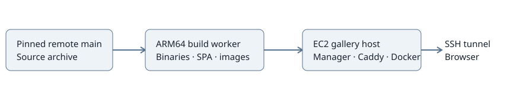

# ARM64 gallery deployment

Deploy the SPA and Activity Lab from remote main. The initial build used
`e056fc114302a9c2f77711166bad0aabd183b67c`; the final refresh includes remote main
`bcbcea22f29d475b864c549be3009b630332a5e1`. Build on the existing ARM worker;
ship prebuilt artifacts to the small EC2 host over SSH. Connection details and
credentials stay outside Git. No GitHub deploy key or registry is required.

## M1 — Prepare release

**Work items**

- [x] Acquire a worktree lease and base it on fetched remote main.
- [x] Build release manager and Activity Lab with locked Rust dependencies.
- [x] Build gallery and Activity Lab frontends with lockfile installs.
- [x] Package ARM64 Activity Lab, Dora and Caddy images, runtime tree and checksums.

**Validation**

- [x] Record source revision, build results and image architectures/digests.
- [x] Verify checksum manifest and runtime files before transfer.

Evidence:

- ARM worker: Docker 29.9.2, Node 22.23.4, npm 10.9.9, Cargo 1.99.1.
- Job 548: release manager/Activity Lab build passed; 36 gallery library tests passed.
- Job 550: both frontend builds and 6 Activity Lab frontend tests passed.
- Job 551: complete release from `b6fc4ce8248621f52ed845bee067eccad79ba96e`;
  92 MiB compressed, all images ARM64, pinned Dora CLI 1.1.0.
- Existing worker caches and the paused default queue were preserved.

The latest-main SPA needed `console/` in its document filter for `console-native`.
The gallery build requires Git metadata. Every hosted run needs the shared Dora
image; the Caddy unit needs `NET_BIND_SERVICE` for its executable's file capability.
Rust source is unchanged from the tested base; deployment commits change the
catalog generator, units and documentation.

| Artifact | SHA256 |
|---|---|
| Release archive | `7d7e71f27c1352a94be6482860601f2b58551dbb5fcd227c04be58bba4fc9601` |
| Activity Lab image | `49acb20b74159e5fe0314c70a56822a5c706a4bbea393b56f0c1c507c7c85acd` |
| Dora image | `87e9524b10012f8ff2a9a06d1af4f7a7bd197757b0b018239fd015bf44e4a8f4` |
| Caddy image | `36c24ad91a7ff7bc4c87fe22bfa8df3c4b18da0773d73fc12ee2c52b98c0bb7e` |

The SPA generator reported one existing broken source link in the console MVP
plan (`system_apps.rs`); documentation-link cleanup is deferred.

All images report `linux/arm64`; Dora reports `dora-cli 1.1.0`. Archive and
per-file checksums passed on the worker, transfer host and EC2 as applicable.

## M2 — Provision and deploy

**Work items**

- [x] Install Docker/Compose and create a dedicated gallery service account.
- [x] Configure a small swap file, private persistent results and release paths.
- [x] Load prebuilt images and configure manager/Caddy systemd services.
- [x] Bind gallery access to loopback and retain SSH-only external access.

**Validation**

- [x] Verify services, image architecture, permissions and loopback listeners.
- [x] Verify deployed source revision and SPA/hosting API responses.
- [x] Record memory/disk use and service restart behavior.

Evidence: EC2 has Docker 29.1.3, Compose 2.40.3, a dedicated `gallery` account,
mode-0700 results storage and a mode-0600 1 GiB swap file. No application
environment configuration inputs were added. Both systemd units passed
`systemd-analyze verify`; both are enabled and active. The SPA and hosting API
respond through the SSH tunnel; only Activity Lab is enabled. Listener inspection
confirmed gallery and Dora endpoints on loopback. Public TCP connection checks
for ports 8095 and 8096 were unreachable. With Activity Lab active,
`free` reported about 503 MiB available; container memory was about 21 MiB for
Activity Lab, 11 MiB combined for Dora, and 23 MiB for Caddy. The manager service
peaked at about 49 MiB during startup. These are observations, not capacity bounds.
A host reboot verified automatic Docker/manager/Caddy startup and the active
1 GiB swap file; the hosting API returned Activity Lab without manual startup.
The first finalized recording remained downloadable after reboot.

## M3 — Exercise hosted app

**Work items**

- [x] Launch Activity Lab through the gallery and exercise its routed API.
- [x] Verify shared viewers, heartbeat, expiry and recording publication.
- [x] Verify a second generation and restart recovery.
- [x] Document operator access, update and rollback commands.

**Validation**

- [x] Record HTTP, stream and MCAP results.
- [ ] Browser visual verification (deferred: no browser available).
- [x] Check public changes for connection details and credential material.
- [x] Record focused checks and deferred broader/other-app qualification.

Live checks passed SPA delivery, catalog registration, mutation-origin rejection,
two independent viewer leases sharing one generation, routed pause/resume controls
and binary WebSocket traffic. With the deployed 120-second timeout, the first
viewer expired while the second kept the app ready. Expiring the final viewer
stopped the app and published a 1,786,970-byte MCAP with valid boundary markers.
The gallery's publication path validates recording integrity before serving it.
A second generation became ready while the first recording remained downloadable.
Graceful manager restart finalized that generation and removed its containers.
An injected manager SIGKILL triggered automatic systemd restart; the next launch
removed all three old app/Dora containers and created three fresh containers.
A final graceful restart published the last recording and left the app idle.
The root disk had about 24 GiB free and idle available memory was about 518 MiB.

Public-file checks passed known private-detail/credential patterns, documentation
links, SVG XML parsing and `git diff --check`. No credentials or live connection
details are included in this change.

Operator commands are in the [EC2 guide](../deploy/ec2/README.md). Browser
visual verification is deferred because no browser is available in this session.

Cloud Node checks passed on ARM64 and x86_64 for the runtime release commit;
full Rust cloud CI and Cursor review are pending. Full local workspace CI was
deferred for this focused deployment change. Other demos, GPU execution,
Kubernetes, load qualification and automatic recording retention are deferred.
The ARM worker build/tests and EC2 runtime checks above are separate evidence.

Activation preserves `/opt/doramcap-gallery/workspace` across release changes
so repository-scoped admission and recovery retain the same identity.
