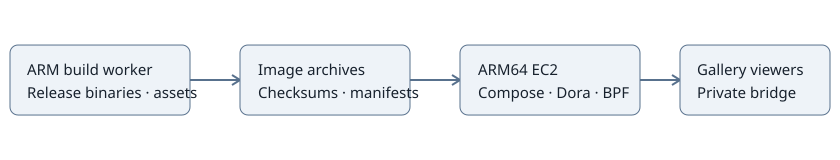

# EC2 CPU app qualification

Extend the existing private ARM64 gallery beyond Activity Lab. Start from remote
main `79d86d56044943f8ca1e9129ffd8d90e668daa20`, build on the ARM worker, and
qualify each app on the 1 GiB EC2 host. Live addresses and credentials stay
outside Git. Keep CUDA disabled; Orchestrator Lab needs its separate host worker.

## M1 — Build CPU app images

**Work items**

- [x] Acquire a lease based on current remote main and inspect wrappers.
- [ ] Separate Fault Watchdog's host dashboard port from Fault Demo.
- [ ] Build native Storage, Dataflow, Fault, Monitor, Recorder and CPU Viewer inputs.
- [ ] Build frontends and package images, deployment files and checksums.

**Validation**

- [ ] Record the exact source revision and ARM build job results.
- [ ] Verify image architecture, checksum manifest and focused frontend tests.

Evidence: ARM worker has Docker, Node/npm, Cargo and Dora 1.1.0. Its default
queue is paused with no running jobs and about 4.5 GiB disk free. Existing caches
are preserved. Fault Demo and Fault Watchdog initially both select port 8088.

## M2 — Qualify portable CPU apps

**Work items**

- [ ] Install images and runtime files while preserving the stable host workspace.
- [ ] Enable Storage, Dataflow Tracing, Fault Demo and Fault Watchdog.
- [ ] Preserve the private bridge origin and proxy configuration.

**Validation**

- [ ] Launch each app, verify readiness and routed APIs/streams or controls.
- [ ] Verify shared sessions, final artifacts and cleanup after session expiry.
- [ ] Check independent generations, selected concurrency and available memory.

Activity Lab is working and may have a live viewer; let the build run before the
required manager restart. The host has about 496 MiB available and 24 GiB disk free.

## M3 — Qualify native monitoring

**Work items**

- [ ] Check EC2 kernel BTF, cgroups and BPF capabilities.
- [ ] Qualify System Monitor, MCAP Recorder and CPU Viewer individually.
- [ ] Keep unsupported apps disabled and record concrete blockers.

**Validation**

- [ ] Verify real telemetry, delivery counts and finalized artifacts.
- [ ] Verify bounded memory and cleanup; distinguish ARM builds from EC2 runtime.
- [ ] Review public changes for credentials and private connection details.

Full workspace CI, GPU qualification and automatic recording retention are
outside this pass. Record focused checks and deferred coverage beside each result.
