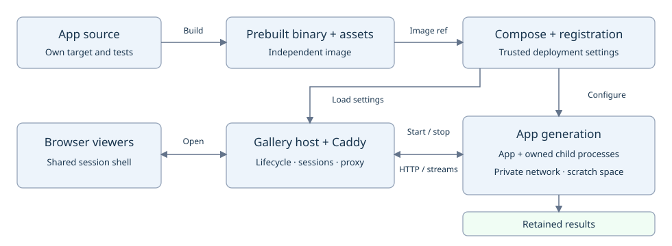

# Designing Docker-hostable apps

Keep apps independently buildable. Compose owns app processes and configuration;
the gallery owns viewer sessions, routing and result publication.



## Decide these before implementation

| Decision | Define |
| --- | --- |
| Presentation | Web or headless; interactive or finite |
| Processes | Executables, readiness and shutdown owner |
| Configuration | Bind, assets, inputs and writable paths |
| Results | Formats, optional files and finalization |
| Host needs | Architecture, devices, capabilities and conflicts |

## Runtime contract

- Accept bind address and port. A standalone default may use loopback; the wrapper
  must be able to select `0.0.0.0` inside its private container network.
- Accept explicit asset, input, configuration and result paths. Runtime behavior
  must work after moving the binary away from the checkout and changing the working
  directory. Compile-time source paths may serve as development defaults only.
- Run in the foreground. Write diagnostics to stdout/stderr; report startup and
  runtime failure with a nonzero exit and a useful error.
- Support the wrapper's numeric UID/GID, a read-only image and writable `/tmp` and
  results mounts. Avoid requiring a home directory or writing beside the executable.
- Make native/device modes explicit. Provide a synthetic mode when meaningful;
  report unavailable prerequisites before accepting work.
- An interactive hosted service stays alive until shutdown. Keep test duration
  limits explicit; do not let a launcher's default timeout end an active session.

For a web app producing MCAP, a suitable interface looks like this. Flag names are
illustrative; existing equivalent options are fine:

```sh
my-app --bind 0.0.0.0 --port 8080 \
  --assets /opt/my-app/dist --record /results/session.mcap
```

## Browser paths and readiness

Build assets with a relative base. Resolve APIs and streams against the document
base; the proxy strips the generation prefix. Test root and prefix hosting,
including reconnects, redirects, cookies and downloads.

```ts
const url = new URL('stream', document.baseURI);
url.protocol = url.protocol === 'https:' ? 'wss:' : 'ws:';
const stream = new WebSocket(url);
```

Expose a bounded, side-effect-free readiness probe that succeeds only when the
required workers and writers can accept work. Validate mutation origins against
the trusted external origin.

## Shutdown, children and results

1. Stop accepting new work and stop producers.
2. Drain consumers and output queues within a documented deadline.
3. Finalize recordings, flush results and retain diagnostic evidence.
4. Stop and reap owned child processes, then exit with the appropriate status.

Dora app migration to the shared runtime is tracked in the
[experiment plan](../../../../libs/workload-docker/docs/102926-shared-dora-experiment.md).

Own and reap application child processes. Declare Dora and nested Docker resources
in the shared workflow. Set
stop deadlines long enough to drain. Write results to the supplied generation
directory; keep scratch data disposable and operational logs private.

## Image and wrapper example

Stage the prebuilt binary, frontend and runtime files; prepare the image before
launch. The [Activity Lab wrapper](../../../activity-demo/deploy/README.md) provides a
working build and Compose example. Add a `registration.pbtxt` beside the wrapper;
see the [protobuf schema](../proto/registration.proto) for supported fields. Restart the manager to
load it; a supported registration does not require rebuilding the manager.

## Current gallery limits and special requirements

| Area | Guidance |
| --- | --- |
| Results | Declare optional primary files and bounded collections; finalized indexes are frozen. |
| Headless | Set `headless: true` and omit `port`. |
| Paths | Nested collections require Linux `openat2`; symlinks and traversal are rejected. |
| Finite jobs | Supervision expects a service to remain ready; one-shot completion needs additional support. |
| Native resources | Declare device, capability and namespace needs; keep hardware profiles opt-in. Experiments in the same repository are exclusive. |
| Console | Host web/worker processes; run inner experiments through the shared workflow. |

## Checklist before enabling an app

- [ ] Build and run the app independently, including from a relocated installation.
  Confirm the manager's dependency tree has no app binary dependency.
- [ ] Validate Compose configuration and registration; launch as the supplied
  numeric UID/GID with the intended read-only filesystem and capability set.
- [ ] Prove data readiness, startup failure reporting and runtime failure handling.
- [ ] Verify operational logs and partial failure evidence remain private, including
  through the app's own APIs and artifact routes.
- [ ] Open two viewers, refresh and reconnect; test root and `/gallery` hosting,
  streams, controls, assets and downloads on desktop/mobile.
- [ ] Expire one session while the other stays active, then expire both. Stop
  during startup and active work; verify bounded drain and readable finalized output.
- [ ] Run two sequential generations; retain the first result and verify removal
  of owned containers, networks, children and device resources.
- [ ] Exercise pre-run reset and compatible/conflicting app combinations. Preserve
  outputs and retained volumes; cleanup failures block preparation.
- [ ] Run required Rust and ARM64 CI checks; run Dora, Docker and hardware-specific
  checks separately. Use lightweight gallery build/schema/visual verification.
- [ ] Record commands, host capabilities, output paths and results in the app's
  plan. Document launch settings, readiness, stop budget and result formats beside
  the app; link its wrapper from a minimal README.

[Hosting operations](hosting.md) · [Remaining-app roadmap](102727-remaining-apps.md)
