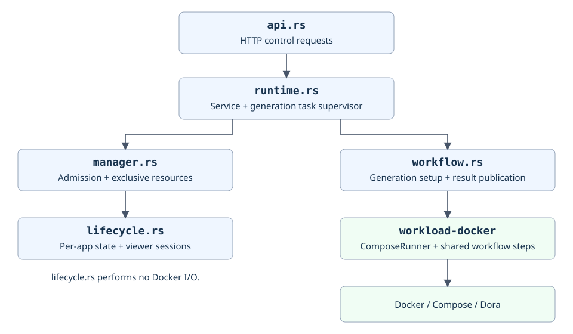

# Server structure

HTTP handlers use `Service` in `runtime.rs`. It coordinates admission through
`Manager` and owns generation tasks independently of request lifetimes. Each app's
`AppLifecycle` tracks its state and viewer sessions. Accepted starts invoke the
gallery workflow, which delegates container lifecycle operations to `ComposeRunner`.

| Module | Responsibility |
| --- | --- |
| [main.rs](../src/main.rs) | Startup, dependency wiring, periodic expiry and process shutdown |
| [registry.rs](../src/registry.rs) | Load and validate trusted protobuf registrations |
| [api.rs](../src/api.rs), [viewer.html](../src/viewer.html) | HTTP endpoints, proxy authorization, downloads and viewer shell |
| [runtime.rs](../src/runtime.rs) | Own generation tasks, dispatch start/stop and track endpoints |
| [manager.rs](../src/manager.rs) | Coordinate viewer sessions and launch admission |
| [lifecycle.rs](../src/lifecycle.rs) | Per-app states, generation identity, viewer sessions and expiry |
| [workflow.rs](../src/workflow.rs) | Set up generations, invoke shared workflows and validate/publish results |
| [artifact_fs.rs](../src/artifact_fs.rs) | Safely open and enumerate retained artifacts |
| [lease.rs](../src/lease.rs) | Hold the exclusive manager lock for the data directory |

Caddy forwards app traffic directly to the ready container after authorization.
The diagram shows hosting control requests. See the
[Docker workflow](../../../../libs/workload-docker/README.md) for container lifecycle ownership.
