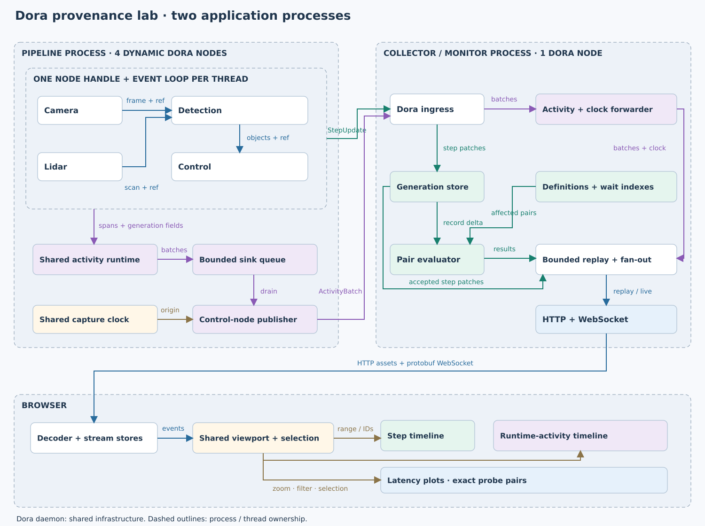
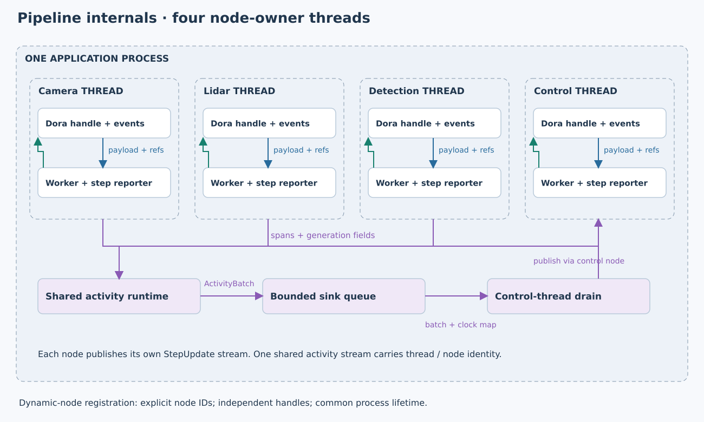

# Dora provenance lab

Created: 2026-10-20. Implementation uses the agreed two-process architecture.

## M1 — Architecture

- [x] Four dynamic Dora nodes in one pipeline process; one owner thread per handle.
- [x] Dedicated collector/monitor process owns the fifth Dora node and HTTP/WebSocket service.
- [x] Camera 20 Hz; lidar 10 Hz; detection consumes explicit camera/lidar references; control consumes detections.
- [x] Independent provenance and activity types, correlated by generation fields on spans.
- [x] One activity runtime provides an exact shared capture clock through additive `Handle::clock()`; clock descriptors carry the session origin to the browser.
- [x] Validation: approved discussion, then actual registration and traffic confirmed four node identities in one PID and a separate monitor PID.

## M2 — Reporting and collection

- [x] Application payloads carry `GenerationRef`; separate start/end patches travel over Dora.
- [x] Each owner publishes steps; the control owner drains the bounded shared activity queue.
- [x] Fixed protobuf definitions feed event-driven evaluation; retain 64 generations per stream.
- [x] Bound replay to 4,096 messages / 8 MiB; detect gaps and disconnect stalled sockets.
- [x] Reproducible normal, delayed-start, missing-report, and fresh-session runs.
- [x] Validation: 120-second normal run, 35-second delayed/loss run, and live protobuf checks passed. Live test verified 632 aligned step/activity pairs and reconnect deduplication.

## M3 — Frontend

- [x] Separate bounded stores for steps, runtime spans, and measurement results.
- [x] Side-by-side timelines and latency points share viewport, filter, zoom, pan, follow-live, and selection.
- [x] Link ancestors, tagged spans, and selected probe references; show incomplete reasons separately.
- [x] Keep identities/timestamps exact as 64-bit values; plot relative offsets.
- [x] Validation: six model tests and production build passed; live WebSocket decoding, lineage links, exact clock containment, and reconnect passed.
- [ ] Visual browser validation of synchronized interactions. CUA inventory returned no browsers; this remains unverified.

## M4 — Measurements and acceptance

| Measurement | Anchor | Start | End |
|---|---|---|---|
| camera_to_detection | Detection | Consumed camera start | Anchor end |
| camera_to_control | Control | Consumed camera start | Anchor end |
| lidar_age_at_control | Control | Consumed lidar start | Anchor end |
| detection_duration | Detection | Anchor start | Anchor end |

- [x] Load stable definitions from `configs/measurements.pbtxt`.
- [x] Validate exact timestamp subtraction, reused lidar generations, retention bounds, zero capture losses, and incomplete results after injected report loss.
- [x] Local Rust tests and strict Clippy passed for the app and both libraries.
- [x] ARM64 job 78 passed full workspace default/all-feature tests, strict Clippy, and native capability checks. Job 79 passed separate 15-second normal and 15-second delayed/loss Dora scenarios. Worker snapshot: `573e3b69e6ec432ab897a3440a262bfd`; frontend validated locally.

## Boundaries and remaining work

- Existing dependencies reused: Dora, Axum/Tokio, Prost/prost-reflect, tracing, crossbeam, React, protobufjs. SVG plots use the shared viewport directly.
- Browser replay may start mid-generation; incomplete historical ancestry stays unavailable. New accepted reports continue filling the store.
- Pipeline restarts create a new epoch. Collector restarts create a new stream ID and reset browser stores.
- HTTP binds to loopback. Dora infrastructure is shared; the launcher stops only its own flow.
- Both architecture SVGs are saved here, rendered with librsvg/Cairo, and visually inspected.
- Temporary measurements, min/max aggregation, and multi-host clock synchronization remain future work.

## Pause retention fix

- [x] Preserve a separate bounded snapshot for all three panels when pausing, zooming, or panning; resume releases it and displays live history.
- [x] Regression test verifies paused steps, spans, and latency samples survive new patches, sample-cap eviction, time-window eviction, and collector restart. All six frontend tests and production build pass.
