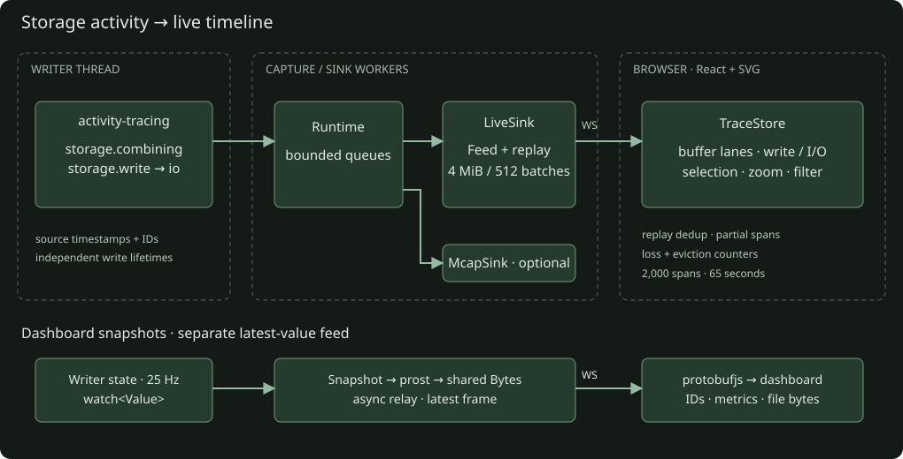

## Milestones

- [x] Default activity capture → bounded LiveSink → Protobuf WebSocket.
- [x] React timeline: buffer-type lanes with stacked instances, child I/O, combining links, filtering and zoom.
- [x] Optional MCAP sink; existing writer controls and observer dashboard retained.
- [x] Reconnect deduplication, partial history, loss and eviction counters.

- [x] Typed Protobuf dashboard snapshots: shared encoding worker and latest-value WebSocket.

## Validation

- [x] Library writer defaults: live trace verifies one I/O operation for a 4 MiB managed message and one for a sealed slab; full demo validation passes.

- [x] Frontend build and twelve model/protocol/zoom tests (lane packing and lost-END/CQE handling included).
- [x] Live HTTP/WebSocket test: combined/large/slab completion, child I/O, links and reconnect replay.
- [x] Rust default/no-default feature checks, six unit tests, all-feature Clippy and existing dashboard tests.
- [x] Optional MCAP capture: 20 closed spans across four paths; zero recorded loss.
- [x] Shutdown with live WebSocket clients exits cleanly.
- [ ] ARM64 worker validation: submission failed; SSH to `100.64.0.20` timed out.
- [ ] Browser visual review: no browser surface available in this session.

Replay retains at most 512 batches / 4 MiB. Each viewer has a 256-batch broadcast
backlog and a two-second send timeout. Sink delivery runs off the writer thread.
The activity view collects independently of the observer's Collection selector.
Mapped writes use the same feed; the demo workload currently exercises managed
buffers and sealed slabs.

Missing END records use an observed CQE, or the parent close as an explicit upper
bound. Other incomplete spans stop at their last observation and show Unknown.
Producer-record loss and batch sequence gaps are separate counters; a zero
producer count does not rule out sink-queue drops.

Snapshot validation compares every field against the sealed JSON diagnostic state,
including optional measurements, exact IDs and file bytes. Sample: 3,368 bytes
Protobuf versus 15,679 bytes JSON (79% smaller). Controls remain JSON.
