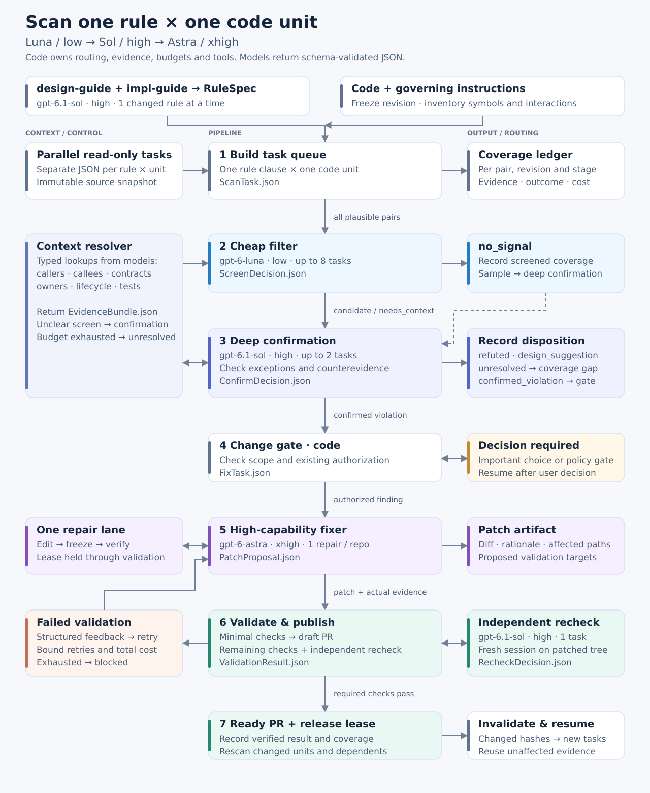

# Code-scan pilot

Review one rule clause against one code unit through schema-constrained model calls.



The [execution policy](workflow-execution.json) proposes Luna/low screening,
Sol/high confirmation, and Astra/xhigh fixes. The [design](workflow-design.json)
and [contracts](workflow-contracts.schema.json) describe the complete pipeline.

The executable pilot only screens I-05 polling patterns in Rust modules. Each
Codex invocation receives one module and the rule as JSON, runs read-only with
tools disabled, and returns [ScreenDecision](screen.schema.json) through the native
`--output-schema` flag. `--output-last-message` saves the response; `--json`
captures CLI events and usage. No findings
are automatically confirmed or fixed.

```sh
node cd/code-scan/pilot.ts prepare RUN_NAME
node cd/code-scan/pilot.ts run RUN_NAME 8
```

Requires Node 22.18+ and an authenticated `codex` CLI. No added packages or
environment variables. Run names identify immutable inputs; use a new name for a
new source revision. Completed task files are retained when a run resumes.

- [Pilot results](runs/20261108-i05/results.md), [machine-readable summary](runs/20261108-i05/summary.json), and [inventory](runs/20261108-i05/manifest.json).
- Source inputs and CLI event logs remain in ignored `inputs/` and `raw/` folders.
- Result files retain requested model/effort, usage, duration, disposition and exact evidence.
- The CLI does not report the served model identity in these events; that field stays unknown.
- Literal timer/wait matching selects the pilot. Unselected files and other languages remain unreviewed.
- A `no_signal` result is screening evidence; it does not establish compliance.

Validation: syntax and schemas passed; all 20 CLI responses match the native
output schema. Exact citations were accepted for 19 responses; one was rejected.
No production code changed. Full CI and ARM64 runs were not required for this pilot.
