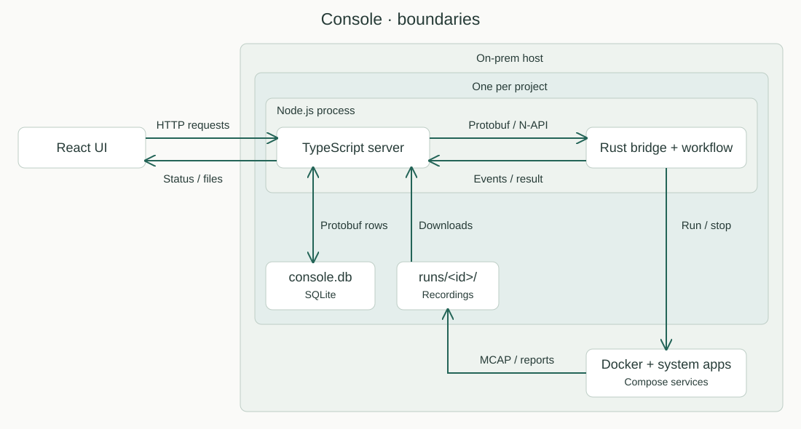

# Console

[Watch the 30 second walkthrough](https://github.com/Cutuy/doramcap/releases/download/console-walkthrough-2026-11-04/console-walkthrough.mp4). [Download a release](https://github.com/Cutuy/doramcap/releases/latest). [Publish a release](docs/publishing.md). Releases ship [CPU monitoring, generic data recording and Fault Watchdog](release/console.pbtxt) as pbtxt-launched system apps.

Select a Compose project and optional system apps, inspect the resolved services,
then run the shared experiment and download its recordings. Dora coordinator and
IPC daemon are included automatically. [History](docs/110226-experiment-history.md)
keeps past runs, their recordings and a **Run again** action, and compares any two selected runs.



```sh
npm --prefix console/server ci
npm --prefix console/server run build:native
npm --prefix console/server run build
npm --prefix console/frontend ci
npm --prefix console/frontend run build
sudo node console/server/dist/main.js /absolute/console.pbtxt /absolute/console/frontend/dist
```

Build unprivileged; run Console with sudo on the local Docker host. The workflow
checks Docker's mount namespace and uses `CAP_SYS_ADMIN` for OverlayFS isolation;
Docker socket access alone is insufficient.

Use the Node.js version in [.node-version](../.node-version). Build the
native addon on the target platform. Configure
host paths and app inputs in [console.pbtxt.example](console.pbtxt.example) and
[configuration](docs/configuration.md). Open the access link printed at startup; it signs the browser in automatically.
Console binds to loopback, starting at port 43187 and retrying occupied ports.
Use `--port PORT` for an exact server port; follow the
[Tailscale hosting instructions](docs/hosting-over-tailscale.md) for a direct remote URL with embedded access.

[HTTP contract](contract/transport.ts) · [Backend](server/README.md) · [Live bridge](bridge/README.md) · [Recovery](docs/recovery.md) ·
[System app specification](docs/103026-system-apps-plan.md) · [Open source comparison](docs/111126-open-source-comparison.md)
