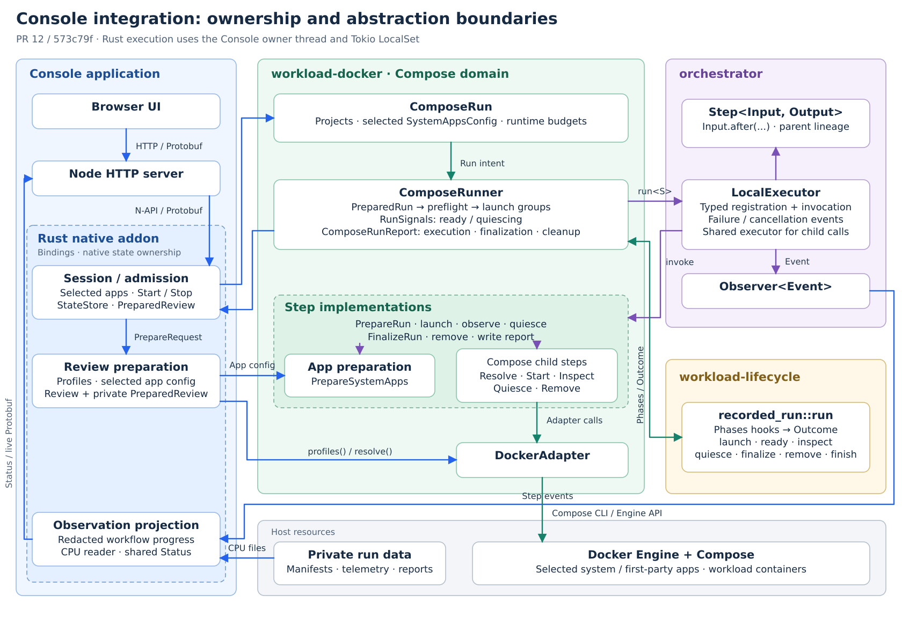

# Console

Run one local Compose project with optional CPU recording and inspect its current result.



The server requires a local Docker socket, prebuilt local workload images, and the capabilities required by the existing recorded Compose workflow.
Choose configured system apps with checkboxes on Review. CPU recording defaults
to enabled when configured; deselecting it runs only the project.
The configured Docker socket must be directly accessible to the server user.
When configured, the monitor image must run the system-monitor binary as its entrypoint.

Copy `console.pbtxt.example`, set the absolute paths, public browser Origin and
optional CPU-monitor image, and create the secret file with mode `0600`. Start the package
with Node 22.12 or later:

```sh
node server/dist/main.js /path/to/console.pbtxt ./frontend
```

Sign in as `console` with the secret file's contents. For remote access, use an SSH tunnel or TLS-terminating proxy; Basic authentication alone does not encrypt credentials. The selected project must
be beneath the configured project root. Source files are trusted host inputs.
If cleanup is unverified, follow the [host recovery procedure](docs/recovery.md) before starting another run.

Readiness/stop deadlines and the sampling/publication interval are configurable in
`runtime` in [console.pbtxt.example](console.pbtxt.example). Omitted values preserve
the 60 s / 15 s / 100 ms defaults. Stop grace is 1–300 s; readiness and sampling
values must be positive. Queue, retention and byte
budgets are named constants in [policy.rs](server/native/src/policy.rs).
