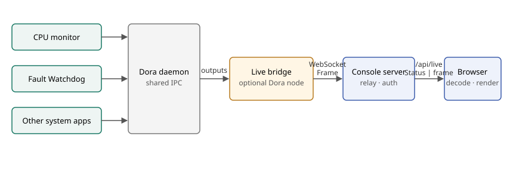

# Live bridge

Optional Console system app. A Dora node that relays every input to one loopback
WebSocket as [`Frame`](../proto/live.proto) messages; Console forwards them to browsers.



```sh
cargo build --release --locked -p console-live-bridge
stage=$(mktemp -d)
cp target/release/live-bridge "$stage/"
docker build -t doramcap/live-bridge:local -f console/bridge/Dockerfile "$stage"
rm -r "$stage"
```

Packaged in [system-apps/live-bridge](../release/system-apps/live-bridge/compose.yaml). Console generates the node's
inputs and complete `BridgeConfig` pbtxt from the selected apps' `live_outputs`; see [configuration](../docs/configuration.md) and the [plan](../docs/110126-live-bridge.md).
