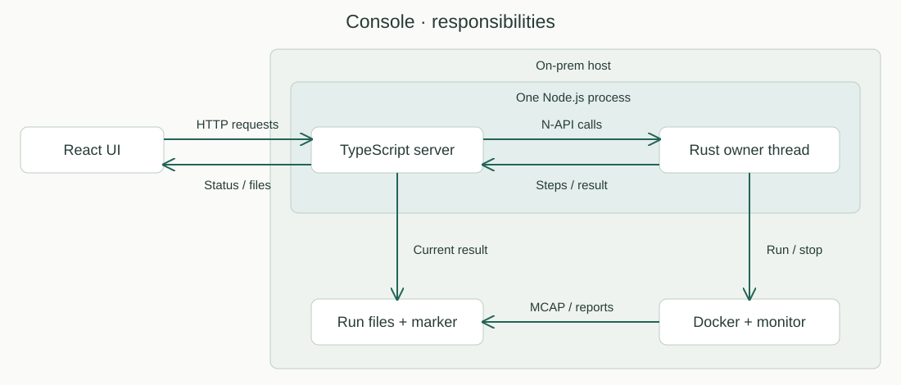
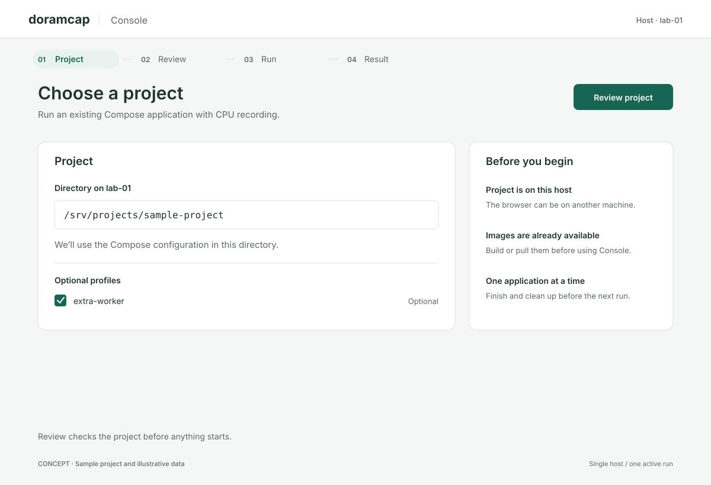
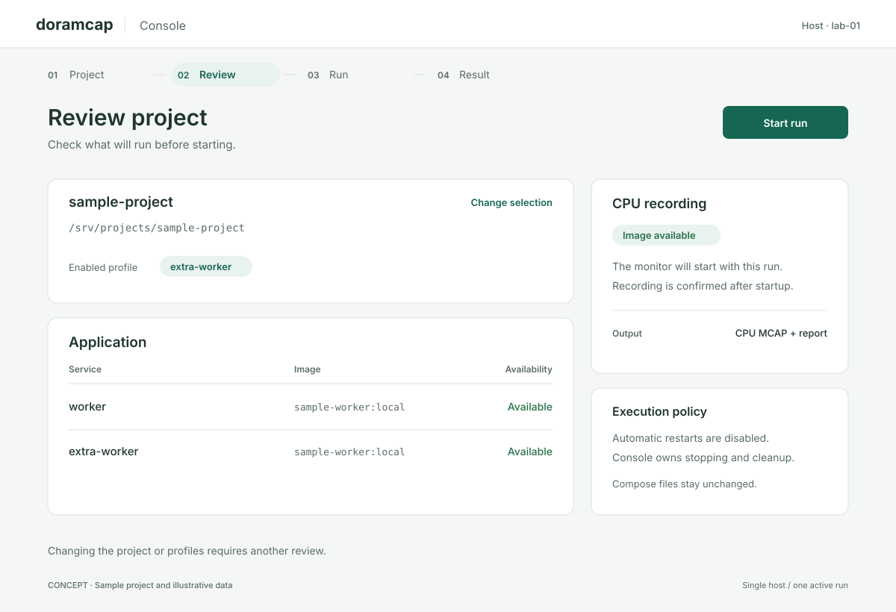
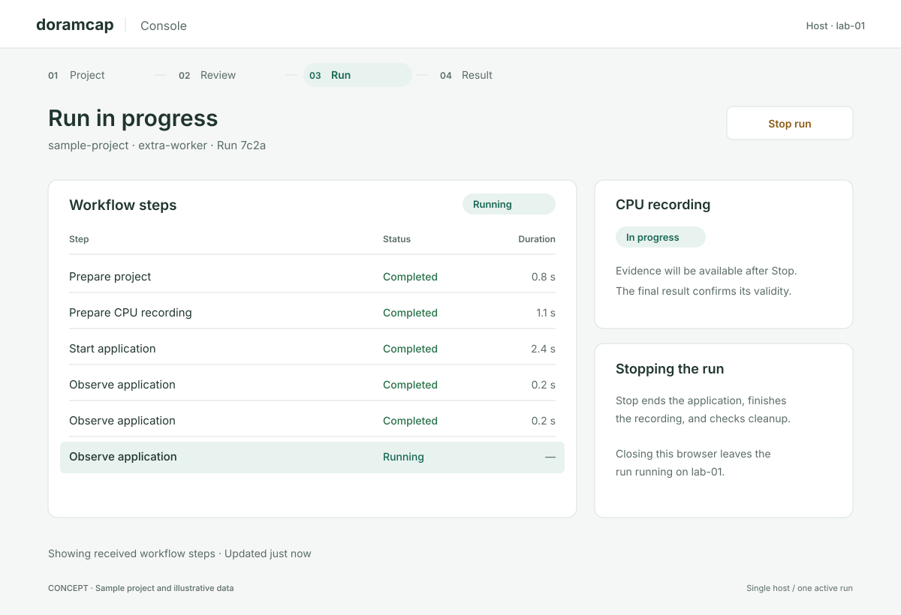
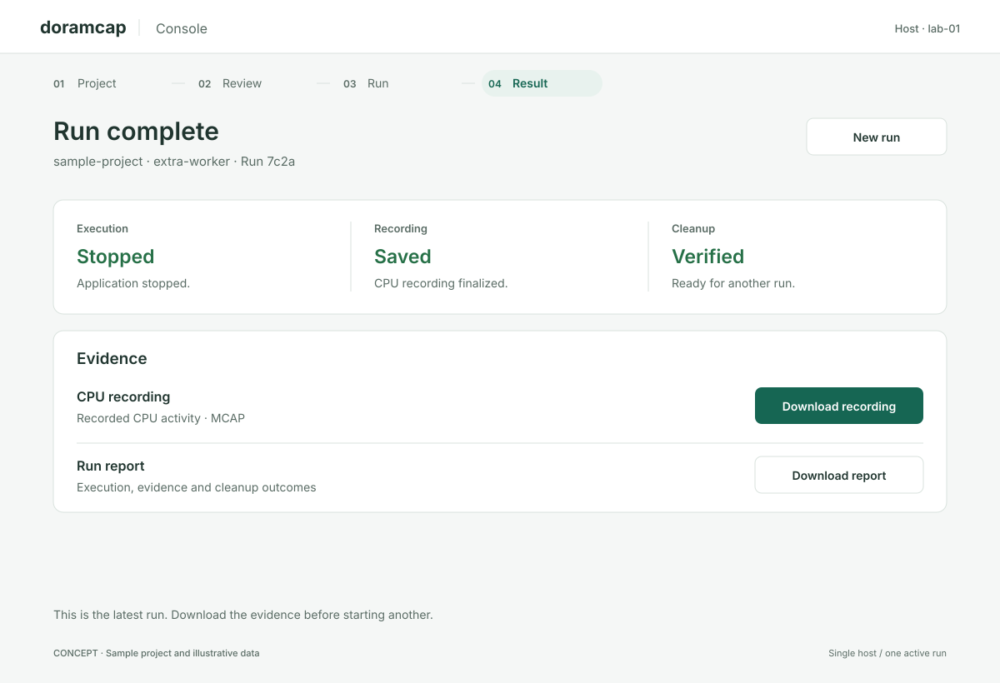
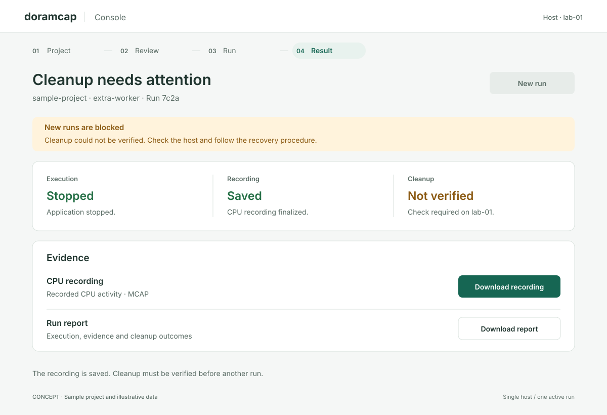
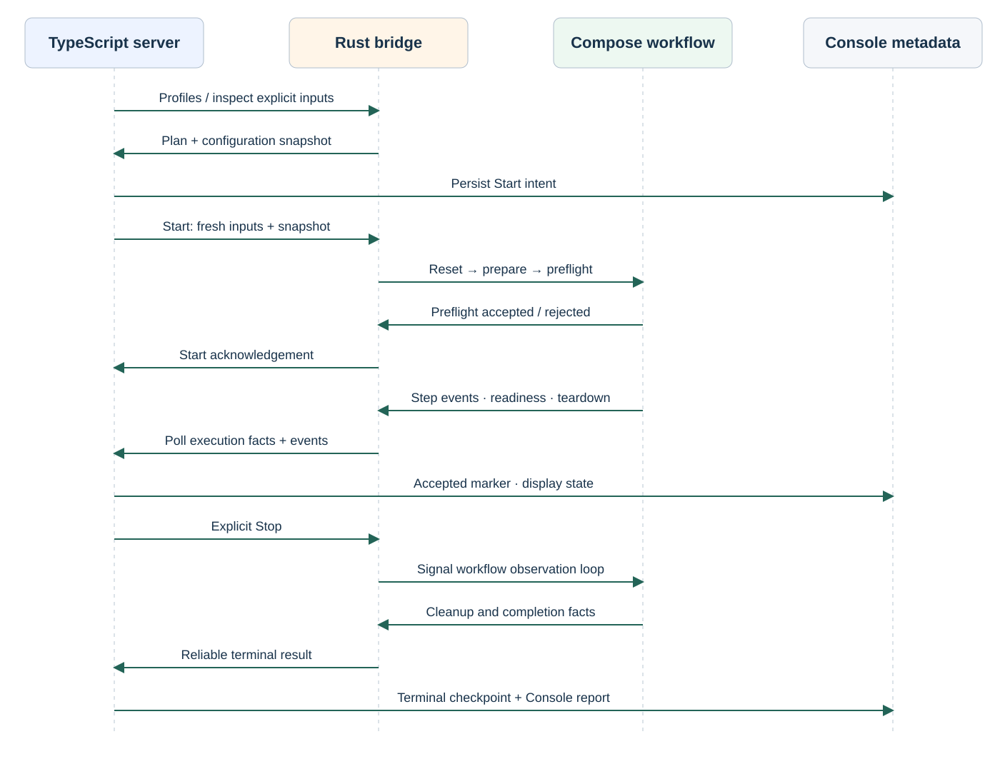

# Console MVP — engineering plan

Created: 2026-10-29. Status: implementation pending. Paths marked **new** below
are planned deliverables. Existing symbols and gaps were checked against PR #10's
Rust source; unchecked boxes describe work still to do.

One page: **project directory + optional profiles → Review → Start → workflow
steps → Stop → current result/downloads**. One user, one Linux host, one run.
Use local prebuilt images and the existing CPU monitor. First qualification uses
a small Compose fixture; vEDGAR `singlepc` follows separately.

Defer custom file/env pickers, individual service selection, history browsing,
event replay, charts, workflow editing, builds/pulls and automatic crash recovery.
Keep the existing filesystem policy and capture limitations; no new isolation or
provenance subsystem belongs to this plan.

## UI language and concept renderings

These are implementation references for the same page at different moments.
Names, durations and run IDs are illustrative. The phase rail shows location in
that flow; it is not navigation between independent screens. Initial delivery uses
this light theme. Shared components and tokens own the appearance of every state.

### Shared rules

| Element | Rule |
|---|---|
| Page | Quiet background `#F5F7F6`; white surfaces; border `#D9E2DD`. Center the content with 64 px side margins at 1200 px. |
| Text | Primary `#20352F`, secondary `#596B64`. System sans; 30 px page title, 19 px section title, 15 px body, 12–14 px labels. Monospace only for paths/identifiers. |
| Spacing | 4 px base; use 8/16/24/32 px spacing, 12 px panel corners and 8 px control corners. Inputs/buttons are at least 44 px tall. |
| Actions | Teal `#166653` with white text for the primary action. Secondary actions are outlined. Stop uses an amber label and remains visually separate from a failure. |
| States | Active teal; completed `#267047`; attention `#8B5A13` on `#FFF3DC`; failed `#A33636` on `#FBECEC`; unknown neutral. Always include a text label. |
| Layout | Main content takes about two thirds of the width; context takes one third. At widths below 900 px, stack context beneath the main content and wrap long paths/step labels. |
| Accessibility | Visible labels, semantic controls and tables, 2 px focus outline with 2 px offset, logical keyboard order and minimum 4.5:1 contrast for normal text. Announce lifecycle changes politely; do not announce every poll. |
| Motion | No completion percentage or invented future steps. Running is a labeled state; any optional motion respects reduced-motion preferences. |

Use the same vocabulary everywhere: **Project, Review, Run, Result** for page
phases; **Review project, Start run, Stop run, New run** for actions. Workflow
states are **Running, Completed, Failed, Cancelled, Panicked**. Results always
separate **Execution, Recording, Cleanup**; an unavailable outcome is **Unknown**.
Friendly labels such as “Prepare project” map to known emitted step identities;
retain the full emitted identity in accessible row details. Unknown steps use
their emitted names. Repeated invocations remain separate rows.

### Project and review

The project concept shows profiles after discovery. Before the first review, hide
that control; when no profiles exist, omit it. Changing the directory/profile
invalidates the review. Missing prerequisites use an inline explanation and disable
Start. Review shows the resolved application with read-only service rows.

### Run

Keep the project/run identity visible. Show received workflow steps and completed
durations, including repeated observations. The sample rows are illustrative;
implementation displays actual emitted invocations. CPU recording becomes “In
progress” only after monitor readiness. A lost connection says “Connection lost;
run may still be active” and retains the last snapshot with its age.

Stop changes the heading to “Stopping run”, disables repeated clicks with the
label “Stopping…”, and continues polling through finalization and cleanup. A
telemetry gap adds “Progress incomplete”; history eviction says “Older steps
hidden”. Neither message changes the authoritative run outcome.

### Result and blocked cleanup

Downloads are the primary result action. New run is secondary and is enabled only
after verified cleanup. The blocked concept deliberately preserves the saved
recording: recording validity and cleanup are independent. Missing artifacts show
an unavailable label with a reason. Do not imply recovery through a Retry button.
After process loss, show “Interrupted” and mark unverified outcomes Unknown.

## Existing code and required changes

| Existing code | Reuse / engineering gap |
|---|---|
| [ComposeProject](../../libs/workload-docker/src/compose/model.rs) | Requires explicit `files`; discovery must populate them. Empty `services` selects the enabled application. |
| [DockerAdapter::resolve](../../libs/workload-docker/src/compose/adapter.rs) | Resolves/pins images and writes a private manifest with `sha256`. Automatically loading `.env` is disabled. |
| [Compose command helper](../../libs/workload-docker/src/compose/command.rs) | Reuse its socket, clean environment, argument handling, output limits and timeouts for profile discovery. |
| [ComposeRunner::run_with_ready](../../libs/workload-docker/src/workflows/recorded_compose/mod.rs) | Calls `PrepareRun` internally, then mounts/launches. Add a review check immediately between those operations. |
| [TelemetryObserver](../../libs/orchestrator/src/telemetry.rs) / [workflow-protocol](../../libs/telemetry/workflow-protocol/proto/workflow.proto) | Existing step events and codec; Console supplies transport and a bounded reducer. Observation repeats every 500 ms. |
| [ComposeRunReport](../../libs/workload-docker/src/workflows/recorded_compose/mod.rs) / [system apps](../../libs/workload-docker/src/workflows/recorded_compose/preparation/model.rs) | Already produce outcome fields, `report.json` and `cpu.mcap`; no new recorder. |

## Deliverables and dependency order

| Milestone | Code delivered | Depends on |
|---|---|---|
| M1 | Addon loads; generated contracts; one Rust owner thread | — |
| M2 | Directory/profile preparation and a review guard before launch | M1 |
| M3 | Start/Stop, bounded workflow progress and durable admission | M2 |
| M4 | One-page HTTP/UI flow and current-result downloads | M3 |
| M5 | Packaged launch and real Docker acceptance harness | M4 |

Implement each milestone as a reviewable change with its tests. Record commands,
revision and observed results beside its validation items before checking them.

## M1 — Establish the native owner and contracts

**Work items**

- [ ] Create **`console/server/native/`**, Cargo package `console-native` (`cdylib`
  plus `rlib` for tests), and add it to workspace/boundary rules. New modules:
  `lib.rs` (bindings), `runtime.rs` (owner loop), `config.rs` (pbtxt loading).
- [ ] Evaluate [napi-rs](https://napi.rs/) against [Neon](https://neon-rs.dev/)
  for Promise completion, owned buffers and Linux packaging; present the decision
  before adding crates. Prefer napi-rs. Reuse existing Tokio, prost, prost-reflect,
  sha2 and rustix; use Node's HTTP/filesystem modules and the existing React/Vite/
  protobufjs toolchain. Pin additions after evaluation; no binding is adopted here.
- [ ] Add **`console/proto/console.proto`** and generate Rust/TypeScript codecs.
  Define `ConsoleConfig`, prepare/start requests, review, status, error and marker
  records. Import the existing system-app and workflow event schemas; configure
  prost external type mappings to reuse their generated Rust types. Protobuf
  uint64 values remain decimal strings/Long in TypeScript, including IDs and time.
- [ ] `ConsoleConfig` fields: listen address, approved project root, data root,
  Docker socket, access-secret file and `SystemAppsConfig`. Require a CPU monitor;
  reject configured Dora flows for this first slice. Parse pbtxt using the existing
  prost-reflect pattern in [registry.rs](../../apps/project-explorer/server/src/registry.rs).
  Use generated configuration types directly.
- [ ] Implement addon `open(configPath)` returning a Promise of a Console handle.
  Spawn one Rust thread with a current-thread Tokio runtime and LocalSet; construct
  `Rc<DockerAdapter>` and `ComposeRunner` there. A bounded command mailbox (32)
  carries owned requests with one-shot replies. Full mailbox returns Busy; no
  JavaScript values or `Rc` objects cross threads.
- [ ] Expose async `prepare`, `start`, `status`, `stop`, `completed` and `close`
  methods. Encode records as owned protobuf buffers across N-API. Include a
  contract version in initialization and reject a server/addon mismatch before
  listening. Add server package scripts for codec generation, native build, TypeScript
  build and Node test runner; check in its lockfile. `close` signals the owner and
  awaits its exit; finalizers do not stop runs.

**Validation**

- [ ] **`native/tests/runtime.rs`**: injected adapter factory records construction,
  command and destruction thread IDs; all equal the owner and differ from caller.
  Fill the mailbox and assert Busy without blocking the caller.
- [ ] **`server/tests/addon.test.ts`**: import the built addon, open/close twice,
  reject a version mismatch, and round-trip an invocation ID greater than `2^53`.
  Use Arrange/Act/Assert sections in Rust and TypeScript test cases.
- [ ] Run a delayed native test operation while an HTTP heartbeat serves every
  100 ms; assert a response within 1 s throughout the delay. Build/test commands:
  `cargo test --profile ci --locked -p console-native` and `npm test` in `console/server`.

## M2 — Resolve the default project and guard the reviewed launch

**Work items**

- [ ] Add **`native/src/project.rs`**. Canonicalize the selected directory beneath
  the configured root. Discover only that directory: exactly one of `compose.yaml`,
  `compose.yml`, `docker-compose.yaml`, `docker-compose.yml`; reject absent or
  ambiguous bases. Accept at most one `compose.override.{yaml,yml}` for a compose
  base, or `docker-compose.override.{yaml,yml}` for a docker-compose base.
  These conservative rules avoid choosing among ambiguous entry points. Pass base
  then override explicitly; add `.env` to `env_files` if present. No ancestor search,
  shell-environment inheritance or custom file list. Repositories are trusted host
  inputs; the approved root restricts selection, not container filesystem authority.
- [ ] Add `DockerAdapter::profiles(&ComposeProject)` in
  **`libs/workload-docker/src/compose/adapter.rs`**. Factor shared config arguments
  out of `resolve`, retaining `/dev/null` plus explicit env files, approved socket
  and clean environment. Call `config --profiles` through the existing command
  helper. Validate selected profiles against this list; keep `services=[]`.
  Compose owns parsing, interpolation, includes and service `env_file` semantics.
- [ ] Add **`native/src/prepare.rs`**. Allocate a random run ID and private
  `data/reviews/<id>/`; resolve the workload with key `workload`. Reuse
  `PrepareSystemApps` and resolve its monitor project to check/pin its local image.
  Return run/prepared IDs, profiles, enabled service names/image IDs and policy
  warnings. Check the existing overlay namespace requirement. Report CPU monitor
  image availability; live capture readiness comes from `WaitForSystemApps` after
  Start. Never return resolved manifests or interpolation values.
- [ ] Keep one in-memory prepared record: original `ComposeProject`, run ID,
  workload manifest digest, resolved monitor image ID and fixed `ComposeRun`
  settings. Use the same run ID/project key at Start; replace the previous review
  on new preparation. Start uses new `data/runs/<id>/`, the existing default overlay
  policy, readiness 60 s and stop 15 s. Before dispatch, repeat discovery and reject
  changed file/env inventories (including newly added overrides). Delete obsolete
  private review directories after replacement/consumption; never delete run results.
- [ ] Add `ComposeRunner::run_with_preflight(spec, stop, observer, ready, check)` in
  **`recorded_compose/mod.rs`**. Factor the shared run body so existing `run` and
  `run_with_ready` retain their behavior. Invoke the one-shot check on `PreparedRun`
  after preparation and before `blocked=true`, `PrepareOverlays` or any launch.
  A rejected check returns an error with private preparation files only.
- [ ] Console's check compares the newly resolved workload digest and monitor image
  ID with the review. Run/project identity is identical; do not compare the monitor
  manifest digest because its output paths change between review/run directories.
  A mismatch returns StaleReview and invalidates Start. Execution consumes those
  just-checked frozen manifests. This checks effective configuration and image
  identity; mutable bind contents retain the runner's documented coverage limits.

**Validation**

- [ ] **`native/tests/project.rs`**: table cases for each base name, base+override,
  no file, ambiguous files, `.env`, invalid profile, outside-root and symlink escape.
  A hostile server environment must not alter the resolved project.
- [ ] **`native/tests/prepare.rs`** with real Compose: compare enabled services and
  resolved values to both default CLI discovery and the equivalent explicit invocation
  for supported unambiguous base/override combinations,
  `.env`, included service/env files and profile cases. Add a new service and assert
  discovery includes it without changing runner code.
- [ ] **`libs/workload-docker/tests/docker.rs`**: reject the preflight callback and
  assert no new owned Docker resources or overlay mounts. Existing runner tests
  remain unchanged and pass through the default no-check path.
- [ ] Add an override or `.env` after Review; Start rejects the changed input set.
  Change command/env/include contents and retag a local image after Review;
  each effective change rejects Start before launch. An unchanged review launches
  its pinned images. Run `cargo test --profile ci --locked -p workload-docker`
  plus the explicit real-Docker cases under the capability rules in M5.

## M3 — Own one run and reduce workflow telemetry

**Work items**

- [ ] Add **`native/src/session.rs`** with transitions
  `Idle → Preparing → Reviewed → Starting → Running → Stopping → Finished` and `Blocked` on
  uncertain cleanup. Allow one pending preparation; reject Prepare during a run,
  and permit Start only from Reviewed. Persist Starting before dispatch; resolve
  Start's Promise only
  after the preflight check accepts, before waiting for readiness. Resolve it with
  StaleReview on a digest mismatch. The run ID is already in the review/status so
  Stop is usable while Start awaits preparation. Keep the runner future polled on
  LocalSet while the command loop serves status and Stop. Retain the readiness
  receiver; its signal moves Starting to Running, never Stopping back to Running.
  Store a one-shot stop sender; repeated Stop succeeds. Reserve a control path for
  Stop/close outside the ordinary mailbox so admission saturation cannot starve them. Check a latched Stop in
  the preflight callback so Stop during preparation cannot lead to a later launch.
- [ ] Feed an observer wrapper into `run_with_preflight`: remove payloads and
  replace raw errors with safe error categories before forwarding to
  `TelemetryObserver`. Its sink copies encoded bytes into a 512-entry queue using
  `try_send`, with a 16 KiB event limit. Queue-full returns an error to the observer;
  the observer's loss counter remains accessible even if the last event was lost.
- [ ] Add **`native/src/progress.rs`** to decode `workflow_protocol::Event` and keep
  at most 512 invocation rows keyed by `(session, executor, invocation)`. Update
  states/durations from emitted events. Evict oldest terminal rows first; count
  history truncation separately from lost events. If all rows are active, drop new
  rows with an overflow count. Unknown event versions set progress incomplete.
- [ ] `status()` returns lifecycle, rows, sequence/loss/truncation counters and the
  final outcome. Use a short snapshot lock shared with the owner; a full event queue
  must not prevent reading status or reporting completion. Preserve terminal
  completion outside the queue. The UI displays step names and states; container
  inspection remains the runner's implementation detail.
- [ ] Add **`native/src/state.rs`**: acquire a nonblocking data-root file lock using
  existing rustix; persist `current.pb` before dispatching Start (0600 temporary
  file, sync, rename, parent sync). Marker fields: version, run ID, request key,
  phase, artifact reference and final outcome. Same-key retries share the original
  acceptance result, including while preparation is pending; a different key during
  an active/blocked run returns Conflict. A known prelaunch rejection/Stop with
  `!runner.blocked()` records no-launch, invalidates review and returns to Idle.
- [ ] On completion, require both `report.boundary_clean` and `!runner.blocked()`
  before admitting another run. A returned error or marker-write failure without
  verified cleanup enters Blocked. On startup, restore Finished or block on an
  unfinished/corrupt marker. No automatic marker clearing or unblock HTTP route.
- [ ] Implement `close`: stop admission, signal Stop, await finalization and persist
  the result, then join the owner thread off the Node event loop. After a 120 s
  process-shutdown deadline, retain the unfinished marker and exit nonzero.
  Document that forced process loss cannot guarantee cleanup; recovery follows the
  existing [isolation procedure](../../libs/workload-docker/docs/102626-docker-experiment-isolation.md).

**Validation**

- [ ] **`native/tests/progress.rs`**: scripted Started/Succeeded/Failed/Cancelled/
  Panicked events; repeated step names with different IDs; missing parent; unknown
  version; queue-full including final-event loss. Send 10,000 completed invocations;
  assert at most 512 rows, exact truncation accounting and independently readable completion.
- [ ] **`native/tests/session.rs`**: delayed preparation plus Stop produces zero
  launches; Stop while running waits for cleanup; duplicate Start launches once;
  a second key conflicts; cleanup failure keeps admission blocked.
- [ ] **`native/tests/state.rs`**: crash points before marker rename, after durable
  marker but before dispatch, and before completion persistence. Restart either
  restores a proven finished result or blocks; two owners cannot acquire one root.
- [ ] **`server/tests/addon.test.ts`**: stop polling while native events saturate the
  queue, then resume; capture/Stop still complete and loss is visible. Close during
  startup and during capture; verify the owner exits only after finalization.

## M4 — Wire the single page and bounded HTTP API

**Work items**

- [ ] Add **`frontend/src/ui/tokens.css`**, `PageFrame.tsx`, `ActionButton.tsx`,
  `StatusLabel.tsx` and `OutcomeSummary.tsx` following the concepts above. Share
  spacing, colors, type and state labels; screen components do not redefine them.
  Add the friendly step-label lookup to `RunSteps.tsx`, preserving full identities.

- [ ] Add **`server/src/main.ts`**, `http.ts`, `native.ts` and `artifacts.ts`.
  Serve built frontend assets and the routes below with Node HTTP. Use generated
  protobuf JSON mappings for HTTP and binary protobuf for the addon; keep uint64
  fields as strings. Limit request bodies to 64 KiB; whitelist request fields.
- [ ] Protect all routes/assets with HTTP Basic authentication (`console` plus the
  configured secret), using Node's timing-safe comparison. Check mutation Origin
  against the configured server origin. Return structured errors: InvalidInput 400,
  Unauthorized 401, Missing 404, StaleReview/Conflict 409, Busy 503, Internal 500.
  Keep raw native diagnostics in private host artifacts.
- [ ] Add the frontend package/lockfile with `build` and `test` scripts, plus
  **`frontend/src/App.tsx`**, `api.ts`, `RunSteps.tsx`, `Result.tsx`. First Review
  discovers profiles; changing the directory or profile checkboxes clears
  its prepared ID and requires Review again. Start stores its request key until
  accepted. During Starting/Run/Stopping poll `/api/current` every 1 s with one request in flight; refresh restores the current
  run. Render emitted states and terminal durations, plus incomplete/truncated
  progress indicators. Stop remains available during Starting and Running.
- [ ] Project `ComposeRunReport` into execution error category, `writers_stopped`,
  `recording_finalized`, `boundary_clean` and `event_stream_healthy`. Persist a
  sanitized `console-report.json`; keep the original `report.json` private.
  Render these outcomes separately. A runner error without a report shows Unknown
  for unavailable outcomes and preserves the admission block.
- [ ] Register only `cpu.mcap` and `console-report.json` from the current run.
  Reuse [evidence::root/open](../../libs/workload-docker/src/evidence.rs) in the addon
  through a new `openArtifact(runId, kind)` binding, opening beneath the trusted
  artifact root without following symlinks; transfer
  ownership of the opened fd to the Node stream and close it on finish/disconnect.
  A download cannot name a host path. Missing/incomplete CPU evidence disables that
  download; replacing the current run leaves prior files on disk without indexing.

| Route | Contract |
|---|---|
| `POST /api/prepare` | `{directory, profiles}` → prepared ID, available profiles, review; no Engine launch |
| `POST /api/start` | `{preparedId, requestKey}` → 202/run ID; stale review → 409 |
| `GET /api/current` | Current lifecycle, bounded step snapshot and optional result; Idle if none |
| `POST /api/stop` | `{runId}` → accepted/already stopped; mismatched run → 409 |
| `GET /api/artifacts/:runId/:kind` | `cpu` or `report` only; authenticated streamed download |

**Validation**

- [ ] **`server/tests/http.test.ts`**: exact route/status matrix, oversized request,
  wrong credentials, cross-origin mutation and unknown fields. Native-call spies
  prove rejected requests never invoke Start/Stop.
- [ ] **`frontend/src/model.test.ts`**: change input invalidates review; lost Start
  response retries the same key; stale polling response cannot replace a newer
  run; step failure and cleanup failure render distinct outcomes.
- [ ] **`server/tests/artifacts.test.ts`**: traversal, wrong run ID and symlink swap
  fail; disconnect closes the fd. Stream an artifact larger than the stream buffer
  and verify backpressure without reading the entire file into memory.
- [ ] Capture each concept state at 1200 px and 390 px widths. Verify shared
  action placement and state labels, keyboard/focus order, contrast, wrapping and
  no horizontal page overflow. Include Stopping, interrupted/Unknown, unavailable
  recording, progress loss and saved-recording/blocked-cleanup variants.
- [ ] Run `npm test` and `npm run build` in both Console packages. Browser-check
  Review, Starting, Run, Stopping, Finished and Blocked with deterministic native
  fixtures before the real-Docker test in M5.

## M5 — Package and qualify the complete slice

**Work items**

- [ ] Add **`console/scripts/package.mts`** to build the addon, server and frontend
  into one directory, with `console.pbtxt.example` and launch instructions.
  First package: Linux x86_64 glibc, Node 24; record the tested Compose version,
  native prerequisites and CPU-monitor image ID. No image build/pull in Console.
- [ ] Add **`console/tests/fixtures/basic/compose.yaml`**, `.env` and an optional
  override: long-running worker plus a profile-gated second worker using the
  supplied local test image. Add explicit fixture variants for early exit and
  missing image. Reuse the monitor-image/test environment from
  [docker.rs](../../libs/workload-docker/tests/docker.rs); own every run's resources.
- [ ] Add **`console/tests/acceptance.mts`**: start the packaged server, drive the
  five HTTP routes, collect step states, download evidence and terminate it.
  Record package/host versions, run IDs, report fields and MCAP verification output
  alongside this milestone. No milestone completes on screenshots alone.

**Validation**

- [ ] Successful run: review default/profile selections, Start, observe real
  PrepareRun/LaunchProjects/ObserveProjects events, Stop, observe finalization and
  removal, download MCAP/report. Reuse the existing footer/sequence checks from
  `native_recorded_workflow`; verify fresh capture session IDs across two runs.
- [ ] Failure runs: missing image fails Review; changed effective config rejects
  Start; early exit reports execution failure; failed cleanup blocks next Start.
  Kill the server during capture and assert restart is Blocked without launching
  new resources. Explicitly clean up the harness's owned resources afterward.
- [ ] Open the packaged server from a second machine and complete the same flow;
  reload during capture and after a clean restart. Verify source Compose files
  unchanged and the latest result restored. No history selector is required.
- [ ] Run all local [CI checks](../../.github/workflows/ci.yml) on final source using
  `--profile ci --locked`; report default/all-feature Clippy and workspace tests,
  no-default storage tests, builds, boundaries, formatting and snapshot tests separately.
- [ ] Run new Docker/native test executables built unprivileged; elevate only the
  executable when capabilities are required, following repository credential rules.
  Submit final source to the serial ARM64 worker and verify its result. Run the
  Console acceptance harness separately; the worker suite does not run that new harness.

Acceptance evidence: **pending for every milestone**. This PR adds the plan only.
