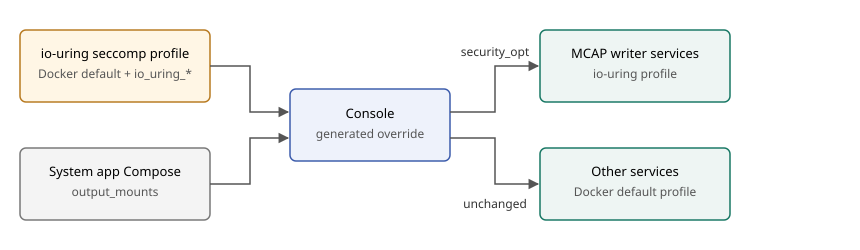

# io_uring seccomp profile (TODO)

Created: 2026-11-01. Status: planned; not started.

Most system apps will embed an MCAP writer. The writer uses io_uring, which
Docker's default seccomp profile blocks, so each MCAP deployment currently sets
`seccomp=unconfined`. That disables all syscall filtering for those containers.

Replace it with one repository-wide profile: Docker's default plus
`io_uring_setup`, `io_uring_enter` and `io_uring_register`. Console applies it to
services that write recordings; every other service keeps Docker's default.

- **Profile owner:** [storage-persistence](../../libs/storage-persistence/README.md),
  which owns the io_uring writer.
- **Selection:** services named in a system app's `output_mounts`. Apps add no
  seccomp settings.
- **Base:** the default profile of a pinned Docker release (29.9.1 on the
  development host).

## Milestone 1: Profile

**Work items**
- [ ] Vendor the pinned Docker default profile with the three io_uring syscalls allowed.
- [ ] Document the Docker release and the refresh procedure beside the file.

**Validation**
- [ ] A check confirms the profile differs from the pinned default by exactly those syscalls.
- [ ] An MCAP writer container initializes io_uring and finalizes a recording under the profile.
- [ ] A syscall outside the default allowlist, such as `unshare`, stays denied.

## Milestone 2: Console applies the profile

**Work items**
- [ ] Add `security_opt: [seccomp=<profile>]` to `output_mounts` services in the generated override.
- [ ] Ship the profile with the Console release and pass it by absolute path.
- [ ] Reject system app inputs that set `seccomp=unconfined` on those services.

**Validation**
- [ ] Server tests cover the generated option and the rejection.
- [ ] A Console run records CPU and fault MCAPs under the profile.

## Milestone 3: Migrate deployments

**Work items**
- [ ] Replace `seccomp=unconfined` in MCAP deployments: system monitor `recording.yaml`,
  `mcap-recorder`, `storage-demo`, `cpu-viewer`, the gallery watchdog `compose.mcap.yaml`
  and the standalone watchdog `compose.mcap.yaml` (#33).
- [ ] Update the `workload-docker` recording test that asserts `seccomp=unconfined`.

**Validation**
- [ ] Gallery recordings and the Docker recording test pass with the profile.
