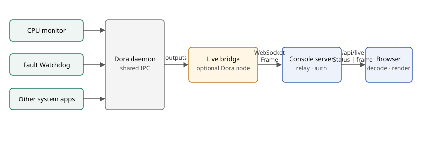

# Live bridge

Created: 2026-11-01.

System apps publish only to Dora. One optional system app, the live bridge,
subscribes to the outputs that selected apps declare and serves them to Console.
Console relays opaque frames to authorized browsers; the browser decodes each
stream with the producer's generated protobuf types.

- **Selection:** Console lists the bridge beside the Dora coordinator and daemon.
  It is optional and selected by default when `live_bridge` is configured.
  Deselecting it removes every live subscriber for the run.
- **Producers:** apps declare `live_outputs` (Dora `node/output` plus a payload kind).
  Console generates the bridge's graph node and Compose service from the selection.
- **Delivery:** bridge inputs use `drop_oldest`. Each stream keeps its
  latest frame for new clients; slow clients skip frames and observe sequence gaps.
- **Size limit:** Console passes `LIMITS.bridgePayloadBytes` from the [transport contract](../contract/transport.ts)
  to the bridge as `--max-payload-bytes`; larger payloads become sequence gaps.
- **Relay:** `/api/live` carries framed `LiveMessage { Status | frame }`. Console
  forwards bridge frames without decoding them.
- **Durable data:** MCAP recordings remain the run record. Live panels show the
  data received by the current browser session.

## Milestone 1: Bridge node

**Work items**
- [x] `console/bridge` Rust Dora node: every input becomes a stream.
- [x] `live.proto` `Frame { stream, sequence, received_unix_ns, payload }`.
- [x] Loopback WebSocket `/stream`: latest frame per stream on connect, then live frames.
- [x] Readiness file after Dora attachment and listener bind.

**Validation**
- [x] Unit tests: replay of latest frames, per-stream sequences, gaps for lagging clients.
- [x] Focused Clippy and formatting.

Evidence: `cargo test --release --locked -p console-live-bridge` 3/3; release Clippy with `-D warnings` and `cargo fmt --all --check` clean; dependency boundaries pass.

## Milestone 2: Console configuration and selection

**Work items**
- [x] `ConsoleConfig.live_bridge { image, port }`; `SystemAppDefinition.live_outputs`.
- [x] Built-in optional `live-bridge` app in review options.
- [x] Generated bridge graph fragment and Compose service for selected outputs.

**Validation**
- [x] Server tests: selection, generated graph inputs and service, invalid outputs rejected.

Evidence: `service.test.ts` bridge selection/deselection cases and `config.test.ts` live output validation pass; generated graphs expand through the native addon.

## Milestone 3: Opaque relay

**Work items**
- [x] One bridge WebSocket client per running run; fan-out to live browser streams.
- [x] `LiveMessage` framing on `/api/live`; latest frames replayed to new browsers.
- [x] Bounded per-browser buffering; drop frames when a browser falls behind.

**Validation**
- [x] Server tests: frames forwarded byte-for-byte, status still streamed, slow browsers drop frames.

Evidence: `http.test.ts` and `live.test.ts` pass; frames are written only while the response buffer holds at most one frame limit.

## Milestone 4: Browser decoding

**Work items**
- [x] Decode CPU accounting: total CPU, top consumers, capture health.
- [x] Decode fault publications: sources, active conditions, revision gaps.
- [x] Status lists the run's live streams and their kinds.

**Validation**
- [x] Frontend unit tests for decoding, merging and rendering.
- [x] Frontend type check and build.

Evidence: frontend `npm test` 37/37 including `streams.test.ts`; `npm run build` succeeds.

## Milestone 5: Remove the CPU-specific feed

**Work items**
- [x] Delete `cpu_feed_url`, `CpuFeeds` and CPU fields in `Status`/`Review`/`RunMetric`.
- [x] Update configuration docs and the system-app specification.
- [x] Supersede the headless CPU feed in PR 35.

**Validation**
- [x] Console server and frontend test suites.

Evidence: server `npm test` 35/35 (native addon rebuilt); frontend 37/37. PR 35 commit `2deaf9b` removes the feed service, its image and `--headless`.

## Milestone 6: Runtime qualification

**Work items**
- [ ] Bridge image build and Docker run with CPU monitor and Fault Watchdog selected.
- [ ] Run with the bridge deselected; confirm no bridge service or graph node.

**Validation**
- [ ] Browser shows live CPU and fault panels on a Docker/BPF host.

Deferred: this workstation lacks the Dora CLI and local doramcap images.
