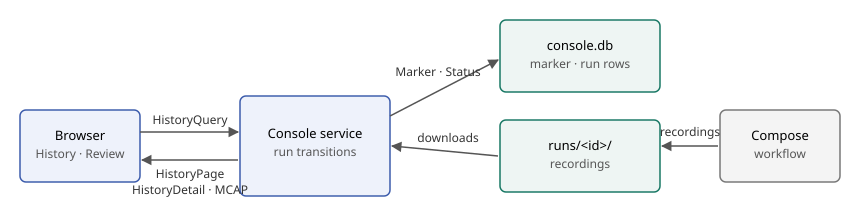
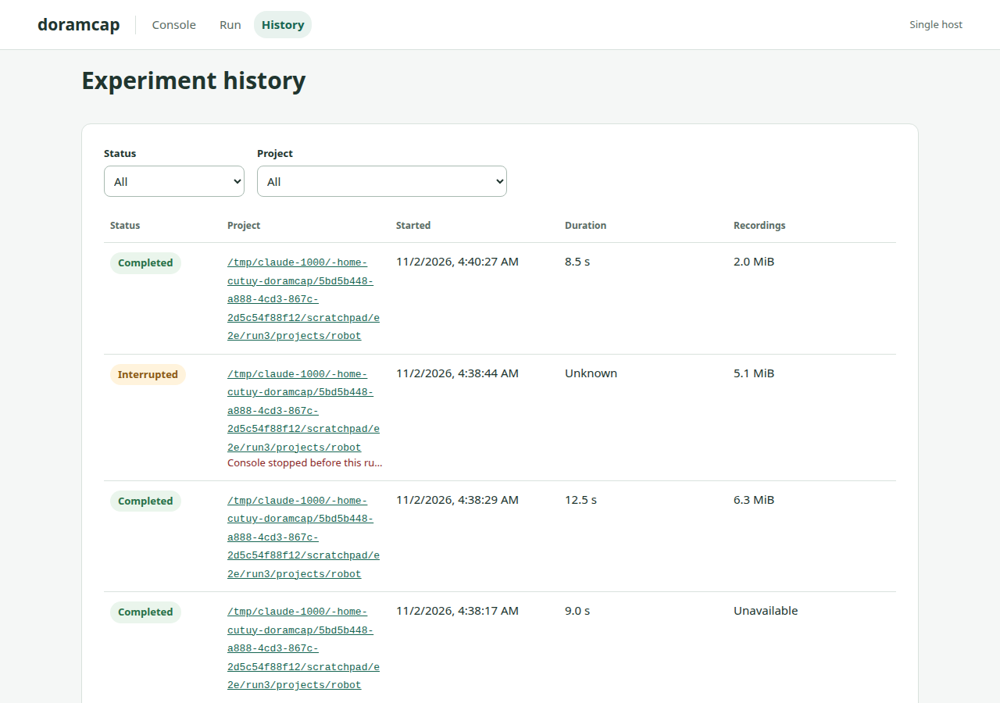
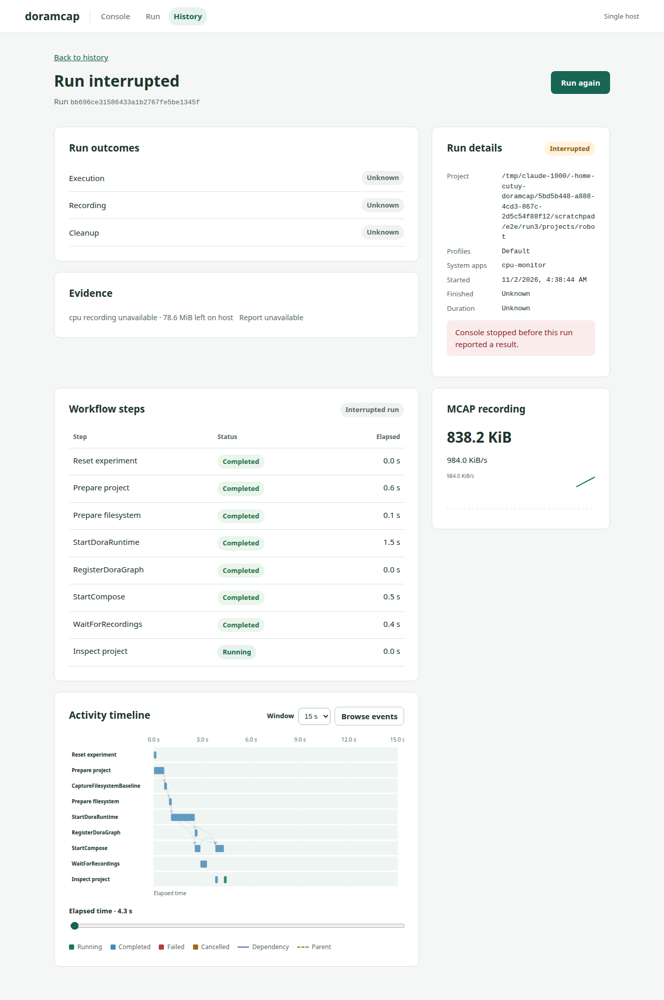

# Experiment history

Created: 2026-11-02. Status: implemented; see milestones for evidence.

History lists every Console run with its status, duration and recordings. A detail
page reuses the Result and timeline views and offers **Run again** through Review.

## Decisions

| Topic | Decision |
| --- | --- |
| Engine | `node:sqlite` `DatabaseSync` from the pinned Node 22. No new dependency. It is experimental in Node 22 and prints an `ExperimentalWarning`. `better-sqlite3` and `rusqlite` were not adopted. |
| Authority | `current.pb`, `activity.pb` and Compose ownership stay authoritative. `console.db` can be rebuilt from them. |
| Failure | No database error reaches a run. The API returns a page with `degraded` set. A corrupt file is preserved for the operator. |
| Row | Run id, project, state and start time as indexed columns; `HistoryEntry` and `Status` as protobuf blobs. |
| Writes | One upsert per phase transition, synchronously on the service loop. WAL with `synchronous=NORMAL` and a 250 ms busy timeout. |
| Interrupted | A row still open at the next open becomes **Interrupted**, with no finish time and no download, unless a checkpoint or marker reports a result. |
| Backfill times | `finished` is the `activity.pb` mtime; `started` subtracts the longest recorded elapsed time. Older checkpoints have no wall clock. |
| Retention | Newest 1000 rows. Pruning removes rows only; recordings stay under `runs/`. An open row is never pruned. Files too old for a full index are skipped, so pruned rows stay pruned. |
| Deletion | Left out. Removing recordings needs an explicit design with the user. |
| List route | `POST /api/history` with a `HistoryQuery` body keeps the query typed and reuses the origin check. It only reads. |
| Downloads | Past recordings resolve through `activity.pb` and the existing beneath-root native open, so they work with the index degraded. Only finalized recordings download. |
| CPU panels | A stored run shows recording metrics only; live CPU frames are not stored. |

## Milestone 1: Contracts

**Work items**
- [x] Add `HistoryState`, `HistoryEntry`, `HistoryArtifact`, `HistoryQuery`, `HistoryPage` and `HistoryDetail` to `console.proto`.
- [x] Add routes, cursor and id patterns, and page bounds to `transport.ts`.

**Validation**
- [x] Browser and server codecs agree on history fields, 64-bit times and error codes.

Evidence: `contract/browser.test.ts` 1/1 with history round trips.

## Milestone 2: Index

**Work items**
- [x] Open `console.db` at mode 0600 with WAL and `user_version` migrations.
- [x] Record each phase transition and the final result.
- [x] Reconcile on open: backfill checkpoints, index the marker, mark open rows interrupted, prune.

**Validation**
- [x] Migration step 1, failed-step rollback, reapply and newer-schema refusal.
- [x] Mode 0600 on database files, WAL mode and symlink refusal.
- [x] Restart persistence, crash leaves an interrupted entry, crash after checkpoint trusts the checkpoint.
- [x] Backfill idempotence with corrupt, oversized and symlinked checkpoints.
- [x] Directory or corrupt file at the path, and a table dropped mid-run, never block a run.
- [x] Retention bound, recordings kept, no resurrection.

Evidence: `tests/history.test.ts` 14/14; server suite 49/49.

## Milestone 3: API and artifacts

**Work items**
- [x] Add the list and detail routes behind the session and origin checks.
- [x] Serve past artifacts through the checkpoint and safe open.

**Validation**
- [x] 401 without a session, 403 for a foreign origin, 400 for bad limit, cursor, state or project, 404 for malformed or unknown ids.
- [x] Keyset paging over tied start times; state, project and combined filters.
- [x] Traversal in a checkpoint path, symlinked recording, symlinked run directory, unfinalized recording and undeclared kind all return 404.

Evidence: `tests/history.test.ts` HTTP and artifact cases.

## Milestone 4: History view

**Work items**
- [x] Add `#/history` and `#/history/<id>` views with filters and paging.
- [x] Reuse `Result`, `RunActivity` and `RunMetrics` for the detail page.
- [x] Add **Run again** through the normal Review flow.

**Validation**
- [x] Loading, empty, filtered-empty, failed and degraded states render.
- [x] Interrupted runs offer no download; missing files stop offering one.
- [x] Real-browser walkthrough with screenshots.

Evidence: `src/history.test.tsx` 11/11; frontend suite 49/49; browser evidence is recorded below.

## Milestone 5: Real experiments

**Work items**
- [x] Run real Compose experiments through a real server, with CPU monitoring.
- [x] Restart after `kill -9` and after SIGTERM.

**Validation**
- [x] History, details and recording downloads survive both restarts.

Evidence (2026-11-02, Compose 5.6.0, real Console under sudo, Chromium 151, `doramcap/system-monitor:local` with BPF recording):
- One failed, two completed and one `kill -9` run listed with real states, durations and sizes after restart.
- The killed run reads **Interrupted**, finish time Unknown, no download. The next run reset its surviving containers; none remain.
- `cpu` MCAP downloads through the browser with the `MCAP0` magic after both the `kill -9` and SIGTERM restarts (6580107 and 2068341 bytes).
- **Run again** reached Review with the profile `extra` prefilled, and a second one started and finished a run. History stayed reachable during that run.
- Failed-row error text came from the workflow; `console.db` mode is 0600; no page errors; no horizontal overflow at 390 px.

## Findings outside this change

- Selecting an optional Compose profile failed real runs with `unknown selected Compose service`; the resolved plan omits the profiled service. Rust is untouched here. The base build was not retested.
- SIGTERM does not end the server while a browser holds `/api/live`; it exited only after the browser closed. `main.ts` is untouched here.
- The list shows sizes from the last transition; the detail page rereads disk. A run left going by `kill -9` keeps growing until the next reset.
