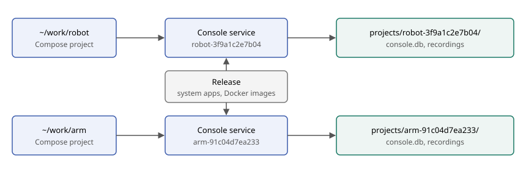

# One Console per project

Created: 2026-11-02.

Each project runs its own Console service with its own database and recordings, so
projects stay independent and can run at the same time.

| Topic | Decision |
| --- | --- |
| Start | `doramcap-console start` uses the current directory; `--project PATH` names another. |
| Project ID | Sanitized folder name plus the first 12 hex of the canonical path's SHA-256, such as `robot-3f9a1c2e7b04`. |
| Service | `doramcap-console-<id>.service`, transient through `systemd-run`. |
| State | `/var/lib/doramcap-console/projects/<id>/`: `console.db`, `console.pbtxt`, `project.txt`, `access.txt` and `runs/<run id>/`. Outside the repository. |
| Moved repository | A new path is a new project; old state stays behind. |
| Sample | `playground/cpu-burn` stays read-only inside the release. |
| Upgrades | Each `console.pbtxt` stays pinned to the release that wrote it. |

## Milestone 1: Free ports per Console

**Work items**
- [x] Select a free live bridge port at startup when `port` is omitted.
- [x] Omit the port from the release template and examples.

**Validation**
- [x] Config and port tests pass.

Evidence: Console server suite passes. Real concurrent runs are recorded under Milestone 2.

## Milestone 2: Per-project service and state

**Work items**
- [x] Add `--project`, defaulting to the current directory.
- [x] Derive the project ID, service name and state directory.
- [x] Add `list`.
- [x] Stop seeding a playground; keep the sample read-only in the release.

**Validation**
- [x] Project ID and release tests pass.
- [x] Two projects run at the same time with separate history and recordings.

Evidence: Console server suite passes. On x86_64, the real CLI started two projects through systemd on ports 43187 and 43188. Both ran through Chromium with live CPU panels at once; each History showed only its own run; recordings of 9.3 and 11.2 MB landed in separate state directories; stopping one left the other running; no containers remained. Not run: the packaged archive, the sample at its installed path, ARM64.

## Milestone 3: One project in the UI

**Work items**
- [x] Remove the project directory input and History's project filter.
- [x] Delete `PrepareRequest.directory`, the `project_directory` column, and the marker and History fields.

**Validation**
- [x] Frontend tests and a browser run pass.

Evidence: frontend 53/53, server 63 passed and 1 skipped, contract 1/1. Two real projects each showed their own directory, ran at once and listed only their own run in History.

Crash recovery: `systemctl kill --signal=KILL` during a real run left all 5 containers running and the run Interrupted in History. The next run removed all 5 before starting its own, finished with a 7.9 MiB recording and left no containers; the interrupted recording stayed on disk.

## Milestone 4: Host-wide CPU data in a per-project Console

CPU monitoring is system-wide by design, so each project's panels and `cpu.mcap` can include other projects' containers.

**Work items**
- [ ] TODO: Decide how panels and recordings identify activity from other projects.

**Validation**
- [ ] With two projects running at once, each Console shows which CPU activity belongs to its project.
