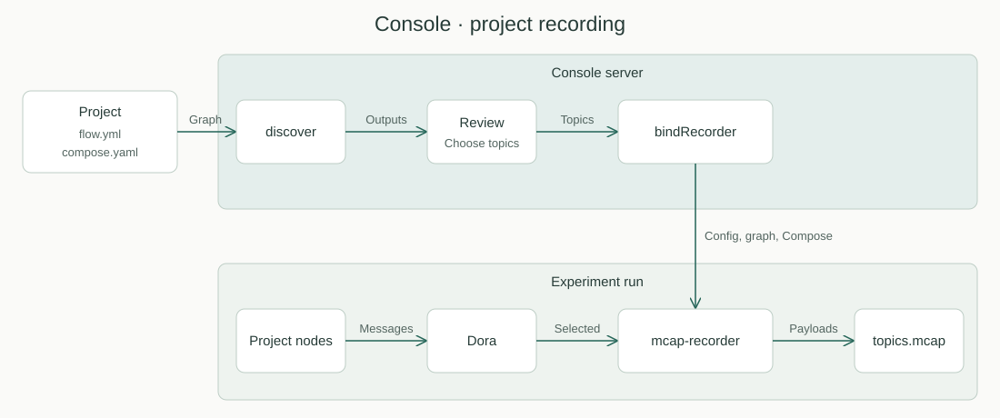

# Console project recording

Created: 2026-11-02. Status: on hold.

Record a project's own Dora and ROS 2 messages from Console, with no app code changes.

- **Graph:** the project supplies its Dora graph beside its Compose file.
- **Choice:** Review lists the graph's outputs; the user ticks the topics to record.
- **Recorder:** Console generates its graph inputs, config and Compose project, as it does for the live bridge.
- **Schemas:** optional. doramcap's own topics keep theirs; project topics default to raw bytes.
- **Load:** a project can publish every message at a high rate, so disk writes must not stall its publishers.
- **Inputs:** Dora first, then ROS 2, through the same writer and Review flow.

Build after PR 88, which changes the project flow. Keep the default selection empty until Milestone 3 lands.

## Decisions to make

| Decision | Needed by | Options | Recommended |
|---|---|---|---|
| Queue policy | Milestone 2 | `backpressure` can stall publishers; `drop_oldest` loses messages with no per-input count | `backpressure`, matching `cpu-recorder` |
| Default selection | Milestone 2 | All outputs, or none | None, because high-rate topics are costly |
| Indexes | Milestone 3 | `storage-persistence` writes none; add them at finish, in a post-pass, or leave them out | Post-pass after finish, keeping the write path simple |
| Durability | Milestone 3 | Sync only at finish, or at an interval | Bounded interval, with the last synced position in the report |
| ROS 2 client | Milestone 7 | Evaluate reputable client libraries and how the image gets its ROS distribution | Present options before adopting one |

## Milestone 1: Project graph

**Work items**

- [ ] `discover` accepts an optional `flow.yml` beside the Compose file.
- [ ] `Graphs.build` merges it with the base and system app graphs.
- [ ] Review surfaces graph errors, including nodes with no same-named host-networked service.

**Validation**

- [ ] Server tests: a project with and without `flow.yml`, a malformed graph and a duplicate node ID.
- [ ] Real run: a Dora project publishes and subscribes through Console.

## Milestone 2: Record selected topics

**Work items**

- [ ] Add the project's outputs and the selected topics to the Review and Prepare protobuf messages.
- [ ] Show outputs with "Record" checkboxes in Review.
- [ ] `bindRecorder` writes the graph fragment, recorder pbtxt and Compose project, following `bindBridge`.
- [ ] Label inputs `application/octet-stream` and declare `topics.mcap` as a run recording.
- [ ] Run again restores the selected topics.

**Validation**

- [ ] Server tests: generated graph inputs and recorder config, with an unknown topic refused.
- [ ] Frontend tests: the checkboxes and a restored selection.
- [ ] Real run: messages in `topics.mcap` match what the app published, and the file downloads.
- [ ] Real run: a project with nothing selected starts no recorder.

## Milestone 3: Recording under load

Today the recorder's single thread drains Dora and makes every `write(2)` through the
`mcap` crate. A slow disk blocks that thread, fills its queue and slows publishers.

**Work items**

- [ ] `storage_persistence::mcap::McapWriter` supports per-channel schemas and channel metadata; it has one schema per file and none today.
- [ ] The recorder writes through it, copying payloads into managed buffers, so disk I/O leaves the Dora event thread.
- [ ] The recorder Compose file permits io_uring through the [seccomp profile](110126-io-uring-seccomp.md); `seccomp=unconfined` until that lands.
- [ ] The report includes writer pressure from `McapMonitor`.
- [ ] Apply the index and durability decisions.

**Validation**

- [ ] Benchmark: a publisher at a representative rate on throttled storage; compare publisher stalls and loss with the `mcap` writer.
- [ ] `compare_recordings` shows equal payloads through a real Dora flow.
- [ ] A recording opens in a viewer and seeks as the index decision promises.

## Milestone 4: Zero-copy from Dora

**Work items**

- [ ] Adapter holding a Dora shared-memory sample as a `ReadLease` through `MmapRegion::import` and `lease`, written with `append_external_payload`.
- [ ] Confirm Dora's mapping meets the `import` contract: stable, writable and unmodified until release. Stop and redesign if not.
- [ ] Small messages Dora delivers inline stay on managed buffers.

**Validation**

- [ ] Benchmark: CPU and throughput at large payload sizes against Milestone 3; keep the adapter only if it improves them.
- [ ] Test: a sample is released only after its I/O completes, including on writer failure.
- [ ] Real run: holding samples during slow I/O does not corrupt publisher memory.

## Milestone 5: Arrow payloads

**Work items**

- [ ] The recorder stores non-uint8 outputs as Arrow IPC, under a declared encoding.
- [ ] Generated configs select this encoding, keeping uint8 outputs as raw bytes.
- [ ] Update the recorder guide.

**Validation**

- [ ] Recorder test: an Arrow struct round-trips with its types.
- [ ] Real run: a project publishing a non-uint8 output records without failing.

## Milestone 6: Optional topic schemas

**Work items**

- [ ] A project can name a schema file for a topic.
- [ ] Console mounts it, and sets the input's encoding and schema settings.
- [ ] Result shows which recorded topics have no schema.

**Validation**

- [ ] Server tests: a valid schema, a missing file and a path outside the project.
- [ ] Real run: a protobuf topic opens decoded in a viewer, and a topic with no schema still records.

## Milestone 7: ROS 2 input

**Work items**

- [ ] A recorder input subscribes to ROS 2 topics and writes CDR payloads through the same writer, with `ros2msg` schemas where available.
- [ ] Review lists a project's declared ROS 2 topics beside its Dora outputs.
- [ ] Console generates the ROS 2 input config and Compose settings, including domain ID and networking.
- [ ] Package the ROS 2 dependency so Dora-only recording does not need it.

**Validation**

- [ ] Recorder test: payloads and times are preserved for a fixture topic.
- [ ] Real run: a ROS 2 publisher records through Console and opens decoded in a viewer.
- [ ] Real run: a project with Dora and ROS 2 topics records both in one run.
