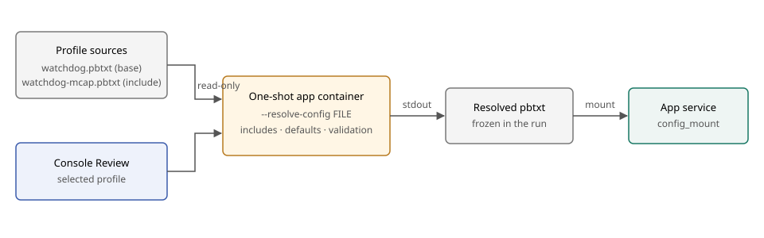

# Resolved launch profiles

Created: 2026-11-02. Status: planned; not started.

Launch profiles mount one pbtxt, so each profile repeats its base config. Review
should instead resolve the selected profile once, and the run should launch exactly
that result.

- **Resolver:** the app, running from its own image. Include order, overlays, defaults and validation are app code.
- **Trigger:** Review, after images are present and before inspection.
- **Output:** one complete pbtxt, frozen with the run's inputs and mounted at `config_mount`.
- **Opt-in:** apps without a resolver keep today's mount, including `system-monitor` and `mcap-recorder`.

```protobuf
config_mount { service: "fault-watchdog" target: "/etc/fault-watchdog/watchdog.pbtxt" }
config_resolver { command: "/usr/local/bin/fault-watchdog" command: "--resolve-config" }
launch_profiles { id: "mcap" label: "Live and MCAP" config: "/absolute/config/watchdog-mcap.pbtxt" }
```

## Alternatives

| Option | Outcome |
|---|---|
| Resolve in Console | Rejected: `Payload::overlay` and `normalize` are app code, so Console would need app types or a second merge that can drift |
| Mount and freeze the config directory | Rejected: Review would validate nothing, and the record would hold sources instead of the launched config |
| Flatten at build time | Rejected: operator-written profiles would need a separate step |

## Milestone 1: App resolver

**Work items**
- [ ] Add a `pbtxt-config` function that formats a resolved app as Fragment text, loadable by `resolve`.
- [ ] Add `fault-watchdog --resolve-config FILE`: print the resolved pbtxt to stdout; on failure print the error to stderr and exit nonzero.

**Validation**
- [ ] Resolving a base plus overlay and loading the output returns the same config as loading the original.
- [ ] Resolving the output again returns identical bytes.
- [ ] A profile requesting a sink the binary was built without fails to resolve.

## Milestone 2: Console resolution

**Work items**
- [ ] Add `config_resolver` to `SystemAppDefinition`; it requires `config_mount` and `launch_profiles`.
- [ ] Run the resolver once per selected profile with `docker run`, using the image of the `config_mount` service.
- [ ] Sandbox it: no network, read-only root, all capabilities dropped, `no-new-privileges`, the profile's directory mounted read-only, and bounded time and output.
- [ ] Write the output to the review workspace and mount that file; Start launches the same file.
- [ ] Report a failure with its stderr at Review.

**Validation**
- [ ] Server tests cover resolver success, failure, timeout, oversized output and apps without a resolver.
- [ ] A changed source file after Review leaves the launched config unchanged.
- [ ] A real Console run launches the resolved file, and the frozen input matches the resolver output.

## Milestone 3: Watchdog profiles

**Work items**
- [ ] Restore `include: "watchdog.pbtxt"` in the MCAP and OTLP standalone profiles, and delete the repeated fields.
- [ ] Mount `config/` in the standalone Compose file, so direct Compose users select a profile through the service command.
- [ ] Declare `config_resolver` in the [configuration example](configuration.md) and document the contract.
- [ ] Replace the standalone test that loads each profile alone with one that loads it beside its base.

**Validation**
- [ ] Real Console runs of the live, MCAP and OTLP profiles finish clean with their expected outputs.
- [ ] A direct Compose launch resolves a profile's include.
- [ ] The Console release session's watchdog app uses the resolver, or its plan records why it waits.
