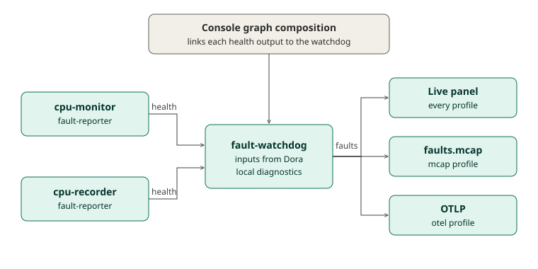

# System app health and protobuf launches

Created: 2026-11-02. Updated: 2026-11-03. Status: implementation and validation.
Updates [PR 96](https://github.com/Cutuy/doramcap/pull/96); leave it open for user review.

CPU monitor records itself. Watchdog aggregates selected health outputs. The generic
recorder stores selected user or system messages. App configs are complete standard
protobuf TextFormat messages, mounted read-only at stable container paths.

## Milestone 0: Standard protobuf configuration

**Work items**
- [x] Delete `pbtxt-config`; migrate watchdog and resource-policy to their generated domain types.
- [x] Remove includes, overlays, injected config defaults and config-relative path rewriting.
- [x] Supply explicit watchdog settings and recorder report paths in shipped pbtxt files.

**Validation**
- [x] Focused release-profile tests pass for watchdog, monitor, recorder and resource-policy without optional features.
- [ ] Final feature-enabled tests and Clippy pass.
- [ ] Reference docs and catalog links match the direct configuration contracts.

Evidence: initial focused Rust run passed 28 tests plus the recorder fixture; the
BPF-only monitor integration test was explicitly ignored in that build.

## Milestone 1: Watchdog inputs from Dora

**Work items**
- [x] Reserve the removed protobuf `inputs` field; read inputs from `node_config()`.
- [x] Validate source/frame budgets against actual Dora inputs and allow zero inputs.

**Validation**
- [x] Initial standalone and host tests pass with direct pbtxt.
- [ ] Feature-enabled profile and budget tests pass on the final source.
- [ ] Real Dora runs cover zero inputs and incoming health publications.

## Milestone 2: System apps publish health

**Work items**
- [x] Add one bounded reporter drain helper under the fault domain.
- [x] Monitor reports sampling deadlines and publication failures.
- [x] Recorder reports input closures/recovery and recording failures.
- [x] Declare health outputs in release and integration graphs and reuse helper in demo.

**Validation**
- [ ] Failure/recovery publications survive real transport and MCAP readback.
- [ ] No-subscriber execution and existing recording behavior pass.
- [x] Dependency boundary checks pass.

## Milestone 3: Console wiring and three-app release

**Work items**
- [x] Wire selected `health` outputs using bounded `drop_oldest` queues.
- [x] Remove fixed `workload/faults`, project `flow.yml` discovery and associated Review blocking.
- [x] Pair generic recorder profiles with complete native Dora graphs and pbtxt configs.
- [ ] Update PR 96 and leave it open for review.

**Validation**
- [x] Graph tests cover zero/one/multiple health sources and arbitrary user-message recording inputs.
- [x] Console server/frontend checks pass (77 server tests, one root-only skip; frontend tests/build pass).
- [ ] Real release-profile acceptance script passes.
- [ ] Cloud CI and full local CI pass on the final source.
- [ ] ARM64 worker validation passes.

Worker observation: started the unprivileged Pueue daemon after finding no socket.
ARM64 validation has not been submitted yet. Full CI and end-to-end results remain pending.

Acceptance command (build the release binaries and examples unprivileged first):

```sh
sudo node --import ./console/server/node_modules/tsx/dist/loader.mjs \
  console/scripts/validate-system-apps.mts --dora /absolute/dora --bin-dir /absolute/target/release
```

This uses isolated test image tags and temporary projects; it retains acceptance
artifacts under the printed `/tmp/console-system-apps-*` directory for inspection.
