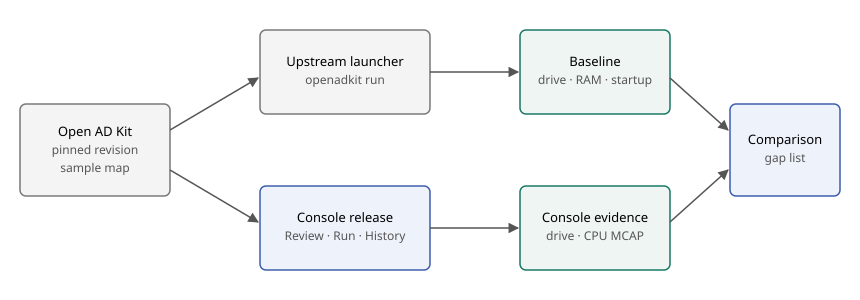

# Console adoption qualification

Created: 2026-11-03. Status: M1 in progress; nothing has run yet.

Qualify the published Console release against a maintained robotics stack. Run it
upstream first, then through Console, and turn each difference into a specific gap.

## Decisions

| Topic | Decision |
| --- | --- |
| Target | [Open AD Kit](https://github.com/autowarefoundation/openadkit) `planning-simulation` at `7256a4f`: Autoware Foundation's containerized Autoware |
| Reasons | Current Compose files, eight ROS 2 services, published images, CPU-only per its manifest |
| Interface | Console's CLI and UI from the published release, with no local build |
| Upstream files | Tracked files stay unchanged; inputs Console needs go in an untracked `.env`, and each one is recorded as a gap |
| Evidence scope | Simulator only; CPU MCAP and observed behavior |
| Superseded | nginx-golang adds little beyond `playground/cpu-burn`; OpenPI's ALOHA example has been untouched since June 2025 |

## Expected gaps

From source review. Each row needs a run to confirm it.

| Open AD Kit | Console | Expected result |
| --- | --- | --- |
| `./openadkit run` passes `config.env` and injects `ROS_DISTRO` and image settings | Runs Compose directly and reads only `.env` | Unset variables fail Review |
| `MAP_PATH=$HOME/autoware_map/...` | Clears the Compose environment | Needs an absolute path |
| `ipc: host` on each service | Replaces it with the shared experiment IPC namespace | DDS behavior to verify |
| `pid: service:map` | Keeps it, and orders startup and stop itself | Ordering to verify |
| `restart: on-failure` | Overrides restart to `no` | Startup races become failures |
| 300 s wait, no health checks | 60 s process-level readiness | Ready reported before Autoware is |
| ROS 2 topics | Records CPU only | Topic recording stays with [#91](https://github.com/Cutuy/doramcap/pull/91) |

## M1: Upstream baseline

**Work items**
- [ ] Record host OS, kernel, Docker, Compose, CPU, RAM and free disk.
- [ ] Fetch the sample map through `./openadkit fetch` and verify its checksum.
- [ ] Start `planning-simulation` with `./openadkit run`; record commands and image digests.
- [ ] Define a repeatable drive check: set an initial pose and goal, then observe route completion.
- [ ] Measure startup time, peak RAM, CPU and disk.

**Validation**
- [ ] All eight services stay up and the drive check passes twice.
- [ ] `down` leaves no project containers or networks; unrelated containers keep running.

## M2: Reach Review

**Work items**
- [ ] Install the published release with `install.sh` and run `doramcap-console doctor`.
- [ ] Run `doramcap-console start` from `deployments/planning-simulation`.
- [ ] Record each Review failure and classify it as a Console fix or a documented input.

**Validation**
- [ ] Review resolves all services and images, with `git status` clean apart from `.env`.
- [ ] Every remaining diagnostic is explained in this plan.

## M3: Two Console runs

**Work items**
- [ ] Start from the UI, run the drive check, then Stop.
- [ ] Repeat through **Run again**.
- [ ] Interrupt one startup and one running experiment.

**Validation**
- [ ] Both runs pass the M1 drive check with fresh containers.
- [ ] Startup, RAM and CPU are compared with M1; differences are explained.
- [ ] Tracked files, the map and unrelated containers stay unchanged.
- [ ] Interrupted runs show as Interrupted; the next run resets and succeeds.
- [ ] Each failure shows an actionable cause in the UI.

## M4: Evidence

**Work items**
- [ ] Download recordings from Result and History.
- [ ] Open each CPU MCAP in Foxglove.
- [ ] Map recorded CPU activity to Autoware services.
- [ ] Record what users need and Console lacks, including topic data and logs.

**Validation**
- [ ] MCAPs from both runs open and show samples across the drive.
- [ ] Each of the eight services has attributable CPU activity.

## M5: Clean host

**Work items**
- [ ] Provision a fresh Ubuntu 24.04 VM with documented prerequisites only.
- [ ] Repeat M1 to M3 from the release with no Doramcap checkout or toolchain.

**Validation**
- [ ] The documented path works without manual fixes.
- [ ] Missing permissions or kernel features produce actionable errors.
- [ ] Measured requirements are published in [install](install.md).

## M6: Compose breadth

**Work items**
- [ ] Pin [Transitive](https://github.com/transitiverobotics/transitive) and the [OpenTelemetry Demo](https://github.com/open-telemetry/opentelemetry-demo).
- [ ] Run both upstream, then through Console.
- [ ] Decide with the user how to handle writable single-file binds, image-declared volumes and a read-only bind of `/`.

**Validation**
- [ ] Each project reaches a clean run or a recorded, explained limit.
- [ ] Each supported project runs twice and leaves no owned resources behind.
