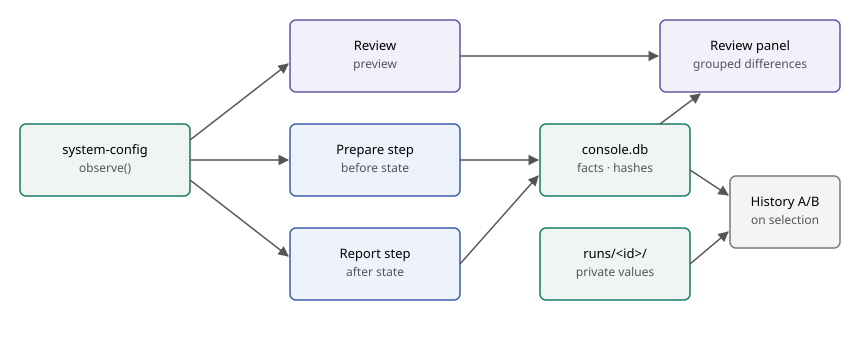

# Machine capture and A/B comparison

Created: 2026-11-04. Status: proposed.

Each run saves what it ran and the machine it ran on. Selecting two runs on the History page shows what is the same and what differs.

- **Today:** history keeps profiles, system apps, times, state and artifacts. Machine snapshots stay as raw JSON in private run files.
- **Next:** a typed capture, saved per run and shown at History and Review.
- **Later:** the same crate gains apply and verify for machine preparation.

Concept: [mockups](../mockups/README.md).

## Decisions

| Topic | Decision |
| --- | --- |
| Entry point | History. Selecting two rows opens the comparison on that page, and the URL keeps the selection. There is no separate Compare page or run picker. |
| Owner | New `libs/resources/system-config` crate. `observe()` ships first; apply and verify reuse the schema later. |
| Differences | Result, setup, configuration and condition are grouped. Only configuration differences warn. Nothing blocks Start or a comparison. |
| Timing | Review shows an unsaved preview. Prepare saves the before state and Report saves the after state. |
| Values | Shown unless a name pattern masks them. Compose secrets are always hidden. |
| Baseline | Review uses the latest completed run with a capture. Run again uses its source run. |
| Fields | Performance focused, listed below. No new crates. |
| Presence | Protobuf fields have no explicit presence, so zero, empty and unset are equivalent in Rust and TypeScript. A fact set in only one run is a change. A run with no capture at all reads as unavailable. |
| Failure | An unreadable field never fails a run. |
| Storage | `console.db` holds machine and setup facts. The comparison reads environment values and frozen file digests from `runs/<id>/` and masks them at display time. |
| Browser | The server computes comparison rows. The browser receives labels and masked values only. |
| Condition | Both values are shown side by side, with no thresholds. |

## Captured facts

| Group | Owner | Facts |
| --- | --- | --- |
| Identity | Console | Run ID, container IDs, paths and times. Excluded from the diff. |
| Result | Console | Status, duration, recording size, recording saved, cleanup verified |
| Experiment setup | Console | Source commit, dirty tree, profiles, system apps, image IDs, environment values, config file digests |
| Machine configuration | `system-config` | Machine fingerprint, architecture, CPU model and count, NUMA nodes, memory, kernel release, boot flags, isolated CPUs, governor, CPU frequency driver, turbo, SMT, huge pages, swappiness, RT limit, cgroup setup, GPU and driver |
| Docker configuration | `workload-docker` | Docker and Compose versions, cgroup driver, storage driver |
| Machine condition | `system-config` | Boot ID, uptime, load, available memory, free disk, temperature |
| Docker condition | `workload-docker` | Other running containers |

Per-CPU settings are stored by CPU range. The machine ID is stored only as a hash. Process and container facts keep names without command lines.

## Open items

| Item | Recommendation | Resolve in |
| --- | --- | --- |
| Initial mask patterns | Short list covering password, secret, token, key and credential names, plus URLs with credentials | Milestone 4 |
| User-defined masks | Add a `console.pbtxt` list only if the initial patterns prove insufficient | After real use |
| Boot flags display | Mask flags by the same name patterns | Milestone 4 |
| GPU model source | Read `/proc/driver/nvidia/gpus/*/information`; confirm on a CUDA host | Milestone 1 |
| Evidence bundle redaction | Design with the bundle export; out of scope here | Bundle export plan |

Deferred: pinned baselines, busy-process sampling, condition thresholds and parsing values out of config files.

## Milestone 1: Crate and schema

**Work items**
- [ ] Add `libs/resources/system-config` with `MachineConfiguration` and `MachineCondition` protobuf messages, with no `optional` fields.
- [ ] Implement `observe()` with direct `/proc` and `/sys` reads. Report turbo from `intel_pstate/no_turbo` or `cpufreq/boost`.
- [ ] Hash the machine ID and group per-CPU settings by CPU range.
- [ ] Add a boundary rule keeping Docker and Console dependencies out of the crate.

**Validation**
- [ ] Fixture trees cover present, missing and malformed files for each fact.
- [ ] A missing file yields an unset field and never an error.
- [ ] Mixed per-CPU values produce separate CPU ranges.
- [ ] The raw machine ID never appears in the output.
- [ ] `observe()` runs on x86 and ARM64 without root.

## Milestone 2: Workflow capture

**Work items**
- [ ] Replace `machine-before.json` and `machine-after.json` with `system-config` capture in the Prepare and Report steps.
- [ ] Add Docker configuration and condition facts through the existing `bollard` client.
- [ ] Publish before and after states through `ExecutionUpdate` as each is captured.

**Validation**
- [ ] The before state is taken after reset and before any service starts.
- [ ] An unreadable field or unavailable Docker fact leaves the run running and the field absent.
- [ ] The after state still arrives after a failed run.
- [ ] Existing recorded workflow tests pass with the old snapshot files removed.

## Milestone 3: Run record

**Work items**
- [ ] Add `ExperimentSetup` and a run capture message to the Console protos.
- [ ] Record source commit and dirty tree through the `git` command; non-git projects read as unavailable.
- [ ] Record image IDs from the prepared configuration.
- [ ] Add an additive `console.db` migration with a size-bounded capture column.
- [ ] Save each state as it arrives.

**Validation**
- [ ] Migration step, failed-step rollback and reading rows without a capture.
- [ ] A failed run and a `kill -9` run both keep their before state.
- [ ] A capture over the size bound is dropped without failing the run.
- [ ] A dirty tree, a clean tree and a non-git project record correctly.
- [ ] Environment values never appear in `console.db`.

## Milestone 4: History A/B comparison

**Work items**
- [ ] Add a checkbox to each History row. Selection lives in `#/history/compare/<a>/<b>`.
- [ ] Open the comparison on the History page as soon as two runs are selected, labeling them A and B in selection order. Further rows are disabled until one is cleared.
- [ ] Add a server diff that reports same, changed or unavailable per field, by walking the capture messages.
- [ ] Add a `GET` comparison route behind the session and origin checks.
- [ ] Read environment values and frozen file digests from each run's private files, apply masks on the server and hide Compose secrets.
- [ ] Show groups for result, setup, configuration and condition, with differences first and matches collapsed.
- [ ] Show configuration changes between a run's before and after states.
- [ ] Keep comparison on the History page; add no separate page.

**Validation**
- [ ] Selecting a second row opens the comparison without leaving History; clearing one closes it.
- [ ] Reloading the comparison URL restores the selection, including runs outside the current filter or page.
- [ ] The diff classifies same, changed, one-side-absent and both-absent fields.
- [ ] 401 without a session, 403 for a foreign origin, 404 for unknown runs and 400 for the same run twice.
- [ ] Masked values, Compose secrets and hashes are absent from API responses.
- [ ] Traversal or symlinks in run files return unavailable values.
- [ ] Runs from before this feature compare on result and profiles, with machine facts unavailable.
- [ ] Loading, failed and missing-file states render, with no horizontal overflow at 390 px.

## Milestone 5: Review preview

**Work items**
- [ ] Add the capture to `Inspection` and compare it in Review through the same diff.
- [ ] Select the latest completed run with a capture as the baseline.
- [ ] Add a baseline run field to `PrepareRequest`, set by Run again.
- [ ] Add a Review panel with grouped differences and current condition values.

**Validation**
- [ ] Baseline selection skips failed, interrupted and uncaptured runs.
- [ ] Run again compares with its source run.
- [ ] No baseline shows current values and an empty-baseline message.
- [ ] Configuration differences warn and Start stays available.
- [ ] A machine change between Review and Start does not cause a stale review.

## Milestone 6: Real experiments

**Work items**
- [ ] Run real Compose A/B pairs through a real Console with a parameter change and a governor change.
- [ ] Run the capture on ARM64, WSL and a CUDA host, and on a Jetson when one is available.
- [ ] Capture screenshots of History comparison and Review for this plan.

**Validation**
- [ ] The parameter change appears under setup with both values.
- [ ] The governor change appears as a configuration warning.
- [ ] A governor change during a run appears as a before and after difference.
- [ ] Facts missing on each platform show as unavailable.
- [ ] History comparison survives `kill -9` and SIGTERM restarts.
- [ ] Full local CI and ARM64 validation pass at the PR integration point.
