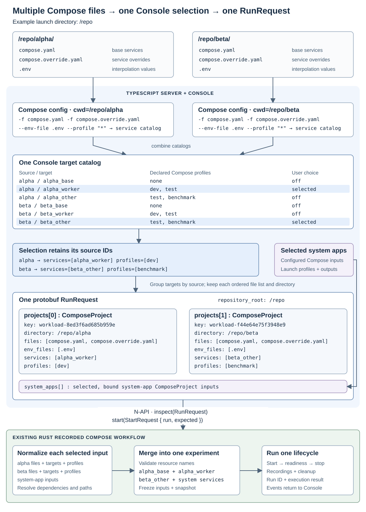

# Multi-project Console

Created: 2026-11-04.

One Console discovers Compose sources beneath its launch directory, presents their
services together, and submits the selected sources as one recorded experiment.
This plan tracks implementation integration and its acceptance checks.

## File sets and convergence

1. Discover the root and immediate child directories. Each source has one standard
   Compose base file, its optional matching override, and its local `.env`.
2. TypeScript invokes `docker compose config` separately for each source, with
   that source's directory, ordered `-f` arguments and environment-file inputs.
   Compose applies file merging, interpolation and source-relative paths.
3. Combine the returned service catalogs into one Console view. Retain the source
   ID on every target and scope each Compose-profile selection to its source.
4. Group selected target names by source. Build one `ComposeProject` per selected
   source, retaining its directory, files, environment files, services and profiles.
5. Put those entries in one `RunRequest.projects[]`, alongside the existing
   `system_apps[]` inputs. This request is the convergence point before Rust.
6. Send `RunRequest` for inspection; Start sends `StartRequest` with the run and
   its reviewed configuration snapshot. Rust normalizes each selected input,
   resolves dependencies, checks resource names and assembles one experiment.

In the diagram, `alpha_worker` uses alpha's base and override with profile `dev`;
`beta_other` uses beta's files with profile `benchmark`. The request retains two
project entries. Native resolution includes `alpha_base` as a dependency and
produces one combined execution plan. Console persists one run and its selections.

## Agreed behavior

- Scan the root and immediate children for `compose.yaml`, `compose.yml`,
  `docker-compose.yaml` or `docker-compose.yml`. Preserve the existing rejection
  of ambiguous base files and overrides within a source directory.
- Initially select every source's default-enabled services. Allow explicit target
  selection, multiple Compose profiles per source, and an empty user selection.
- Preserve Compose's service activation and dependency semantics. System apps
  retain their configured launch profiles.
- Keep discovery, selection, API and history in TypeScript. Reuse native execution.
- Report conflicting selected resource names during Review. Catalog discovery
  must succeed independently of combined-run validation so users can adjust targets.

## Existing boundaries and gaps

| Layer | Existing boundary | Planned work |
| --- | --- | --- |
| Discovery | [Single-directory discovery](../server/src/system-apps.ts) | Enumerate sources and assign stable IDs. |
| Compose resolution | [TypeScript image discovery](../server/src/images.ts) | Reuse Compose CLI resolution for catalogs; align environment and project identity with execution. |
| Console API/UI | [Browser contract](../proto/console.proto) and [selection UI](../frontend/src/App.tsx) | Represent source-specific targets/profiles and separate catalog loading from Review. |
| Run assembly/history | [Console service](../server/src/service.ts) | Fill multiple project entries, revalidate inputs, persist selections and restore Run again. |
| Native execution | [RunRequest](../proto/execution.proto), [ComposeProject](../../libs/workload-docker/proto/compose.proto), [preparation](../../libs/workload-docker/src/workflows/recorded_compose/preparation.rs) | Validate the existing multi-input path through end-to-end tests. |

## Milestone 1: Discovery and selection contracts

**Work items**
- [ ] Discover bounded sources with stable identities and source-local file lists.
- [ ] Resolve service/profile catalogs through the TypeScript Compose helper.
- [ ] Add typed source selections and catalog responses to Console protobuf messages.
- [ ] Match execution's explicit environment and repository-scoped project identity.
- [ ] Bound and cancel Compose discovery, joining its subprocesses on shutdown.

**Validation**
- [ ] Test root/child discovery, overrides, `.env`, relative paths and ambiguous files.
- [ ] Test overlapping profiles, explicit targets and dependency inclusion with real Compose configuration.
- [ ] Verify discovery does not download images or start containers.
- [ ] Verify cancelled discovery leaves no owned subprocesses.

## Milestone 2: Review, execution and persistence

**Work items**
- [ ] Populate `projects[]` with one entry per selected source and retain `system_apps[]`.
- [ ] Preserve source IDs, services and profiles in markers, history and comparisons.
- [ ] Restore selections for Run again and retain readable legacy history.
- [ ] Revalidate selected sources and the configuration snapshot before Start.
- [ ] Update CLI startup discovery and help.

**Validation**
- [ ] Verify default selections, explicit empty choices and independent source profiles.
- [ ] Verify protobuf/HTTP round trips and history/re-run selection restoration.
- [ ] Verify conflict errors leave the catalog usable for adjusting the selection.
- [ ] Reject removed targets and changed child-source configuration after Review.
- [ ] Retain single-source execution coverage.

## Milestone 3: Selection UI

**Work items**
- [ ] Present targets with source labels and per-source Compose-profile controls.
- [ ] Present system-app choices alongside user targets.
- [ ] Keep Review, execution progress and history together for one run.
- [ ] Provide recovery when a saved source or target is no longer available.

**Validation**
- [ ] Test initial defaults, profile changes, individual target changes and source isolation.
- [ ] Exercise discovery → selection → Review → Start → Stop → History → Run again in a browser.
- [ ] Verify dependencies appear in the resolved Review and stale selections can be reset.

## Milestone 4: Real multi-project execution

**Work items**
- [ ] Build a temporary root with alpha and beta source directories; each has
  a base, override, `.env`, local input file, two profiled targets and a dependency.
- [ ] Give targets overlapping memberships such as `[dev, test]` and `[test, benchmark]`.
- [ ] Exercise Console's HTTP API, browser client codecs, native addon and real Docker.

**Validation**
- [ ] Assert expected containers, source-local values, overrides and omitted targets.
- [ ] Assert history/re-run selections, preserved source files and clean shutdown.
- [ ] Assert naming-conflict rejection, stale-input rejection and sibling cleanup after startup failure.
- [ ] Run Console server/frontend/contract checks and production builds on the implementation revision.
- [ ] Record browser verification and ARM64 validation at integration.

Prototype evidence: local x86_64 Console checks, builds and HTTP-to-Docker runs
passed in the separate implementation checkout, including changed child `.env`
inputs and failure cleanup. Browser verification was blocked by browser availability;
ARM64 and full repository CI remain pending. The implementation PR must record
validation against its final source revision beside these acceptance checks.
