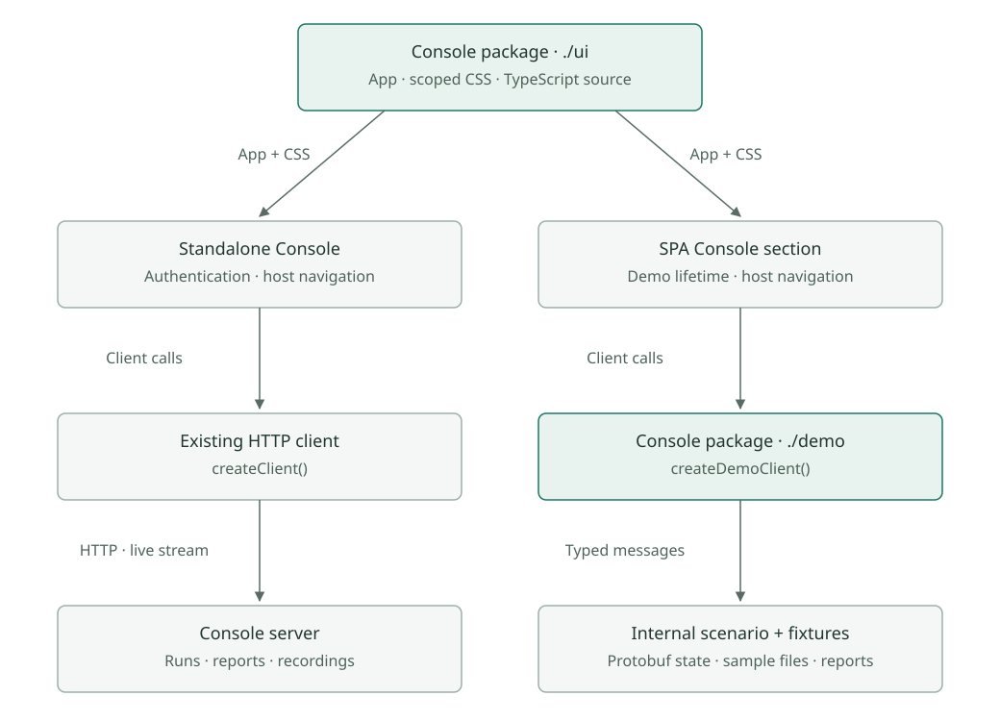

# Console demo in the project explorer

Created: 2026-11-04. Status: implemented in stacked PRs; final owner review and integration checks pending.

Add a Console section to the project explorer SPA using the production React
screens. A browser-owned demo client supplies a walkthrough of the release's `cpu-burn`
project, one built-in run and downloadable examples. The SPA remains statically hosted.

Visitor flow: History starts with one built-in run. The visitor picks settings and
runs an experiment, compares any two runs and may keep creating runs. A page refresh
clears their runs and restores the built-in one.

## Accepted design

Agreed with the project owner on 2026-11-04.

| Area | Decision |
| --- | --- |
| Source | Keep `console/frontend` in place as a private local package exporting TypeScript source. |
| Entries | `./ui` exports the existing `App` and loads scoped CSS; `./demo` exports `createDemoClient`. |
| Client | Infer the shared client shape from `ReturnType<typeof createClient>`; use one internal context for the client and base path. |
| Internals | Keep protobuf constructors, fixtures and simulation helpers inside the package. |
| Navigation | `App` keeps its hash listener and hash writes and takes one `basePath` prop; link helpers build under it. Standalone passes an empty base. |
| Shell | The SPA header contains Console; embedded `PageFrame` retains Run, History and workflow navigation. |
| Lifetime | One demo client lives as long as the page, so a run continues during SPA navigation. Refresh and Reset restore the built-in run. |
| Reset | Reset remounts `App` with a new `key`; the client stays fixed for each mount. |
| Scenario | The release's `cpu-burn` project and system apps, with production step IDs and names, stream IDs and machine fact names. |
| Upcoming | `#/console/upcoming` shows the concept mockups from the first release, each marked Upcoming. |
| Run header | View tabs and run phases share one navigation row in production and the demo. |
| Comparison | Each group's "N matching" expands in place, in production and the demo. |
| History | One built-in successful run; any two runs compare; Run again works from any completed run. |
| Comparison | A small diff inside the demo turns per-run named facts into real comparison rows. The server is unchanged. |
| Artifacts | The built-in run offers its matching MCAP file and report. Visitor runs offer a matching JSON report and report no recording file or size. |
| Theme | Console stays light inside the SPA for now. |
| Limits | Runs last 15 s at 10 Hz unless stopped. Visitor runs have no count limit; refresh clears them. |

The package uses the existing React, TypeScript, Vite and protobuf dependencies.
Each host compiles the shared source in its own build. The production import graph
reaches `./ui`; the SPA additionally imports `./demo`.

## Decisions awaiting owner review

Made during implementation while the owner was away. Each stays easy to revise.

| Topic | Decision | Reason |
| --- | --- | --- |
| Startup failure | No failure scenario; drop its checks. | Follows from one built-in run; visitors see no failed run. |
| Report links | Visitor reports use `data:` URLs. | Nothing to create or revoke, which removes reset and disposal cleanup. |
| `current()` | Keep it on the client. | The browser contract test and server route use it. |
| Stack | Three PRs: shared UI, demo client, SPA section. Milestones 1 and 2 are split across them. | Each PR builds and passes on its own; the SPA dependency needs a consumer. |
| Reports | The built-in run's report is generated like any other; no report file is bundled. | One code path, and the file cannot drift. |
| Sample recording | Generated from the same code as live packets, with synthetic container IDs. | Reproducible, and contains no real host data. |
| `@mcap/core` | Dev dependency of `console/frontend`, pinned to 2.4.0. | Writes and checks the recording; the repository's reader tests already use this version. Outside both bundles. |
| Machine difference | The built-in run's machine differs from visitor runs in governor, energy preference and swappiness. | Gives the first comparison and Review visible differences. |
| Cgroup names | Top CPU consumers show real `docker-<id>.scope` names. | This is what production displays; friendlier names would misrepresent it. |
| Mockup hosting | Upcoming pictures load from the release, so the SPA stays small but needs network access for them. | 1.3 MB each; the repository's README already links them this way. |
| App requirements | The demo does not enforce "requires CPU monitoring" style profile requirements. | Keeps the demo small; the labels still state them. |
| Live clock | Elapsed times and the timeline tick every 100 ms in production too, using the existing live interval. | Requested for the demo, and the screens are shared. |
| Stop timing | Stop always ends as Completed, two simulated seconds later. | Matches a graceful stop; no Cancelled scenario. |
| Filename rule | `artifactFilename` moves to the shared contract, a one-line server change. | Avoids a second copy for `download` attributes. |
| Explorer install | `npm --prefix console/frontend ci` is a required step before building the explorer. | npm does not install a linked package's dependencies. |

## Production change boundary

| Location | Intended change |
| --- | --- |
| `frontend/src/App.tsx`, `History.tsx`, `Comparison.tsx` | Receive the supplied client and base path through one internal context; retain existing screen and workflow logic. |
| `frontend/src/api.ts`, `Result.tsx` | Add `artifactUrl(runId, id)` returning `string \| undefined`; links need availability and a URL, and carry a `download` filename. |
| `frontend/src/model.ts` | Route parsing and link helpers take the base path. |
| `frontend/src/ui/PageFrame.tsx`, `tokens.css` | Add the embedded layout, scope styles beneath a Console root, reset SPA globals that reach it and pin the light color scheme. |
| `frontend/package.json`, entry modules, build scripts | Expose the two source entries and prepare generated code before consumers compile. |

Use local inferred types for component props and client wiring. Public exports are
the two entry values above; generated schemas and screen internals stay behind
them. Demo behavior belongs to the demo client and SPA wrapper.

## Runtime behavior

- Subscribe before publishing initial state. A returning screen receives the current status and replays the current run's frames to rebuild its live panels; CPU dictionary frames are always kept.
- `live` remains subscribed through idle and completed states until aborted. Detaching a screen removes its subscription while the page-owned scenario continues.
- Use event callbacks for commands and state changes. Schedule finite sample events with named durations; disposal cancels pending events.
- Preserve current prepare/start/stop behavior, including request-key reuse, stale reviews, cancellation during preparation and one active run. Gracefully stopping an accepted run follows the production Completed outcome.
- Fixtures use generated protobuf messages, valid run identifiers and consistent timestamps, counters, comparison facts and recording metadata. Mark the SPA experience as an interactive demo.
- Keep the built-in run stable. Visitor-created runs are memory-only; a cleared or unknown run link offers the existing route back to History. Recording-disabled selections produce recording-disabled outcomes.

SPA routes: `#/console`, `#/console/history`, `#/console/history/<id>`,
`#/console/history/compare/<a>` and `#/console/history/compare/<a>/<b>`. Standalone
URLs retain their existing forms.

Give every fixed value a descriptive name.

## Milestone 1: Source package and reproducible builds

**Work items**
- [x] Add `./ui` and `./demo` source exports to the existing private package; the SPA consumes them and standalone keeps its relative entry.
- [x] Declare the SPA's local package dependency and update its lockfile. Make installation of Console dependencies and protobuf generation explicit in the clean-checkout workflow.
- [x] Generate protocol code before either consumer type-checks or bundles. Preserve independent standalone and SPA build commands through a small explicit preparation step.
- [x] Resolve React/ReactDOM to one instance per host bundle; retain CSS side effects and relative static-asset URLs.

**Validation**
- [x] From a checkout without generated modules, install locked dependencies, then build both frontends successfully.
- [x] Verify public entry imports work and ordinary package imports of unexported internals fail.
- [x] Inspect bundle imports: production excludes demo fixtures/scheduling; the SPA contains no Node/native server modules.
- [x] Confirm one React runtime per application and verify the dev server refreshes shared TS/CSS edits.

Evidence (2026-11-04, local unless noted):
- Clean install and build of both frontends passed with generated code removed; Node CI builds the explorer after Console.
- Unexported paths fail with `ERR_PACKAGE_PATH_NOT_EXPORTED`. The production bundle has no demo code; the SPA bundle has no Node or native modules.
- The dev server ran with no React errors and refreshed a shared CSS edit, from a copy outside `.git`. Worktrees under `.git` cannot use the dev server because Vite denies that path.

## Milestone 2: Shared UI integration

**Work items**
- [x] Inject the client and base path once; replace singleton-client use in App, History and Comparison with the internal context.
- [x] Give route and link helpers the base path, covering `PageFrame`, History, Comparison and the Run again hash write.
- [x] Add embedded `PageFrame` behavior and scoped styles with a small reset for SPA globals, preserving the standalone shell, focus behavior and semantic landmarks. Pin the Console root to the light color scheme.
- [x] Add `artifactUrl` to `createClient`, retaining production endpoint generation. Require both artifact availability and a URL before rendering a download link, and give links a `download` filename.

**Validation**
- [x] Existing Console tests pass for prepare, run, stop, history, comparison and artifact links; add focused contract checks in that existing suite.
- [x] Unmount/remount, a new `key` and React StrictMode do not duplicate active subscriptions.
- [x] Standalone session establishment and its original URLs still work. No session request is issued by importing the shared UI.
- [x] Host-prefixed links, comparison selection, Run again, leaving Console and browser back/forward preserve the correct view.
- [x] Review standalone and embedded rendering at desktop/mobile widths; check SPA heading, paragraph, link and `.detail-grid` styles do not disturb Console, plus focus and absence of nested main landmarks.

Evidence (2026-11-04, local unless noted):
- Console suite passes, including new base-path, missing-file and embedded-landmark tests. Node CI passes on x86 and ARM64 at the shared UI PR.
- Browser walkthrough confirmed links, Run again, back navigation, one `main` landmark and no `/api` calls.
- Computed styles matched standalone after the reset for Project and History screens. Desktop and mobile screenshots reviewed.

## Milestone 3: Interactive capture client

**Work items**
- [x] Implement `createDemoClient` with the inferred production client shape, generated message constructors and internal scenario state.
- [x] Support prepare, start, stop, current, history, historyRun, historyCompare and live. Model the configured sample project's real options, including live-only versus recording.
- [x] Seed one successful capture. Build Review and History comparison rows with a demo-local diff over per-run named facts.
- [x] Deliver workflow statuses and real-format CPU telemetry packets through the existing UI models and reducers; use deterministic sample data.
- [x] Run for 15 s at 10 Hz through scheduled events, retain the current run's frames and keep state across screen subscriptions. Provide an inferred disposal helper for the SPA owner.

**Validation**
- [x] Existing Console test infrastructure covers successful completion, early Stop, preparation cancellation, duplicate Start, stale review, recording disabled and Run again.
- [x] Filters, paging, run lookup and comparisons agree with the same stored run facts; missing IDs return the existing Missing error behavior.
- [x] Comparison rows cover Same, Changed and Unavailable, including Review's current-values-only machine condition.
- [x] Abort stops delivery to that subscriber; re-entry reconstructs current status and live panels without restarting or duplicating the run.
- [x] Disposal cancels pending work and prevents old callbacks from modifying new state.
- [x] The demo completes the walkthrough with all Console-server network requests blocked.

Evidence (2026-11-04, local unless noted):
- 15 demo tests pass with `fetch` blocked, covering the listed behaviors. Node CI passes on x86 and ARM64 at the demo client PR.

## Milestone 4: Example files and per-run reports

**Work items**
- [x] Bundle a small, valid MCAP file and matching report for the built-in run; document its reproducible generation.
- [x] Keep the built-in status, schema/channel data, sample timestamps, recording size and artifact metadata aligned with those files.
- [x] Generate visitor-run JSON reports from terminal outcomes using the production report fields, returned as `data:` URLs through `artifactUrl`.
- [x] Report no file or size for visitor recordings. Show recording-disabled selections using existing states.

**Validation**
- [x] Decode the bundled MCAP with existing reader tooling and check schemas, samples, duration and exact file size against fixture metadata; confirm it holds no host-identifying values.
- [x] Compare JSON report fields with production-format expectations for completion, early Stop and disabled recording.
- [x] Verify download filenames, media types and availability on current results and History; unavailable artifacts create no broken links or "left on host" text.
- [x] Verify sample URLs under `/` and `/doramcap/`.

Evidence (2026-11-04, local unless noted):
- A test decodes the MCAP with CRCs on and checks schema, 150 samples, the dictionary topic, timestamps, names and the exact 42678-byte size.
- Browser downloads gave `cpu.mcap` (42678 bytes) and `console-report.json` without leaving the page; report fields match the server's.
- The recording downloaded correctly at both `/` and `/doramcap/`.

## Milestone 5: SPA section and integration checks

**Work items**
- [x] Add Console navigation with its own highlight and lazy-load the local package entries on first use. Keep the demo client at page lifetime while Console views may unmount.
- [x] Add the interactive-demo label, a link to the install page and a Reset action to the SPA wrapper; Reset also returns navigation to the initial Console view.
- [x] Connect the base path, unknown-run handling and embedded layout. Preserve other SPA sections, selection URLs and static hosting.
- [x] Update `scripts/ci/test-node.mts` to build the SPA explicitly after shared prerequisites; it currently skips packages without a test script.
- [x] Update minimal build/hosting documentation and record the latest validation in this milestone.

**Validation**
- [x] Console frontend tests/build and the SPA production build/schema validation pass on the final revision; run report/server checks if their serialization code changed.
- [x] Walk through prepare, profile changes, start, early Stop, completion, History, comparison, Run again, downloads and Reset in a local browser preview.
- [x] Navigate to another SPA section during a run and return; verify continued progression, retained history and restored live state. Refresh restores the built-in run and handles a visitor-created deep link clearly.
- [x] Check direct URLs, browser history, keyboard use, responsive layout, the light Console in a dark SPA and static hosting at both root and repository subpaths. Refresh the local preview after final visual changes.
- [ ] Review how "Recording: Saved" beside "cpu recording unavailable" reads, and whether the 15 s run at 10 Hz feels right.
- [ ] Verify production Console against its real server for session entry, review, live updates and downloads; elevate only capability-requiring test executables under repository rules.
- [ ] At PR integration, verify x86 and ARM64 Node CI and submit the repository's required ARM64 validation unless waived. Record local, ARM64 and blocked checks separately.

Keep new automated behavior checks in the existing Console suite. SPA verification
uses its production build, schema validation and local visual checks. Full local
Rust CI is reserved for an integration point or changes that warrant it under
[AGENTS.md](../../AGENTS.md).

Evidence (2026-11-04, local unless noted):
- Chromium walkthrough passed at `/` and `/doramcap/`, including leaving during a run, Reset, refresh, a natural 15 s run, dark mode and a 390 px layout. The only browser error is a missing `favicon.ico`.
- Not done: the production Console check against a real server (Node CI covers the browser contract test), the ARM64 worker submission, and the owner's review of wording and run length.

## Plan validation

- Documentation: milestone structure, local links and whitespace checks passed; SVG parsed and labels updated.
- Application checks: recorded in each milestone.
