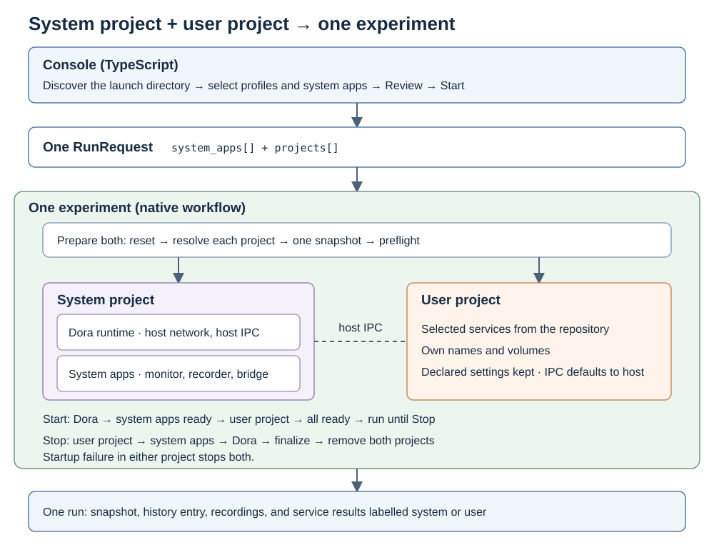

# System and user project isolation

Created: 2026-11-04.

Each experiment runs two Compose projects. The system project holds the Dora runtime
and system apps. The user project holds the repository's selected services, so user
names, networks and volumes stay separate from ours.

A survey of on-prem robot projects found one Compose project per deployment, with
components split through `include`, usually on host networking and host IPC. Host is
therefore our default. Running several user projects stays out of scope.

## Flow

1. Console discovers the launch directory as it does today and sends one `RunRequest`.
2. Prepare resets the experiment, resolves both projects and captures one snapshot. A failure here starts nothing.
3. Start Dora and system apps, wait for them to be ready, then start the user project.
4. Once both are ready, monitor both until Stop.
5. Stop the user project, system apps, then Dora. Finalize recordings and remove both projects.

## Agreed behavior

- **Experiment:** one snapshot, history entry and recording set per run. Service results are labelled system or user.
- **System project:** always present, holding the Dora runtime and selected system apps, all on host network and host IPC.
- **User project:** `projects[]` entries merge into it as they do today; Console sends one. Names stay generated from repository and key, and may repeat system names.
- **Host IPC:** a user service with no `ipc:` setting gets `ipc: host`. Declared settings stay as written.
- **Networking:** services sending messages to the recorder use host networking; other user services keep their declared network settings. Review rejects a Dora graph node off host networking, and warns about a recorded ROS 2 producer once [ROS 2 recording](https://github.com/Cutuy/doramcap/pull/91) exists.
- **Failure:** a startup failure in either project stops both.
- **Compose checks:** other existing rejections and overrides stay as they are.
- **Dora nodes:** a graph node resolves to a service in either project; a name present in both is rejected.

## Deferred

Add these when a real repository needs them:

- Several isolated user projects, with discovery and selection across them.
- Private IPC for an experiment.
- Authored project names.

## Milestone 1: Host IPC proof

Run first; a failure here reopens the design.

**Work items**
- [ ] Extend [the shared IPC test](../../libs/workload-docker/tests/shared_ipc.rs) with the daemon in one Compose project and a service in another, both on host IPC.
- [ ] Add a user project exchanging messages over shared-memory-only Fast DDS with a process running natively on the host.

**Validation**
- [ ] A Zenoh SHM message crosses the project boundary.
- [ ] Fast DDS shared-memory messages flow between a container and a native host process.
- [ ] Two repositories running at once do not interfere through host `/dev/shm`.
- [ ] A run leaves no shared-memory files behind in host `/dev/shm`, including after a crash and reset.

## Milestone 2: Native two-project workflow

**Work items**
- [ ] Hold a system plan and a user plan in [preparation](../../libs/workload-docker/src/workflows/recorded_compose/preparation.rs), using [the existing merge](../../libs/workload-docker/src/workflows/recorded_compose/preparation/model.rs) within each.
- [ ] Apply the host IPC default in [Dora configuration](../../libs/workload-docker/src/workflows/recorded_compose/preparation/model.rs) and [the runtime services](../../libs/workload-docker/src/workflows/dora.rs); stop overriding declared `ipc:` and `shm_size` settings.
- [ ] Replace `/dev/shm` sizing with a preflight check that the host has the configured capacity.
- [ ] Capture one snapshot covering both projects and compare it before Start.
- [ ] Extend [launch, monitoring and shutdown](../../libs/workload-docker/src/workflows/recorded_compose/execution.rs) to both plans.
- [ ] Extend reset, Docker events, filesystem evidence and cleanup to both projects.
- [ ] Label per-service results system or user in [the Compose contract](../../libs/workload-docker/proto/compose.proto).
- [ ] Delete checks the project boundary makes redundant.

**Validation**
- [ ] A user service, volume and network can share a name with a system resource.
- [ ] A declared `ipc:` setting and `network_mode` reach the running container unchanged.
- [ ] Insufficient host `/dev/shm` is rejected before any container starts.
- [ ] A changed project after Review is rejected before any container starts.
- [ ] A startup failure in the user project stops system apps, finalizes recordings and removes both projects.
- [ ] A service failure during the run is detected in either project.
- [ ] Stop follows the agreed order and recordings finalize.
- [ ] A run after a crash resets leftovers from both projects.
- [ ] User-only and system-only runs retain their coverage.

## Milestone 3: Console

**Work items**
- [ ] Carry the system or user label through [the service](../server/src/service.ts) and [the browser contract](../proto/console.proto); keep legacy history readable.
- [ ] Show the label in [Review](../frontend/src/App.tsx), progress, history and comparison.
- [ ] Update configuration docs.

**Validation**
- [ ] Test protobuf/HTTP round trips and comparison across a legacy run and a new run.
- [ ] Exercise Review → Start → Stop → History → Run again in a browser, with a user service named like a system app.
- [ ] Run a real `ipc: host` deployment, such as Open AD Kit planning simulation, and assert expected containers and clean shutdown.
- [ ] Run Console checks and production builds, then ARM64 validation, on the final implementation revision.
