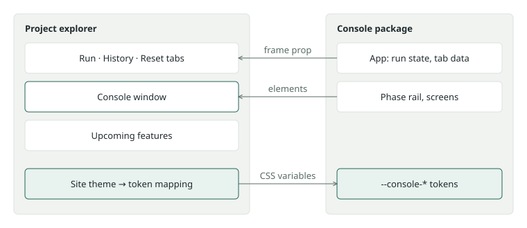

# Native Console demo

Created: 2026-11-05. Follows [the Console demo plan](110426-spa-console-demo.md).

Make the Console section read as part of the project explorer, and give the real
Console a matching light and dark look.

## Accepted design

Agreed with the project owner on 2026-11-05.

| Area | Decision |
| --- | --- |
| Composition | `App` takes a layout prop and keeps its run state. The site places Run, History, the run phases and Reset on the page. |
| Theming | Named `--console-*` tokens; the site maps its theme to them in one CSS block. |
| Light and dark | `light-dark()` follows the inherited `color-scheme`, so the site's switch reaches the demo. |
| Look | The site's colours, font, corners, padding and button sizes become Console's defaults. |
| Standalone theme | Follows the browser or OS setting, with no switch. |
| Scenario | A sample robotics project with seven services. Visitor runs write 10 to 13 MiB/s while services run; CPU total changes every 100 ms with spikes. |
| Built-in run | Keeps its published 21.8 KiB recording and matching low rate, so its download stays truthful. |

## Milestone 1: site content

**Work items**

- [x] Move the Console tab after Overview.
- [x] Replace the demo bar with a standard page heading; keep Reset demo.
- [x] Show Upcoming features as a section below the demo; remove its sub-route.
- [x] Rewrite the home panel: where Console runs, the SSH tunnel, install steps, Try Console.

**Validation**

- [x] Production build of the project explorer.
- [x] Visual check: home at desktop and phone width, Console at desktop width.

## Milestone 2: Console tokens

**Work items**

- [x] Replace hardcoded colours in styles and charts with `--console-*` tokens.
- [x] Add tokens for font, corners, panel padding, heading weight and button size, with the site's values as defaults.
- [x] Inherit `color-scheme`; the standalone page follows the browser or OS.
- [x] Map the site's theme to the tokens in one block.

**Validation**

- [x] Console frontend tests and build; project explorer build.
- [x] Visual check of every Console phase, History and comparison, light and dark, in the demo.
- [x] Standalone Console Project screen renders in light and dark. Other screens were checked in the demo, which uses the same CSS.
- [x] Touch targets on phone width.

## Milestone 3: layout prop

**Work items**

- [x] Add a frame prop to `App` with view and phase data and the screen; the current layout becomes the default frame.
- [x] Remove the embedded branch from `PageFrame`.
- [x] Render Run, History, the run phases and Reset on the page; keep the screens in the window.

**Validation**

- [x] Console frontend tests and build; project explorer build.
- [x] Demo: tabs follow the URL, a run continues across tabs and sections, Reset works.
- [x] Standalone Console layout is unchanged.

## Milestone 4: richer demo run

**Work items**

- [x] Review lists several services, each with its own image.
- [x] MCAP write rate of at least 10 MiB/s with 30% variation while services run.
- [x] CPU total updates at 10 Hz, with spikes from the busiest services.
- [x] Visitor runs report their recording size in comparisons.
- [x] Top CPU consumers names the demo's services.

**Validation**

- [x] Console frontend tests and project explorer build.
- [x] Demo: Review, live values and comparison checked in headless Chromium.
