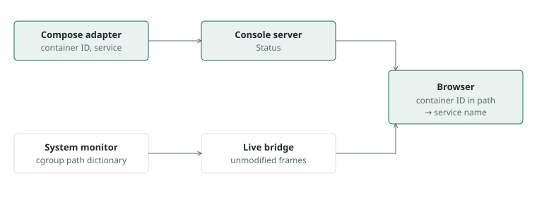

# Service names in Top CPU consumers

Created: 2026-11-05. Status: design accepted; slice cleanup proposed for owner review.

Top CPU consumers shows `docker-<id>.scope` in the installed Console and service names
in the demo. Show each container's Compose service in both, and in recordings, while the
CPU monitor keeps operating only on cgroups.

## Accepted design

Agreed with the project owner on 2026-11-05.

| Area | Decision |
| --- | --- |
| Name source | Console sets a per-service `cgroup_parent`, so the cgroup path carries the service name. |
| Monitor | Unchanged, with no Docker access or new configuration. |
| Telemetry | Format unchanged; recordings gain names through the paths they already store. |
| Compose knowledge | Stays in the Compose workflow, which already rewrites each service in its frozen manifest. |

## Observed behavior

Docker 29.9 with the systemd driver and cgroup v2, through `docker run` and Compose:

```text
default       /system.slice/docker-<id>.scope
named parent  /doramcap.slice/doramcap-camera.slice/doramcap-camera-driver.slice/docker-<id>.scope
```

- Each `-` in a slice name adds a nesting level; the last slice segment holds the full name.
- Slices stay active and empty after their containers exit, until stopped or reboot.
- Not yet tested: the cgroupfs driver, and service names containing `--`, dots or a leading `-`.

## Behavior

- A run's services use `doramcap-<service>.slice` as their parent on the systemd driver.
- Services that already set `cgroup_parent` keep it, and the run records a policy diagnostic.
- Other cgroup drivers leave placement unchanged, so those hosts keep today's names.
- The browser shows the service from a `doramcap-` slice, and otherwise the path segment it shows today.
- Restarted services appear as separate rows with the same name.
- Containers leave `system.slice` during Console runs; tooling that assumes that location sees the change.

## Slice cleanup: proposed

Stop the run's slices after its project is removed. A failure adds a diagnostic and does not fail the run.

| Option | Tradeoff |
| --- | --- |
| **Stop at removal (proposed)** | Leaves the machine as found, matching Console's verified cleanup. Adds a call to systemd. |
| Leave until reboot | No new code. Empty slices build up, one or more per service name ever run. |

## Milestone 1: name service cgroups

**Work items**

- [ ] Set `cgroup_parent` where `configuration.rs` applies per-service policy to the manifest.
- [ ] Encode service names into valid slice names, using the tested rules.
- [ ] Keep user-set parents and non-systemd hosts unchanged, with diagnostics.
- [ ] Stop the run's slices during removal, including after an interrupted run's recovery.

**Validation**

- [ ] Unit tests: manifest output for plain, hyphenated and unusual names, user-set parents and each driver.
- [ ] Docker test: containers land in named slices, and no slices remain after removal.
- [ ] Experiment review, recovery and cleanup verification still pass; the manifest digest stays stable across review and start.

## Milestone 2: show names

**Work items**

- [ ] Add one tested path-to-name function in `streams.ts`, keeping groups distinct by ID.
- [ ] Make the demo publish real-format paths under `doramcap-<service>.slice`, replacing its made-up paths.

**Validation**

- [ ] Frontend tests: named paths, hyphenated names, `docker-<id>.scope` and host cgroups.
- [ ] A real Console run on x86_64 and ARM64 shows service names, live and in the MCAP; a host process keeps its name.
- [ ] Demo walk in light and dark.
