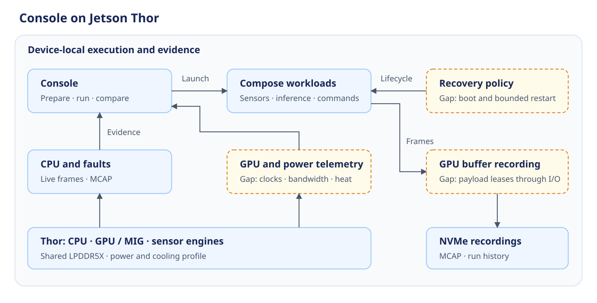

# Console deployment gaps on Jetson Thor

Created: 2026-11-07. Initial assessment: `7e898863997bacdf1cb26391feeaca9a3616eaf5`.
Rechecked against: `c0e0b1410d48e01aac3ebf1621e7ab085fd47f02`.
Status: source assessment; physical Thor qualification remains open.

Console has ARM64 releases, Compose orchestration, CPU accounting, recording and
run comparison. Deploying it on Thor needs target validation and broader evidence
about GPU execution, shared memory, power and thermal behavior. This assessment
extends the [runtime roadmap](../../docs/roadmap.md); priorities below are proposals.

## Hardware context

The NVIDIA Jetson Thor Series Modules Data Sheet, DS-11945-001 v1.4
(February 20, 2026), describes T5000/T4000 modules with 128/64 GB LPDDR5X,
273 GB/s peak memory bandwidth, two MIG partitions and multiple sensor/video
engines (printed pp. 1-8). Carrier wiring and the selected software release
determine available configurations.

CPU, GPU and other engines share physical DRAM. NVIDIA documents full system-memory
coherency beginning with Thor, NVML on Thor Linux, and memory-sharing CUDA IPC
with CUDA 13 on Thor's open GPU driver. These capabilities warrant evaluating
existing APIs; synchronization and buffer ownership still need qualification.
See [CUDA for Tegra](https://docs.nvidia.com/cuda/cuda-for-tegra-appnote/),
[JetPack releases](https://developer.nvidia.com/embedded/jetpack/downloads) and
[Thor power management](https://docs.nvidia.com/jetson/archives/r38.2/DeveloperGuide/SD/PlatformPowerAndPerformance/JetsonThor.html).

## Prioritized gaps

**Unverified** means implementation exists but target evidence is missing.
**Missing** means the reviewed implementation lacks the stated capability.
Priorities describe deployment order.

| ID / priority | Existing foundation | Gap and consequence | Evidence |
| --- | --- | --- | --- |
| T1 / deployment gate | ARM64 images, archive and native addon | **Unverified:** install, GPU containers, live streams, recording, cleanup and repeat runs on a pinned Thor software profile. Generic ARM64 CI cannot establish this. | [Release workflow](../../.github/workflows/console-release.yml), [CI hosts](../../scripts/ci/README.md) |
| T2 / deployment gate | Native per-core/cgroup accounting; CPU affinity and RR scheduling | **Unverified:** target BPF load, accurate accounting and sustained overhead. Doctor checks BTF presence; the collector also needs iterators, rstat functions and visible symbols. Qualify the chosen kernel and RT variant when used. | [Doctor](../server/src/release.ts), [BPF requirements](../../libs/resources/cgroup-bpf/docs/design.md), [policy](../../libs/resources/resource-policy/proto/policy.proto) |
| T3 / diagnostic value | Live CPU/fault panels; before/after machine snapshots | **Missing:** continuous GPU activity, memory-bandwidth pressure, power, clocks and throttle reasons. Snapshots cannot explain transient stalls. GPU queue/execution latency also needs workload or profiler integration. | [Live kinds](../proto/live.proto), [machine schema](../../libs/resources/system-config/proto/system_config.proto) |
| T4 / application integration | Compose onboarding; configured Dora byte recording and source metadata | **Missing:** native ROS 2 input and first-party sensor-buffer adapters in the reviewed recorder. **Unverified:** representative sensor-to-inference-to-command lineage and clock correlation. Integrations depend on the chosen workload. | [Recorder](../../apps/mcap-recorder/README.md), [recording path](../../apps/mcap-recorder/src/recording.rs) |
| T5 / buffer lifecycle | Registered/local managed CUDA memory; fixed-consumer shared rings with Ready/Done events; external storage leases | **Missing:** a recorder adapter that resolves GPU frame descriptors and retains payloads through I/O completion. **Unverified:** Thor CUDA loading, memory pressure, consumer failure and MIG boundaries. Saving a descriptor alone does not persist its image. | [CUDA IPC](../../libs/memory/cuda-dora-shm/src/lib.rs), [CUDA bindings](../../libs/memory/cuda-host-memory/Cargo.toml), [storage providers](../../libs/storage-persistence/docs/101826-external-buffer-leases.md) |
| T6 / resource control | Typed CPU policy; native Compose device settings | **Missing:** managed GPU/MIG assignment, conflict detection and workload admission. Shared DRAM and other SoC engines still require contention measurements when MIG is enabled. | [Policy contract](../../libs/resources/resource-policy/proto/policy.proto), [Compose resolution](../../libs/workload-docker/src/compose/adapter/configuration.rs) |
| T7 / sustained recording | Bounded writer paths, rotation, explicit completion and final synchronization | **Missing:** integrated blackbox retention and Console history quotas. **Unverified:** real sensor throughput, slow/full NVMe and abrupt interruption during inference. Current MCAP output is uncompressed and index-free. | [Writer](../../libs/storage-persistence/README.md), [contracts](../../libs/storage-persistence/docs/contracts.md), [roadmap](../../docs/roadmap.md) |
| T8 / unattended operation | Shared run sequence, app manifests, experiment cleanup and fault reporting | **Missing:** an agreed autonomous boot/restart/recovery contract. Compose restart policies are disabled for experiment ownership. Watchdog reports alone do not restore workloads. | [Restart handling](../../libs/workload-docker/src/compose/adapter/configuration.rs), [recovery](recovery.md), [launch forms](../../libs/workload-lifecycle/docs/110726-launch-forms.md) |

## Proposed qualification sequence

### Milestone 1: Existing Console on one Thor profile

**Work items**

- [ ] Agree on module/carrier, JetPack/BSP/kernel/CUDA versions, NVMe, power and cooling.
- [ ] Verify release installation, GPU container access and actual BPF load prerequisites.

**Validation**

- [ ] Complete install, prepare, launch, live capture, stop, MCAP readback and repeat-run checks.
- [ ] Verify CPU accounting against controlled work and effective scheduling settings.
- [ ] Record target configuration and distinguish optional capability failures from launch failures.

### Milestone 2: Explain a mixed robotics workload

**Work items**

- [ ] Agree on one sensor, inference, command and recording workload with rates and timing/overhead budgets.
- [ ] Add typed GPU, shared-memory, power and thermal observations to recording and Console.
- [ ] Preserve relevant platform settings in run comparisons and correlate source timestamps.

**Validation**

- [ ] Measure latency percentiles/maxima, jitter, missed deadlines and sample counts under competing load.
- [ ] Correlate stalls with clocks, throttling, resource pressure and instrumentation losses.
- [ ] Measure Console's own CPU, memory, I/O and workload-latency overhead against agreed budgets.

### Milestone 3: Qualify required buffers, isolation and recovery

**Work items**

- [ ] Select buffer/recording adapters and GPU controls from the pilot's demonstrated needs.
- [ ] Define retention, overload and durability behavior for sustained capture.
- [ ] Agree on unattended ownership, bounded retries, dependency readiness and reboot reconciliation if required.

**Validation**

- [ ] Verify payload bytes, GPU readiness, lease retention and safe reuse under pool exhaustion and consumer failure.
- [ ] Exercise competing GPU workloads and selected MIG assignments; record shared-resource effects.
- [ ] Exercise slow/full storage, recorder termination and power interruption with recoverable artifact accounting.
- [ ] Inject startup hangs, crashes and stalled progress; verify bounded recovery and stale-instance cleanup.

## Validation and open decisions

- Static inspection covers release, telemetry, policy, CUDA, recording and recovery paths at the stated revisions.
- Existing evidence covers x86/ARM64 components and desktop RTX CUDA execution. The ARM64 worker has no GPU.
- No new x86, ARM64 worker, Thor, CUDA or RT tests ran for this assessment; no target performance claim is established.
- Documentation checks: relative links, SVG parsing/rendering and whitespace checks pass.
- First hardware/software profile, workload budgets, required middleware and unattended-operation scope need agreement.
- This document proposes work; dependency choices, new configuration inputs and implementation decisions retain the repository's approval requirements.
